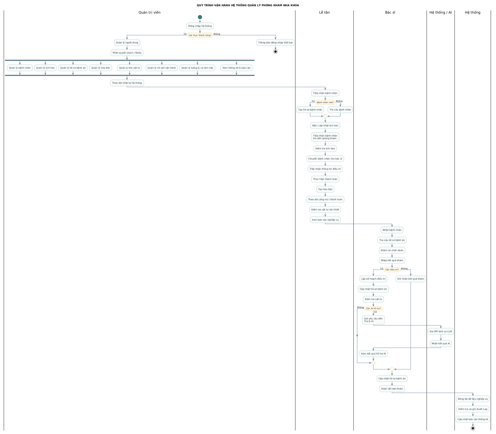

<p align="center">
  
</p>

<h1 align="center">Dental Clinic Management System</h1>

<p align="center">
  Hệ thống quản lý phòng khám nha khoa: đặt lịch, hồ sơ bệnh nhân, bệnh án, hóa đơn, kho, lương và báo cáo trong một ứng dụng web.<br/>
  Dành cho phòng khám nha khoa nhỏ và vừa tại Việt Nam, gồm quản trị viên, lễ tân và bác sĩ. Đây là đồ án tốt nghiệp (ĐATN).
</p>

<p align="center">
  <a href="https://github.com/Trantuan0310/dental-clinic-nestjs-react/actions/workflows/ci.yml"></a>
  
  
  
  
</p>

---

## 📑 Mục lục

- [✨ Tính năng](#-tính-năng)
- [🛠 Công nghệ](#-công-nghệ)
- [📋 Yêu cầu](#-yêu-cầu)
- [🚀 Cài đặt](#-cài-đặt)
- [💡 Sử dụng](#-sử-dụng)
- [🧪 Kiểm thử](#-kiểm-thử)
- [☁️ Triển khai](#️-triển-khai)
- [📂 Cấu trúc thư mục](#-cấu-trúc-thư-mục)
- [📘 Tài liệu](#-tài-liệu)
- [🤝 Đóng góp](#-đóng-góp)
- [👤 Tác giả và liên hệ](#-tác-giả-và-liên-hệ)
- [📜 Giấy phép](#-giấy-phép)

---

## ✨ Tính năng

| Nhóm | Chức năng chính |
| --- | --- |
| **Đặt lịch** | Trang đặt lịch công khai cho bệnh nhân, duyệt yêu cầu đặt lịch, lịch hẹn, check-in, hàng chờ, điều phối bác sĩ |
| **Bệnh nhân và bệnh án** | Hồ sơ bệnh nhân, phiên khám, sơ đồ răng, ghi chú lâm sàng, đơn thuốc, ảnh và tệp đính kèm |
| **Thu ngân** | Hóa đơn, thanh toán nhiều lần, công nợ, hoàn tiền, danh mục dịch vụ |
| **Nhân sự** | Lịch làm việc, đăng ký ca, nghỉ phép, bảng lương bác sĩ và nhân viên |
| **Kho và chi phí** | Vật tư nha khoa, nhập xuất kho, cảnh báo sắp hết, quản lý chi phí có duyệt |
| **Báo cáo** | Dashboard, doanh thu theo dịch vụ, bác sĩ, loại khách hàng |
| **Hệ thống** | Đăng nhập JWT + refresh token, phân quyền theo vai trò, nhật ký thao tác (audit log), song ngữ Việt/Anh |
| **AI** | Tóm tắt bệnh án và gợi ý dùng Google Gemini (tùy chọn, tắt được) |

Ba vai trò sử dụng hệ thống: **quản trị viên phòng khám**, **lễ tân** và **bác sĩ**. Bệnh nhân không phải là tài khoản người dùng mà là dữ liệu được quản lý ([ADR 0003](docs/ADR/0003-patient-is-not-user.md)).

<p align="center">
  
</p>

---

## 🛠 Công nghệ

| Lớp | Công nghệ |
| --- | --- |
| Backend | NestJS 10, TypeScript (strict), Prisma 5, Argon2, Swagger |
| Frontend | React 18, Vite 5, Tailwind CSS 3, TanStack Query, React Hook Form + Zod, i18next |
| Cơ sở dữ liệu | PostgreSQL 16 (Redis tùy chọn, dùng cache kết quả AI) |
| Kiểm thử | Jest + Supertest (backend), Playwright (E2E) |
| Hạ tầng | Docker Compose, Nginx, GitHub Actions |

Kiến trúc là **Modular Monolith**: mỗi nghiệp vụ là một module NestJS độc lập, có thể tách thành service riêng sau này. Chi tiết xem [`ARCHITECTURE.md`](ARCHITECTURE.md) và [`TECH_STACK.md`](TECH_STACK.md).

---

## 📋 Yêu cầu

- **Node.js 22** trở lên (CI chạy Node 22, image Docker dùng Node 24)
- **npm**, đi kèm Node.js. Dự án dùng `package-lock.json`.
- **Docker** và Docker Compose, để chạy PostgreSQL
- Hệ điều hành: Linux, macOS hoặc Windows. Windows có sẵn script khởi động một chạm, xem [`README_DEV.md`](README_DEV.md).

---

## 🚀 Cài đặt

1. **Clone repository**

   ```bash
   git clone https://github.com/Trantuan0310/dental-clinic-nestjs-react.git
   cd dental-clinic-nestjs-react
   ```

2. **Cấu hình và cài backend**

   ```bash
   cd backend
   cp .env.example .env      # sửa JWT_SECRET; GEMINI_API_KEY có thể để trống
   npm install
   ```

3. **Khởi động PostgreSQL, tạo schema và dữ liệu mẫu**

   ```bash
   npm run db:up                    # PostgreSQL 16 trong Docker
   npx prisma migrate deploy        # áp dụng migration
   npm run prisma:seed              # tài khoản admin + dữ liệu nền
   npm run prisma:seed:clinical     # (tùy chọn) 3 tháng dữ liệu khám chữa bệnh mẫu
   ```

4. **Chạy backend** (http://localhost:3000)

   ```bash
   npm run start:dev
   ```

5. **Chạy frontend** ở một terminal khác (http://localhost:5173)

   ```bash
   cd frontend
   npm install
   npm run dev
   ```

> **Windows:** chạy `check-env.bat` rồi `start-dev.bat` để thực hiện tất cả các bước trên.
>
> **Gặp lỗi P3005 "schema is not empty"?** Chạy `npm run db:baseline` trong `backend/`. Các lỗi khác xem [`TROUBLESHOOTING.md`](docs/09_UserGuide/TROUBLESHOOTING.md).

---

## 💡 Sử dụng

Mở http://localhost:5173 và đăng nhập bằng tài khoản quản trị được seed:

```
Email    : admin@clinic.local
Mật khẩu : Admin123!     (bắt buộc đổi ở lần đăng nhập đầu)
```

Sau đó vào trang **Người dùng** (`/admin/users`) để tạo tài khoản lễ tân và bác sĩ. Bộ dữ liệu `seed-clinical` có sẵn các tài khoản này.

| Địa chỉ | Nội dung |
| --- | --- |
| http://localhost:5173 | Trang giới thiệu, đặt lịch công khai và ứng dụng quản lý |
| http://localhost:3000/api/docs | Swagger, tài liệu REST API |
| http://localhost:3000/health | Kiểm tra tình trạng backend |

Hướng dẫn theo vai trò: [quản trị viên](docs/09_UserGuide/ADMIN_GUIDE.md), [lễ tân](docs/09_UserGuide/RECEPTIONIST_GUIDE.md), [bác sĩ](docs/09_UserGuide/DENTIST_GUIDE.md), [phân quyền](docs/09_UserGuide/PHAN_QUYEN.md).

---

## 🧪 Kiểm thử

```bash
# Backend
cd backend
npx tsc --noEmit          # kiểm tra kiểu
npm run lint              # ESLint
npm test                  # unit + integration (Jest)
npm run test:isolated     # API test trên PostgreSQL thật (cần DATABASE_URL)

# Frontend
cd frontend
npm run typecheck
npm run lint
npm run build
npm run test:e2e          # Playwright, cần backend + DB đang chạy
```

Kết quả gần nhất (20/10/2026): backend **1390/1390** test pass (56 suite); `tsc` và ESLint không có lỗi ở cả hai phía; frontend build thành công. CI trên GitHub Actions chạy migration, API test với PostgreSQL thật và E2E Playwright cho mỗi pull request vào `main`/`develop`.

---

## ☁️ Triển khai

Bản production chạy bằng `docker-compose.prod.yml`, gồm PostgreSQL, migration, backend và Nginx phục vụ frontend.

```bash
cp .env.production.example .env.production   # điền tên miền, secret, thông tin phòng khám
docker compose --env-file .env.production -f docker-compose.prod.yml build
docker compose --env-file .env.production -f docker-compose.prod.yml run --rm migrate
docker compose --env-file .env.production -f docker-compose.prod.yml --profile bootstrap run --rm bootstrap
docker compose --env-file .env.production -f docker-compose.prod.yml up -d backend web
```

Các lần cập nhật sau chỉ cần `bash scripts/deploy-vps.sh`: script tự backup DB → build → migrate → restart. Nạp cấu hình ngày khai trương (dịch vụ, giá, giờ làm, tài khoản nhân viên) bằng `scripts/clinic-setup-vps.sh`.

Chuyển sang VPS mới: `scripts/move-to-new-vps.sh`. Dùng database bên ngoài: `docker-compose.external-db.yml`. Hướng dẫn đầy đủ (biến môi trường, Nginx, HTTPS, backup, rollback) nằm trong [`docs/08_Deployment`](docs/08_Deployment/README.md).

---

## 📂 Cấu trúc thư mục

```
.
├── backend/                 # NestJS API
│   ├── src/                 # mỗi thư mục là một module: auth, patients, appointments,
│   │                        # medical-records, billing, inventory, payroll, reports, ai, ...
│   ├── prisma/              # schema, migration, script seed
│   └── test/                # E2E + API test với PostgreSQL thật
├── frontend/                # React SPA
│   ├── src/features/        # màn hình theo nghiệp vụ
│   ├── src/components/      # UI dùng chung
│   └── e2e/                 # Playwright
├── docs/                    # đặc tả, ADR, hướng dẫn sử dụng, triển khai
├── scripts/                 # script cài đặt và triển khai VPS
├── docker-compose.prod.yml  # cấu hình production
└── *.bat, *.ps1             # script khởi động nhanh trên Windows
```

---

## 📘 Tài liệu

| Tài liệu | Nội dung |
| --- | --- |
| [`docs/INDEX.md`](docs/INDEX.md) | Bản đồ toàn bộ tài liệu |
| [`docs/00_Vision`](docs/00_Vision/PRODUCT_VISION.md) | Tầm nhìn và phạm vi sản phẩm |
| [`ARCHITECTURE.md`](ARCHITECTURE.md) | Kiến trúc tổng thể |
| [`docs/03_Specification`](docs/03_Specification) | Đặc tả từng module |
| [`docs/ADR`](docs/ADR) | Các quyết định kiến trúc |
| [`PROJECT_RULES.md`](PROJECT_RULES.md) | Quy tắc code và quy trình |
| [`ROADMAP.md`](ROADMAP.md) | Kế hoạch theo sprint |
| [`README_DEV.md`](README_DEV.md) | Script phát triển trên Windows, dữ liệu mẫu |

---

## 🤝 Đóng góp

1. Tạo nhánh mới từ `main`: `git checkout -b feat/ten-tinh-nang`
2. Viết code theo [`PROJECT_RULES.md`](PROJECT_RULES.md). Mọi thay đổi nghiệp vụ phải khớp với đặc tả trong `docs/03_Specification`.
3. Chạy các lệnh trong mục [Kiểm thử](#-kiểm-thử) và đảm bảo không có lỗi.
4. Commit theo [Conventional Commits](https://www.conventionalcommits.org/) (`feat:`, `fix:`, `docs:`, ...) rồi mở pull request vào `main`.

---

## 👤 Tác giả và liên hệ

- **Trần Tuấn** – [@Trantuan0310](https://github.com/Trantuan0310)
- **GGTuanAnh** – [@GGTuanAnh](https://github.com/GGTuanAnh)
- Báo lỗi hoặc góp ý: mở [issue](https://github.com/Trantuan0310/dental-clinic-nestjs-react/issues) trên GitHub.

---

## 📜 Giấy phép

Dự án chưa áp dụng giấy phép mã nguồn mở. Mọi quyền thuộc về tác giả (`UNLICENSED`). Nếu muốn công khai cho người khác dùng lại, có thể chọn giấy phép tại [choosealicense.com](https://choosealicense.com/).
