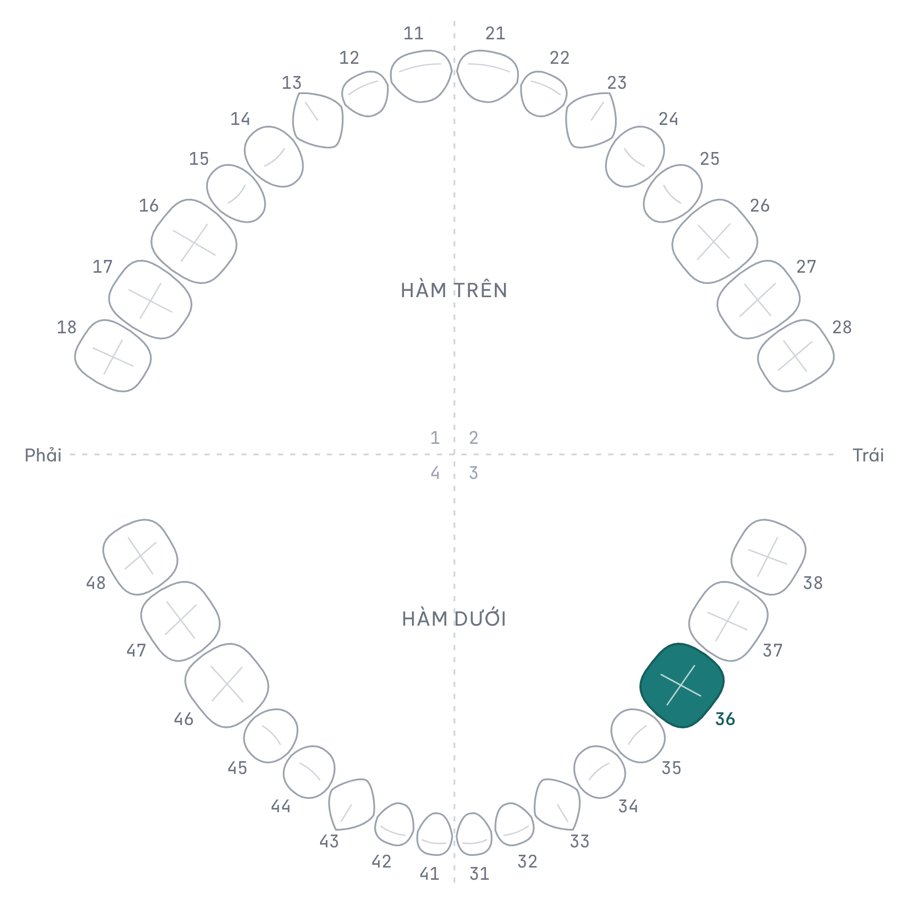

# CHƯƠNG 1. CƠ SỞ LÝ THUYẾT VÀ CÔNG NGHỆ

Chương này trình bày các kiến thức làm nền tảng cho đồ án: đặc thù nghiệp vụ của phòng khám nha khoa, tổng quan các phần mềm quản lý hiện có, kiến trúc và công nghệ được lựa chọn, các vấn đề bảo mật và quyền riêng tư dữ liệu y tế, thanh toán điện tử, ứng dụng mô hình ngôn ngữ lớn và phương pháp kiểm thử, triển khai. Mỗi nội dung được trình bày ở mức cần thiết để giải thích các quyết định thiết kế ở Chương 3 và Chương 4.

## 1.1. Nghiệp vụ phòng khám nha khoa

### 1.1.1. Đặc điểm hoạt động

Khác với khám bệnh thông thường, điều trị nha khoa thường kéo dài qua nhiều lần hẹn và gắn với từng chiếc răng cụ thể. Một bệnh nhân có thể vừa trám răng hàm dưới bên trái, vừa đang trong liệu trình bọc sứ răng cửa hàm trên, vừa được nhắc cạo vôi định kỳ sáu tháng một lần. Vì vậy, dữ liệu của phòng khám nha khoa có ba đặc điểm cần được phần mềm phản ánh:

- **Theo thời gian:** mỗi lần khám (phiên khám) ghi lại lý do khám, chẩn đoán, các thủ thuật đã làm, đơn thuốc và tình trạng răng tại thời điểm đó. Lịch sử phải được giữ nguyên, không ghi đè.
- **Theo vị trí:** thủ thuật và tình trạng được gắn với số răng. Câu hỏi thường gặp của bác sĩ là "răng này đã làm gì, khi nào, ai làm".
- **Theo kế hoạch:** các ca phức tạp được lập kế hoạch điều trị gồm nhiều bước, có báo giá, bệnh nhân đồng ý rồi thực hiện dần qua nhiều phiên khám.

Vòng hoạt động cơ bản của một phòng khám gồm: đặt lịch → tiếp nhận (check-in) → chờ khám → khám và điều trị → lập hóa đơn và thu tiền → hẹn tái khám. Song song là các hoạt động hỗ trợ: quản lý ca làm việc và tính lương bác sĩ, quản lý kho vật tư (thuốc tê, vật liệu trám, mũi khoan…), chi phí vận hành và báo cáo.

### 1.1.2. Hệ thống ký hiệu răng FDI

Để ghi nhận chính xác vị trí điều trị, ngành nha khoa sử dụng các hệ thống ký hiệu răng chuẩn. Hệ thống phổ biến nhất trên thế giới và ở Việt Nam là hệ hai chữ số của Liên đoàn Nha khoa Thế giới (FDI), được chuẩn hóa trong ISO 3950 [@iso3950]. Trong hệ này, chữ số thứ nhất chỉ một phần tư hàm (cung phần tư), chữ số thứ hai chỉ vị trí răng tính từ đường giữa ra phía sau:

- Răng vĩnh viễn: cung phần tư 1 (hàm trên bên phải bệnh nhân), 2 (hàm trên bên trái), 3 (hàm dưới bên trái), 4 (hàm dưới bên phải); vị trí từ 1 (răng cửa giữa) đến 8 (răng khôn). Ví dụ răng 36 là răng hàm lớn thứ nhất hàm dưới bên trái.
- Răng sữa: cung phần tư 5 đến 8, vị trí từ 1 đến 5 (ví dụ răng 85).

Hệ thống trong đồ án dùng ký hiệu FDI cho mọi dữ liệu gắn với răng (thủ thuật, kế hoạch điều trị, sơ đồ răng) và kiểm tra tính hợp lệ của số răng ở cả giao diện lẫn máy chủ. Sơ đồ răng được vẽ theo dạng cung như nhìn từ mặt nhai, sắp xếp như bác sĩ nhìn vào miệng bệnh nhân (bên phải bệnh nhân nằm bên trái hình), như Hình 1.1.

::: {custom-style="Ảnh"}
{width=11cm}
:::

::: {custom-style="hình"}
Hình 1.1. Sơ đồ 32 răng vĩnh viễn đánh số theo hệ FDI
:::

::: {custom-style="nguồn"}
Nguồn: Tác giả, chụp từ hệ thống GenSmile
:::

### 1.1.3. Yêu cầu pháp lý về hồ sơ và dữ liệu cá nhân

Thông tư 46/2018/TT-BYT của Bộ Y tế quy định về hồ sơ bệnh án điện tử, trong đó nhấn mạnh việc bảo đảm tính toàn vẹn, khả năng truy vết người tạo và người sửa hồ sơ, cũng như phân quyền truy cập [@tt46]. Nghị định 13/2023/NĐ-CP về bảo vệ dữ liệu cá nhân xếp dữ liệu về tình trạng sức khỏe vào nhóm dữ liệu cá nhân nhạy cảm, yêu cầu bên xử lý dữ liệu phải có biện pháp bảo vệ phù hợp và chỉ xử lý trong phạm vi cần thiết [@nd13]. Hai văn bản này định hướng nhiều quyết định của đồ án: hồ sơ khám sau khi đóng chỉ được bổ sung chứ không được sửa đè, mọi thao tác nhạy cảm đều ghi nhật ký kiểm toán, nhân viên chỉ thấy dữ liệu cần cho công việc của mình, và dữ liệu nhận diện bệnh nhân không được gửi cho dịch vụ AI bên ngoài.

## 1.2. Tổng quan các phần mềm quản lý phòng khám nha khoa

Thị trường có hai nhóm giải pháp chính. Nhóm thứ nhất là các phần mềm quản lý nha khoa nước ngoài lâu năm như Open Dental [@opendental] (mã nguồn mở) và Dentrix [@dentrix] (thương mại). Các phần mềm này có đầy đủ chức năng từ lịch hẹn, sơ đồ răng đến bảo hiểm và báo cáo, nhưng được thiết kế theo quy trình và hệ thống thanh toán, bảo hiểm của Bắc Mỹ, giao diện tiếng Anh, chủ yếu cài đặt trên máy tính để bàn của phòng khám. Nhóm thứ hai là các phần mềm trong nước chạy trên nền tảng đám mây, tiêu biểu là SimlyDent [@simlydent]. Theo thông tin nhà cung cấp công bố, SimlyDent có lịch hẹn, sơ đồ răng tương tác cho 32 răng vĩnh viễn và 20 răng sữa, hồ sơ bệnh án điện tử, thu chi, kho vật tư tự xuất theo điều trị, báo cáo, nhắc lịch qua Zalo OA, SMS, email và hỗ trợ chuỗi nhiều chi nhánh; đặt lịch trực tuyến và điểm danh bằng mã QR là tính năng mua thêm ở một số gói [@simlydent_gia]. Nhóm này phù hợp ngôn ngữ, quy trình và kênh liên lạc ở Việt Nam. Tuy nhiên, các trang giới thiệu không đề cập tới việc tự đối soát chuyển khoản theo hóa đơn, giới hạn dữ liệu theo từng bác sĩ hay trợ lý AI. Ngoài ra còn nhiều phòng khám nhỏ vẫn quản lý bằng sổ sách, bảng tính và ứng dụng nhắn tin.

Bảng 1.1 so sánh các tiêu chí quan trọng giữa cách quản lý thủ công, phần mềm nước ngoài, phần mềm trong nước và hệ thống GenSmile của đồ án. Với SimlyDent, bảng chỉ ghi những gì nhà cung cấp công bố trên trang giới thiệu; "không thấy công bố" nghĩa là trang giới thiệu không nhắc tới, không khẳng định phần mềm không có.

::: {custom-style="bảng"}
Bảng 1.1. So sánh các cách quản lý phòng khám nha khoa
:::

| Tiêu chí | Sổ sách, bảng tính, Zalo | Phần mềm nước ngoài (Open Dental, Dentrix) | Phần mềm trong nước (SimlyDent) | GenSmile (đồ án) |
|---|---|---|---|---|
| Lịch hẹn nhiều bác sĩ, chống trùng giờ | Thủ công | Có | Có | Có, khóa ở cơ sở dữ liệu |
| Bệnh nhân tự đặt lịch trực tuyến | Không | Tùy gói, thêm phí | Mua thêm ở một số gói | Có |
| Sơ đồ răng, lịch sử theo từng răng | Không | Có | Có sơ đồ răng | Có, xem lịch sử ngay trên răng |
| Kế hoạch điều trị, báo giá | Thủ công | Có | Có | Có |
| Thanh toán chuyển khoản QR, tự đối soát | Không | Không phù hợp Việt Nam | Không thấy công bố | Có (VietQR, webhook) |
| Nhắc lịch qua Zalo/SMS tiếng Việt | Thủ công | Không | Có | Có |
| Phân quyền theo vai trò và theo dòng dữ liệu | Không | Theo vai trò | Phân quyền nhân sự | Có cả hai |
| Nhật ký kiểm toán | Không | Có | Không thấy công bố | Có |
| Bệnh nhân tự tra cứu lịch sử khám | Không | Qua cổng bệnh nhân | Không thấy công bố | Có, đường dẫn bảo mật |
| Nhiều chi nhánh | Không | Có | Có | Chưa hỗ trợ |
| Truy cập qua trình duyệt, điện thoại | Một phần | Chủ yếu máy bàn | Có (đám mây) | Có |
| Trợ lý AI có kiểm soát | Không | Không | Không thấy công bố | Có |

::: {custom-style="nguồn"}
Nguồn: Tác giả tổng hợp từ [@opendental; @dentrix; @simlydent; @simlydent_gia] và khảo sát thực tế
:::

Từ so sánh trên, phần mềm trong nước như SimlyDent đã đáp ứng tốt nhu cầu vận hành cơ bản và có lợi thế về chuỗi nhiều chi nhánh. Khoảng trống mà đồ án hướng tới nằm ở các điểm chưa thấy được công bố: tự đối soát chuyển khoản VietQR theo từng hóa đơn, giới hạn dữ liệu theo từng bác sĩ cùng nhật ký kiểm toán phục vụ yêu cầu bảo vệ dữ liệu sức khỏe, bệnh nhân tự tra cứu lịch sử khám không cần tài khoản, và trợ lý AI có kiểm soát.

## 1.3. Kiến trúc ứng dụng web

### 1.3.1. Ứng dụng một trang và REST API

Hệ thống được xây dựng theo mô hình tách biệt giao diện và máy chủ. Phía người dùng là một ứng dụng web một trang (Single-Page Application, SPA): trình duyệt tải ứng dụng một lần, sau đó chỉ trao đổi dữ liệu dạng JSON với máy chủ và tự vẽ lại phần giao diện thay đổi. Cách làm này cho trải nghiệm mượt như ứng dụng cài đặt, phù hợp với nhân viên làm việc liên tục cả ngày trên cùng một màn hình.

Phía máy chủ cung cấp giao diện lập trình theo phong cách REST [@fielding]: mỗi loại dữ liệu là một tài nguyên có địa chỉ riêng (ví dụ `/patients/:id`, `/appointments`), thao tác qua các phương thức HTTP chuẩn GET, POST, PATCH, DELETE với ngữ nghĩa và mã trạng thái thống nhất [@http]. Toàn bộ API được mô tả theo đặc tả OpenAPI [@swagger] và sinh tài liệu tự động, giúp kiểm thử và tích hợp dễ dàng.

### 1.3.2. Kiến trúc phân lớp và chia module theo nghiệp vụ

Bên trong máy chủ, mã nguồn được tổ chức theo kiến trúc phân lớp [@fowler_layer]: lớp điều khiển (controller) nhận yêu cầu HTTP và kiểm tra dữ liệu đầu vào; lớp dịch vụ (service) chứa quy tắc nghiệp vụ; lớp truy cập dữ liệu làm việc với cơ sở dữ liệu. Theo chiều ngang, hệ thống được chia thành các module theo miền nghiệp vụ (bệnh nhân, lịch hẹn, hồ sơ khám, thanh toán, kho…), mỗi module sở hữu dữ liệu và quy tắc của mình, giao tiếp với module khác qua dịch vụ được công bố. Cách chia theo miền nghiệp vụ này kế thừa tư tưởng của thiết kế hướng miền [@evans], giúp mỗi phần có thể được hiểu, kiểm thử và thay đổi độc lập. Toàn bộ các module chạy chung trong một tiến trình và một cơ sở dữ liệu (kiến trúc nguyên khối có module hóa), phù hợp với quy mô một phòng khám: đơn giản khi triển khai, giao dịch dữ liệu nhất quán, nhưng vẫn có ranh giới rõ ràng để tách ra sau này nếu cần.

## 1.4. Công nghệ phía máy chủ

### 1.4.1. Node.js và NestJS

NestJS là framework xây dựng ứng dụng máy chủ trên Node.js, viết bằng TypeScript [@nestjs]. NestJS cung cấp sẵn cấu trúc module, cơ chế tiêm phụ thuộc (dependency injection) và các thành phần xử lý yêu cầu theo chuỗi:

- **Guard** quyết định yêu cầu có được phép đi tiếp hay không; đồ án dùng guard để xác thực JWT và kiểm tra quyền.
- **Pipe** chuyển đổi và kiểm tra dữ liệu đầu vào; đồ án dùng các lớp DTO kèm ràng buộc (độ dài, định dạng, kiểu UUID…) để từ chối dữ liệu sai ngay từ cửa vào.
- **Interceptor** và **filter** xử lý chung trước, sau yêu cầu và khi có lỗi, giúp định dạng phản hồi và thông báo lỗi thống nhất.

Lựa chọn NestJS giúp toàn bộ hệ thống dùng một ngôn ngữ TypeScript ở cả hai phía, kiểu dữ liệu được kiểm tra khi biên dịch, và mã nguồn có cấu trúc nhất quán khi số module tăng lên.

### 1.4.2. PostgreSQL và Prisma ORM

PostgreSQL là hệ quản trị cơ sở dữ liệu quan hệ mã nguồn mở, hỗ trợ đầy đủ giao dịch ACID, ràng buộc toàn vẹn, chỉ mục nhiều loại và kiểu dữ liệu JSONB cho dữ liệu bán cấu trúc [@postgres]. Đồ án tận dụng các đặc điểm này: ràng buộc khóa ngoại và ràng buộc kiểm tra bảo đảm dữ liệu hợp lệ ngay ở tầng cơ sở dữ liệu; khóa tư vấn (advisory lock) theo bác sĩ và theo bệnh nhân bên trong giao dịch chống đặt trùng lịch khi hai lễ tân thao tác cùng lúc; JSONB lưu bản chụp sơ đồ răng của mỗi phiên khám và danh sách số răng của mỗi thủ thuật.

Prisma là bộ công cụ ánh xạ đối tượng – quan hệ (ORM) cho TypeScript [@prisma]. Lược đồ dữ liệu được khai báo trong một tệp duy nhất, từ đó Prisma sinh ra lớp truy vấn có kiểu chặt chẽ: lỗi sai tên cột hay sai kiểu dữ liệu bị phát hiện ngay khi biên dịch. Thay đổi cấu trúc cơ sở dữ liệu được quản lý bằng các tệp migration đánh số tuần tự, chạy tự động khi phát hành phiên bản mới. Khóa chính dùng UUID phiên bản 7 [@uuidv7], vừa khó đoán vừa tăng dần theo thời gian nên thân thiện với chỉ mục.

## 1.5. Công nghệ phía giao diện

- **React** là thư viện xây dựng giao diện theo thành phần (component): mỗi phần giao diện là một hàm nhận dữ liệu và trả về cấu trúc hiển thị; khi dữ liệu thay đổi, React tự cập nhật phần tương ứng [@react].
- **Vite** là công cụ phát triển và đóng gói, khởi động nhanh trong lúc lập trình và tạo bản phát hành được chia nhỏ theo trang để tải nhanh [@vite].
- **TanStack Query** quản lý dữ liệu lấy từ máy chủ: lưu đệm, tự làm mới, đồng bộ giữa các màn hình và xử lý trạng thái đang tải, lỗi [@tanstack]. Nhờ đó giao diện luôn hiển thị dữ liệu mới mà không cần tự viết nhiều mã đồng bộ.
- **Tailwind CSS** là bộ lớp tiện ích để định kiểu giao diện nhất quán, hỗ trợ giao diện co giãn theo màn hình và chế độ tối [@tailwind].
- **Recharts** vẽ biểu đồ cho bảng điều khiển và báo cáo [@recharts]; **i18next** quản lý chữ giao diện hai ngôn ngữ Việt – Anh [@i18next].

Giao diện tuân theo các nguyên tắc khả dụng phổ biến [@nielsen] (trạng thái hệ thống luôn hiển thị, ngăn lỗi trước khi xảy ra, cho phép hoàn tác) và các khuyến nghị về khả năng tiếp cận [@wcag] (nhãn cho trình đọc màn hình, điều khiển bằng bàn phím, độ tương phản màu).

## 1.6. Xác thực, phân quyền và kiểm toán

### 1.6.1. Xác thực bằng JWT

Hệ thống dùng JSON Web Token (JWT) [@jwt] để xác thực. Sau khi đăng nhập thành công, máy chủ cấp một **mã truy cập** ngắn hạn (15 phút) chứa định danh và danh sách quyền của người dùng, có chữ ký số để không thể giả mạo, và một **mã làm mới** dài hạn (7 ngày) được lưu trong cookie chỉ máy chủ đọc được (HttpOnly, SameSite=Strict). Khi mã truy cập hết hạn, giao diện dùng mã làm mới để xin mã mới; mã làm mới được thay mới sau mỗi lần dùng và chỉ giá trị băm của nó được lưu trong cơ sở dữ liệu, nên có thể thu hồi khi đăng xuất hoặc khi phát hiện bất thường. Mật khẩu được băm bằng Argon2 [@argon2], thuật toán được thiết kế để chống tấn công dò mật khẩu bằng phần cứng chuyên dụng.

### 1.6.2. Phân quyền theo vai trò và theo dòng dữ liệu

Mô hình kiểm soát truy cập theo vai trò (RBAC) [@rbac] gán quyền cho vai trò và gán vai trò cho người dùng, thay vì gán quyền trực tiếp cho từng người. Đồ án định nghĩa 133 mã quyền chi tiết theo dạng `module.hành_động` (ví dụ `patient.read`, `invoice.refund`, `dental_chart.write`) và ba vai trò hệ thống: quản trị viên, lễ tân, bác sĩ; quản trị viên có thể tạo vai trò tùy chỉnh.

RBAC trả lời câu hỏi "người này có được làm loại việc này không", nhưng chưa trả lời "với bản ghi nào". Trong phòng khám, cùng là quyền xem hồ sơ khám, bác sĩ chỉ nên thấy bệnh nhân mình đã hoặc sắp điều trị. Vì vậy đồ án bổ sung **giới hạn theo dòng dữ liệu** (row-level scope): mỗi truy vấn của bác sĩ được lọc thêm theo quan hệ giữa bác sĩ và bệnh nhân; khi một bác sĩ hỏi về bệnh nhân không liên quan, hệ thống trả lời như thể bệnh nhân không tồn tại để không tiết lộ thông tin.

### 1.6.3. Nhật ký kiểm toán và các rủi ro bảo mật phổ biến

Mọi thao tác nhạy cảm (đăng nhập, xem hồ sơ qua kênh đặc biệt, sửa giá, hủy hóa đơn, thay đổi quyền, AI thực hiện hành động…) được ghi vào bảng nhật ký kiểm toán: ai làm, lúc nào, trên bản ghi nào, chi tiết thay đổi. Ứng dụng chỉ ghi thêm vào bảng này, không có chức năng sửa hay xóa nhật ký. Thiết kế bảo mật của hệ thống được đối chiếu với danh sách mười rủi ro phổ biến nhất của ứng dụng web OWASP Top 10 [@owasp], đặc biệt là kiểm soát truy cập sai, lỗi xác thực, chèn mã và cấu hình không an toàn; Chương 3 trình bày cách từng rủi ro được xử lý.

## 1.7. Thanh toán qua VietQR và tích hợp nhắn tin

VietQR là chuẩn mã QR thanh toán liên ngân hàng tại Việt Nam, xây dựng trên tiêu chuẩn kỹ thuật của Ngân hàng Nhà nước [@vietqr]. Một mã VietQR chứa mã ngân hàng, số tài khoản nhận, số tiền và nội dung chuyển khoản; khách mở ứng dụng ngân hàng bất kỳ, quét mã là các thông tin được điền sẵn. Đồ án sinh mã VietQR trên mỗi hóa đơn với nội dung là mã hóa đơn. Khi tiền về tài khoản, dịch vụ trung gian theo dõi tài khoản ngân hàng gửi một lời gọi webhook tới hệ thống; hệ thống kiểm tra khóa xác thực đi kèm lời gọi, tìm hóa đơn theo nội dung và số tiền, rồi tự ghi nhận thanh toán. Mỗi giao dịch chỉ được ghi một lần dù lời gọi bị gửi lặp lại. Giao dịch không khớp được đưa vào danh sách chờ lễ tân xử lý tay.

Về liên lạc, hệ thống gửi email qua SMTP, gửi SMS qua nhà cung cấp tin nhắn thương hiệu và gửi tin Zalo qua Zalo Notification Service (ZNS) [@zns], dịch vụ cho phép doanh nghiệp gửi tin thông báo theo mẫu đã duyệt tới số điện thoại người dùng Zalo. Tin nhắn được gửi theo thứ tự ưu tiên kênh, có chống gửi trùng và ghi nhật ký kết quả.

## 1.8. Mô hình ngôn ngữ lớn trong phần mềm nghiệp vụ

Mô hình ngôn ngữ lớn (LLM) có khả năng hiểu và sinh văn bản tự nhiên, nhờ đó có thể soạn nháp ghi chú khám từ ghi nhanh của bác sĩ, soạn tin nhắn chăm sóc khách hàng hay trả lời câu hỏi tra cứu bằng tiếng Việt. Để LLM thao tác với dữ liệu thật, các nghiên cứu gần đây đề xuất cho mô hình **gọi công cụ**: mô hình không tự trả lời từ trí nhớ mà quyết định gọi một hàm (công cụ) với tham số phù hợp, nhận kết quả rồi suy luận tiếp [@react_agent; @toolformer].

Tuy nhiên, đưa LLM vào phần mềm y tế đặt ra ba rủi ro: mô hình có thể "bịa" thông tin; nội dung độc hại trong dữ liệu có thể điều khiển mô hình (tấn công chèn lệnh – prompt injection); và dữ liệu cá nhân có thể bị gửi ra dịch vụ bên ngoài [@owaspllm]. Đồ án xử lý các rủi ro này bằng ba nguyên tắc:

1. **AI chỉ đề xuất, con người quyết định:** mọi hành động làm thay đổi dữ liệu (đặt, hủy, dời lịch) chỉ được AI soạn thành thẻ xác nhận; người dùng bấm xác nhận thì hệ thống mới thực hiện, qua đúng các quy tắc và quyền như thao tác bằng tay.
2. **Tối thiểu hóa dữ liệu:** mô hình chỉ thấy mã tham chiếu như `[P1]` thay cho bệnh nhân; tên và số điện thoại được trình duyệt điền vào sau khi nhận câu trả lời.
3. **Luôn có phương án dự phòng:** khi dịch vụ AI lỗi hoặc không được cấu hình, các chức năng soạn nháp rơi về mẫu soạn sẵn và trợ lý chuyển sang chế độ tra cứu theo từ khóa, không chức năng nghiệp vụ nào phụ thuộc vào AI.

## 1.9. Kiểm thử phần mềm, tích hợp liên tục và triển khai

### 1.9.1. Chiến lược kiểm thử

Đồ án áp dụng mô hình kim tự tháp kiểm thử [@cohn]: nhiều kiểm thử đơn vị nhanh ở đáy, ít hơn kiểm thử tích hợp ở giữa và một số kịch bản đầu cuối ở đỉnh. Cụ thể:

- **Kiểm thử đơn vị** bằng Jest [@jest] cho từng dịch vụ và quy tắc nghiệp vụ, cơ sở dữ liệu được giả lập.
- **Kiểm thử API trên PostgreSQL thật:** chạy toàn bộ migration trên một cơ sở dữ liệu sạch rồi gọi API thật, phát hiện lỗi mà kiểm thử giả lập bỏ sót (ràng buộc, giao dịch, truy vấn sai).
- **Kiểm thử đầu cuối** bằng Playwright [@playwright]: trình duyệt tự động đóng vai lễ tân, bác sĩ, quản trị viên thực hiện các luồng nghiệp vụ hoàn chỉnh trên giao diện.

Chất lượng phần mềm được đánh giá theo các đặc tính của mô hình ISO/IEC 25010 [@iso25010], tập trung vào tính phù hợp chức năng, bảo mật, độ tin cậy, hiệu năng và tính khả dụng.

### 1.9.2. Tích hợp liên tục và triển khai bằng Docker

Tích hợp liên tục (CI) là thực hành mỗi thay đổi mã nguồn được tự động biên dịch và kiểm thử trước khi gộp vào nhánh chính [@fowler_ci]. Đồ án dùng GitHub Actions với 10 bước kiểm tra bắt buộc (biên dịch, kiểm tra kiểu, kiểm tra quy chuẩn mã, kiểm thử đơn vị, kiểm thử trên PostgreSQL, kiểm thử đầu cuối và đóng gói container); chỉ khi tất cả đạt thì thay đổi mới được gộp.

Hệ thống được đóng gói thành các container Docker [@docker] gồm cơ sở dữ liệu, bước chạy migration, máy chủ ứng dụng và máy chủ web Nginx phục vụ giao diện, khởi chạy cùng nhau bằng Docker Compose. Cách đóng gói này bảo đảm môi trường chạy thật giống hệt môi trường kiểm thử, việc triển khai lên máy chủ ảo chỉ cần một lệnh.

## 1.10. Kết luận chương

Chương 1 đã trình bày đặc thù nghiệp vụ của phòng khám nha khoa (dữ liệu theo thời gian, theo vị trí răng và theo kế hoạch), hệ ký hiệu răng FDI và các yêu cầu pháp lý về hồ sơ và dữ liệu cá nhân. Qua so sánh các giải pháp hiện có, đồ án xác định khoảng trống cần giải quyết. Chương cũng giới thiệu kiến trúc SPA – REST, các công nghệ NestJS, PostgreSQL, Prisma, React được lựa chọn; cơ chế xác thực JWT, phân quyền theo vai trò kết hợp theo dòng dữ liệu, nhật ký kiểm toán; thanh toán VietQR, nhắn tin; cách tiếp cận có kiểm soát khi dùng mô hình ngôn ngữ lớn; và phương pháp kiểm thử, triển khai. Đây là cơ sở để Chương 2 khảo sát và phân tích yêu cầu của hệ thống.
