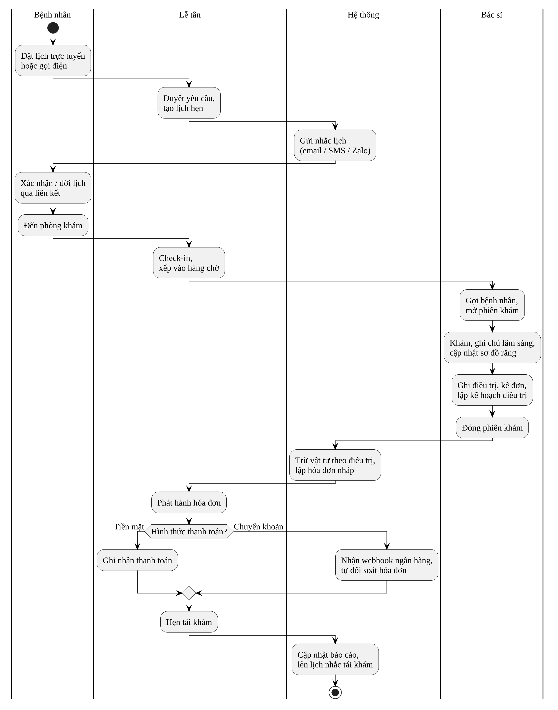
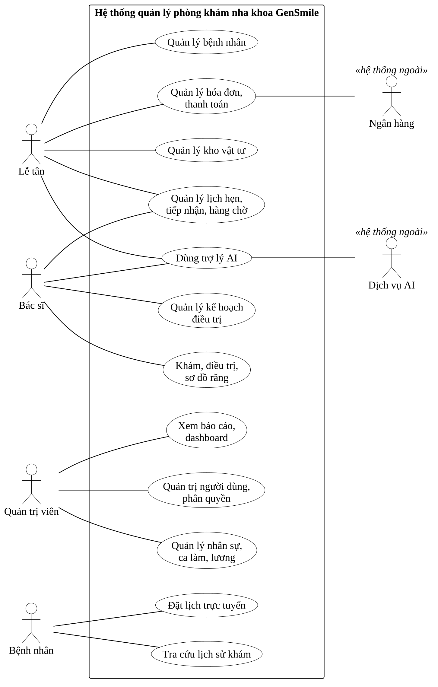
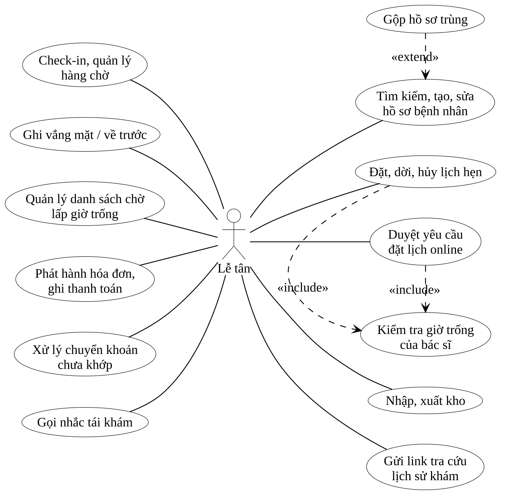
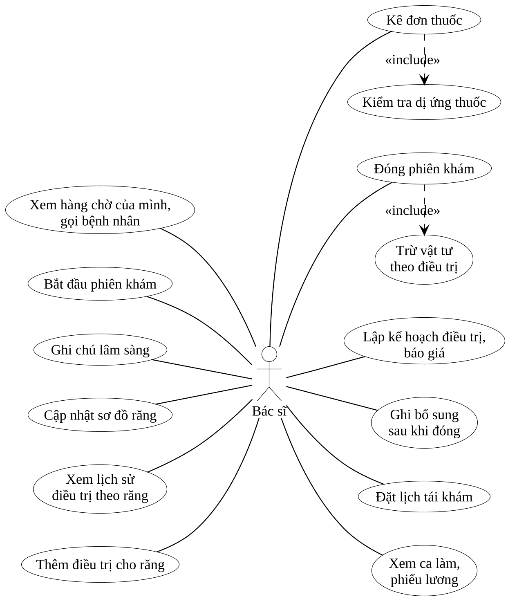
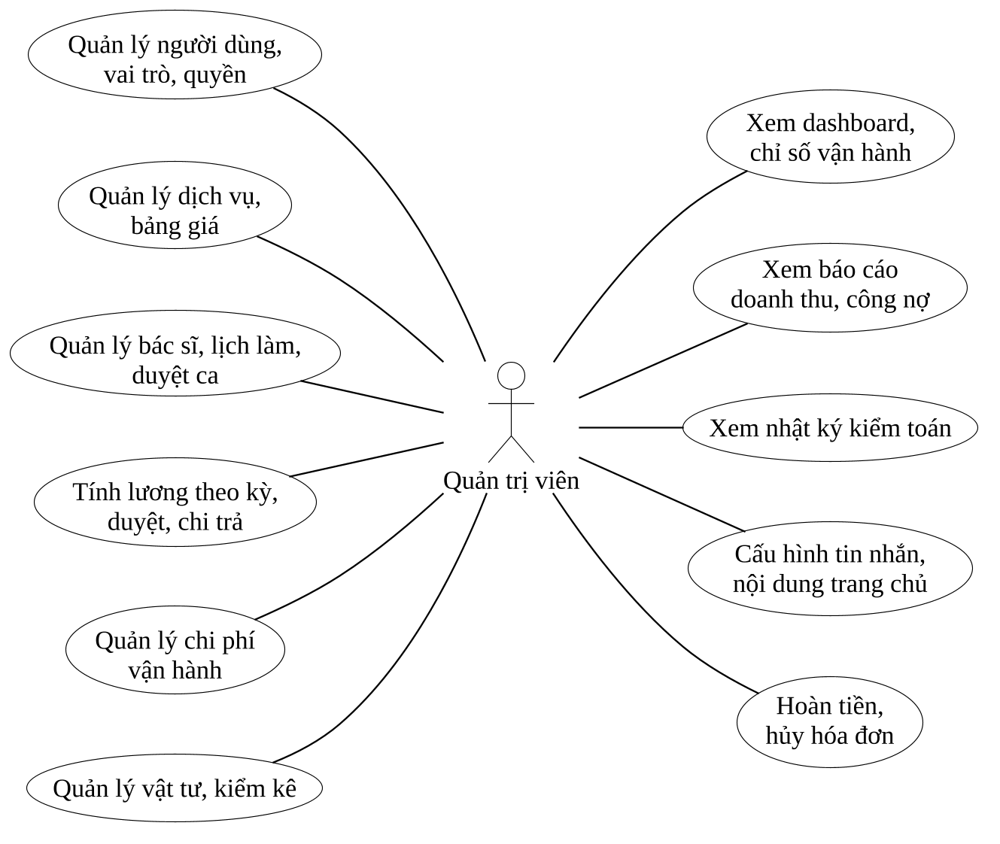
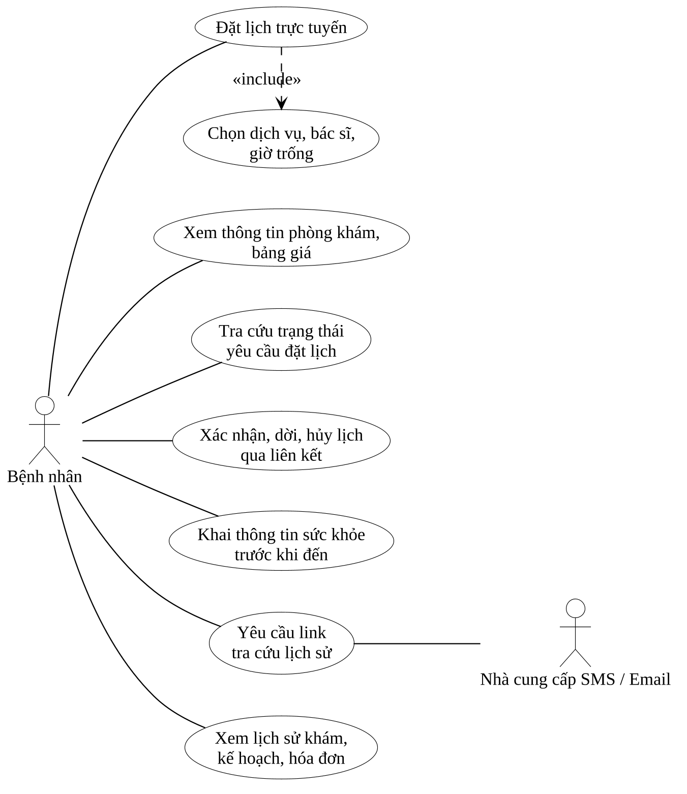

# CHƯƠNG 2. KHẢO SÁT HIỆN TRẠNG VÀ PHÂN TÍCH YÊU CẦU

Chương này khảo sát cách một phòng khám nha khoa vận hành hằng ngày, xác định các tác nhân tham gia, từ đó phân tích yêu cầu chức năng và phi chức năng của hệ thống. Kết quả được mô hình hóa bằng biểu đồ hoạt động và biểu đồ use case theo chuẩn UML [@uml], làm đầu vào cho thiết kế ở Chương 3.

## 2.1. Khảo sát quy trình tại phòng khám

### 2.1.1. Một ngày làm việc điển hình

Khảo sát được thực hiện tại Nha khoa An Việt, qua trao đổi với bác sĩ Nguyễn Văn Việt về quy trình làm việc hằng ngày, các khó khăn trong quản lý và mong muốn đối với phần mềm. Từ kết quả khảo sát, hệ thống được thiết kế cho mô hình phòng khám nha khoa tư nhân quy mô vừa: nhiều bác sĩ làm theo ca, lễ tân kiêm thu ngân, chủ phòng khám kiêm quản lý. Một ngày làm việc diễn ra như sau:

- **Đầu ngày:** lễ tân xem danh sách lịch hẹn trong ngày, gọi nhắc những khách chưa xác nhận, sắp xếp ghế cho từng bác sĩ theo ca.
- **Trong ngày:** khách đến được lễ tân tìm hồ sơ (hoặc tạo hồ sơ mới), đánh dấu đã đến và xếp vào hàng chờ. Bác sĩ gọi khách vào ghế, khám, ghi lại tình trạng răng và các thủ thuật đã làm, kê đơn nếu cần, lập kế hoạch điều trị cho các ca nhiều bước. Vật tư được lấy từ kho theo từng ca.
- **Sau mỗi ca khám:** lễ tân tổng hợp các thủ thuật thành hóa đơn, thu tiền mặt hoặc chuyển khoản, hẹn lần tái khám tiếp theo.
- **Cuối ngày, cuối tháng:** chủ phòng khám đối chiếu tiền thu được với sổ sách và sao kê ngân hàng, kiểm kê vật tư, tổng hợp số ca của từng bác sĩ để tính lương.

Hình 2.1 mô tả quy trình nghiệp vụ tổng thể mà hệ thống cần hỗ trợ, chia theo làn của từng tác nhân.

::: {custom-style="Ảnh"}
{width=15cm}
:::

::: {custom-style="hình"}
Hình 2.1. Biểu đồ hoạt động của quy trình nghiệp vụ tổng thể
:::

::: {custom-style="nguồn"}
Nguồn: Tác giả
:::

### 2.1.2. Những khó khăn của cách quản lý hiện tại

Khi các bước trên được thực hiện bằng sổ sách, bảng tính và tin nhắn, khảo sát ghi nhận các vấn đề được tổng hợp trong Bảng 2.1.

::: {custom-style="bảng"}
Bảng 2.1. Các vấn đề của cách quản lý thủ công và hướng giải quyết
:::

| Khâu | Vấn đề | Hướng giải quyết trong hệ thống |
|---|---|---|
| Đặt lịch | Lịch nằm trong sổ, nhiều người ghi nên dễ đặt trùng giờ một bác sĩ; khách chỉ đặt được trong giờ hành chính qua điện thoại | Lịch dùng chung, máy chủ kiểm tra trùng giờ theo lịch làm việc từng bác sĩ; khách tự đặt trực tuyến 24/7 |
| Nhắc lịch | Lễ tân gọi tay từng khách, dễ sót; khách quên hẹn | Tự gửi nhắc qua email, SMS; khách xác nhận hoặc dời lịch qua liên kết |
| Tiếp nhận | Không biết ai đang chờ, chờ bao lâu; bác sĩ phải hỏi lễ tân | Hàng chờ thời gian thực theo bác sĩ, bảng trạng thái ghế |
| Hồ sơ khám | Ghi tay, khó đọc lại; không tra được lịch sử một chiếc răng | Phiên khám điện tử, sơ đồ răng theo từng lần khám, lịch sử theo răng |
| Kế hoạch điều trị | Báo giá miệng hoặc giấy, khó theo dõi bước nào đã làm | Kế hoạch có báo giá, khách đồng ý, đánh dấu từng bước đã thực hiện |
| Thanh toán | Tính tiền tay, chuyển khoản phải dò sao kê; công nợ khó theo dõi | Hóa đơn lập từ phiên khám, mã VietQR, tự đối soát khi tiền về, theo dõi công nợ |
| Kho | Không biết vật tư sắp hết; không biết vật tư dùng cho ca nào | Trừ kho theo điều trị khi đóng phiên khám, cảnh báo sắp hết, gợi ý nhập |
| Nhân sự | Đếm ca, đếm hoa hồng bằng tay để tính lương | Lịch làm việc, chấm ca, tính lương theo kỳ có lương nền và hoa hồng |
| Quản lý | Không có số liệu tổng hợp đáng tin | Dashboard chỉ số vận hành, báo cáo doanh thu, công nợ, hiệu suất bác sĩ |
| Bảo mật | Ai cũng xem được mọi hồ sơ; không biết ai đã sửa gì | Phân quyền theo vai trò và theo dòng dữ liệu, nhật ký kiểm toán |

::: {custom-style="nguồn"}
Nguồn: Tác giả khảo sát tại Nha khoa An Việt và tổng hợp
:::

## 2.2. Các tác nhân của hệ thống

Từ khảo sát, hệ thống có bốn tác nhân người dùng và ba hệ thống bên ngoài, được mô tả trong Bảng 2.2.

::: {custom-style="bảng"}
Bảng 2.2. Các tác nhân của hệ thống
:::

| Tác nhân | Mô tả | Mục tiêu chính |
|---|---|---|
| Quản trị viên (chủ phòng khám) | Người quản lý phòng khám, có toàn quyền cấu hình | Quản lý người dùng, dịch vụ, giá, nhân sự, lương; xem báo cáo; kiểm soát an toàn dữ liệu |
| Lễ tân | Nhân viên tiếp đón kiêm thu ngân | Quản lý hồ sơ bệnh nhân, lịch hẹn, hàng chờ; lập hóa đơn, thu tiền; nhập xuất kho |
| Bác sĩ | Nha sĩ khám và điều trị | Khám, ghi hồ sơ, sơ đồ răng, điều trị, đơn thuốc, kế hoạch điều trị; xem ca làm và lương của mình |
| Bệnh nhân | Khách hàng của phòng khám, không có tài khoản | Đặt lịch, xác nhận hoặc dời lịch, khai thông tin trước khi đến, tra cứu lịch sử khám |
| Ngân hàng (hệ thống ngoài) | Dịch vụ theo dõi tài khoản ngân hàng | Báo giao dịch chuyển khoản đến qua webhook |
| Dịch vụ nhắn tin (hệ thống ngoài) | Máy chủ email, nhà cung cấp SMS | Chuyển tin nhắc lịch, liên kết tới bệnh nhân |
| Dịch vụ AI (hệ thống ngoài) | Mô hình ngôn ngữ lớn qua cổng API | Soạn nháp văn bản, trả lời tra cứu theo yêu cầu của nhân viên |

::: {custom-style="nguồn"}
Nguồn: Tác giả
:::

## 2.3. Yêu cầu chức năng

Yêu cầu chức năng được nhóm theo các phân hệ nêu trong phiếu giao đề tài. Mỗi yêu cầu được đánh mã dạng nhóm-số để đối chiếu khi kiểm thử ở Chương 5, với các nhóm: BN (bệnh nhân), LH (lịch hẹn và tiếp nhận), KB (khám bệnh), TT (thanh toán), NS (nhân sự), KH (kho và danh mục), BC (báo cáo), AI (trợ lý AI) và QT (quản trị).

### 2.3.1. Quản lý bệnh nhân

Bảng 2.3 liệt kê các yêu cầu về hồ sơ bệnh nhân, từ tạo hồ sơ, gộp hồ sơ trùng đến việc bệnh nhân tự tra cứu lịch sử khám.

::: {custom-style="bảng"}
Bảng 2.3. Yêu cầu chức năng phân hệ quản lý bệnh nhân
:::

| Mã | Yêu cầu |
|---|---|
| BN-01 | Tạo, xem, sửa hồ sơ bệnh nhân: họ tên, ngày sinh, giới tính, số điện thoại, người liên hệ (bắt buộc với trẻ em), địa chỉ, nghề nghiệp, tiền sử dị ứng, bệnh mạn tính. Hệ thống tự cấp mã bệnh nhân. |
| BN-02 | Tìm kiếm nhanh theo tên, mã, số điện thoại; gợi ý hồ sơ có thể trùng khi tạo mới. |
| BN-03 | Gộp hai hồ sơ trùng, giữ lại toàn bộ lịch sử; xóa mềm và khôi phục hồ sơ. |
| BN-04 | Xem trên một màn hình: thông tin, lịch hẹn, các phiên khám, kế hoạch điều trị, hóa đơn, sổ đồng thuận điều trị. |
| BN-05 | Gửi cho bệnh nhân đường dẫn bảo mật để tự tra cứu lịch sử khám. |

::: {custom-style="nguồn"}
Nguồn: Tác giả
:::

### 2.3.2. Quản lý lịch hẹn và tiếp nhận

Phân hệ lịch hẹn và tiếp nhận là nơi lễ tân thao tác nhiều nhất trong ngày; các yêu cầu được nêu ở Bảng 2.4.

::: {custom-style="bảng"}
Bảng 2.4. Yêu cầu chức năng phân hệ lịch hẹn và tiếp nhận
:::

| Mã | Yêu cầu |
|---|---|
| LH-01 | Đặt lịch hẹn theo bác sĩ, dịch vụ, khung giờ; chỉ cho đặt trong giờ làm việc của bác sĩ, không trùng lịch bác sĩ và không trùng lịch bệnh nhân. |
| LH-02 | Xem lịch theo ngày, tuần, theo bác sĩ; danh sách lịch hẹn có lọc. |
| LH-03 | Dời lịch, hủy lịch có lý do; đánh dấu vắng mặt; hoàn tác trong ngày. |
| LH-04 | Bệnh nhân đặt lịch trực tuyến: chọn dịch vụ, bác sĩ, giờ trống; lễ tân duyệt, đề xuất giờ khác hoặc từ chối. |
| LH-05 | Tự gửi nhắc lịch trước giờ hẹn; bệnh nhân xác nhận, xin dời hoặc hủy qua liên kết riêng. |
| LH-06 | Check-in khi khách đến, tiếp nhận khách vãng lai; hàng chờ theo thứ tự đến cho từng bác sĩ, ưu tiên cấp cứu, chuyển bác sĩ. |
| LH-07 | Danh sách chờ: ghi nhận khách muốn khám sớm hơn, gợi ý khi có giờ trống. |
| LH-08 | Nhắc tái khám định kỳ (ví dụ 6 tháng cạo vôi) và theo dõi kết quả gọi nhắc. |

::: {custom-style="nguồn"}
Nguồn: Tác giả
:::

### 2.3.3. Khám và điều trị

Bảng 2.5 nêu các yêu cầu của bác sĩ trong phiên khám, trong đó yêu cầu cốt lõi là gắn mỗi điều trị với số răng trên sơ đồ.

::: {custom-style="bảng"}
Bảng 2.5. Yêu cầu chức năng phân hệ khám và điều trị
:::

| Mã | Yêu cầu |
|---|---|
| KB-01 | Bác sĩ mở phiên khám từ lịch hẹn đã check-in; mỗi lịch hẹn có tối đa một phiên khám. |
| KB-02 | Ghi chú lâm sàng theo cấu trúc: lý do khám, khám thực thể, chẩn đoán, kế hoạch; có thể dùng mẫu khám nhanh. |
| KB-03 | Sơ đồ răng: cập nhật tình trạng từng răng (bình thường, sâu, đã hàn, bọc mão, đã nhổ, implant, cần nhổ); hỗ trợ răng sữa cho trẻ em; lưu bản chụp cho từng phiên khám, có hoàn tác. |
| KB-04 | Chọn một răng để xem toàn bộ lịch sử điều trị của răng đó qua các lần khám và thêm điều trị cho răng đó. |
| KB-05 | Ghi điều trị: dịch vụ từ danh mục (giá lấy theo bảng giá), số răng, số lượng, vật tư sử dụng; sửa giá phải có quyền và lý do. |
| KB-06 | Kê đơn thuốc; cảnh báo bắt buộc khi thuốc trùng với tiền sử dị ứng. |
| KB-07 | Đóng phiên khám: khóa hồ sơ, trừ vật tư, lập hóa đơn nháp; sau khi đóng chỉ được ghi bổ sung. |
| KB-08 | Kế hoạch điều trị: lập danh sách thủ thuật theo răng kèm báo giá, ghi nhận khách đồng ý, theo dõi tiến độ, nhắc khách chưa đặt lịch. |

::: {custom-style="nguồn"}
Nguồn: Tác giả
:::

### 2.3.4. Hóa đơn và thanh toán

Các yêu cầu về hóa đơn và thanh toán, kể cả thanh toán chuyển khoản qua VietQR, được trình bày ở Bảng 2.6.

::: {custom-style="bảng"}
Bảng 2.6. Yêu cầu chức năng phân hệ hóa đơn và thanh toán
:::

| Mã | Yêu cầu |
|---|---|
| TT-01 | Lập hóa đơn từ phiên khám, áp dụng giảm giá, phát hành và in hóa đơn. |
| TT-02 | Ghi nhận thanh toán nhiều lần (tiền mặt, chuyển khoản); theo dõi trạng thái chưa trả, trả một phần, đã trả. |
| TT-03 | Hiển thị mã VietQR trên hóa đơn; tự ghi nhận thanh toán khi ngân hàng báo tiền về; danh sách giao dịch chưa khớp để xử lý tay. |
| TT-04 | Hoàn tiền, hủy hóa đơn, điều chỉnh giảm, có quyền riêng và lý do. |

::: {custom-style="nguồn"}
Nguồn: Tác giả
:::

### 2.3.5. Nhân sự, kho, báo cáo và các chức năng hỗ trợ

Bảng 2.7 gom các yêu cầu của những phân hệ phục vụ quản lý: nhân sự và lương, kho, báo cáo, trợ lý AI và quản trị hệ thống.

::: {custom-style="bảng"}
Bảng 2.7. Yêu cầu chức năng các phân hệ quản lý
:::

| Mã | Yêu cầu |
|---|---|
| NS-01 | Quản lý nhân viên, bác sĩ (chuyên môn, dịch vụ được làm), tài khoản và vai trò. |
| NS-02 | Lịch làm việc, đăng ký và duyệt ca, ngày nghỉ; cảnh báo ca thiếu người. |
| NS-03 | Tính lương theo kỳ: lương nền, giờ làm, hoa hồng theo điều trị; duyệt, chi trả, khóa kỳ; phiếu lương cho từng người. |
| KH-01 | Quản lý danh mục vật tư, nhập kho, xuất kho, kiểm kê; lịch sử biến động. |
| KH-02 | Cảnh báo vật tư dưới mức tối thiểu và gợi ý số lượng nhập. |
| BC-01 | Dashboard: số lịch hẹn, doanh thu, thực thu, công nợ; chỉ số vận hành (tỷ lệ vắng mặt, tỷ lệ đặt lịch tiếp, tỷ lệ chấp nhận kế hoạch, thời gian chờ, hủy sát giờ, tỷ lệ thu) so với mục tiêu. |
| BC-02 | Báo cáo doanh thu theo kỳ, theo bác sĩ, theo dịch vụ; tuổi nợ; công suất ghế theo giờ; hành trình bệnh nhân. |
| AI-01 | Trợ lý AI: soạn nháp ghi chú khám, tin nhắn cho khách, nhận xét báo cáo; trợ lý dạng chat tra cứu và đề xuất đặt, hủy, dời lịch có xác nhận. |
| QT-01 | Quản lý vai trò và quyền; xem nhật ký kiểm toán; cấu hình kênh nhắn tin và nội dung trang chủ. |

::: {custom-style="nguồn"}
Nguồn: Tác giả
:::

## 2.4. Yêu cầu phi chức năng

Các yêu cầu phi chức năng được xác định theo mô hình chất lượng ISO/IEC 25010 và các khuyến nghị bảo mật OWASP [@owasp], tổng hợp trong Bảng 2.8.

::: {custom-style="bảng"}
Bảng 2.8. Yêu cầu phi chức năng
:::

| Đặc tính | Yêu cầu |
|---|---|
| Bảo mật | Xác thực bắt buộc cho mọi chức năng nội bộ; mật khẩu băm bằng thuật toán chuyên dụng; phân quyền theo vai trò và theo dòng dữ liệu; giới hạn tần suất gọi API; liên kết công khai có mã ngẫu nhiên, hết hạn, chỉ lưu giá trị băm. |
| Quyền riêng tư | Chỉ hiển thị dữ liệu cần cho vai trò; không gửi tên, số điện thoại bệnh nhân cho dịch vụ AI; ghi nhật ký mọi lần truy cập hồ sơ qua kênh đặc biệt [@nd13]. |
| Toàn vẹn dữ liệu | Không đặt trùng lịch kể cả khi nhiều người thao tác cùng lúc; tiền dùng kiểu số thập phân chính xác; hồ sơ đã đóng không bị sửa đè [@tt46]. |
| Độ tin cậy | Chức năng nghiệp vụ không phụ thuộc vào AI hay dịch vụ nhắn tin; lỗi dịch vụ ngoài không làm hỏng giao dịch chính; tin nhắn không gửi trùng. |
| Hiệu năng | Thao tác thường dùng phản hồi dưới 1 giây với dữ liệu vài năm của một phòng khám; trang đầu tải nhanh trên mạng di động. |
| Khả dụng | Giao diện tiếng Việt (có tiếng Anh), dùng được trên máy tính và điện thoại, có chế độ tối; thông báo lỗi rõ ràng; thao tác quan trọng có xác nhận hoặc hoàn tác. |
| Khả năng bảo trì | Mã nguồn chia module theo nghiệp vụ; kiểm thử tự động; thay đổi cơ sở dữ liệu qua migration có đánh số. |
| Khả năng triển khai | Đóng gói container, triển khai lên máy chủ ảo bằng một lệnh, có kiểm tra phiên bản sau khi triển khai. |

::: {custom-style="nguồn"}
Nguồn: Tác giả
:::

## 2.5. Biểu đồ use case

Hình 2.2 trình bày biểu đồ use case tổng quát, thể hiện các nhóm chức năng chính và tác nhân sử dụng chúng; các hình tiếp theo chi tiết hóa use case của từng tác nhân.

::: {custom-style="Ảnh"}
{width=8.5cm}
:::

::: {custom-style="hình"}
Hình 2.2. Biểu đồ use case tổng quát
:::

::: {custom-style="nguồn"}
Nguồn: Tác giả
:::

Lễ tân là tác nhân thao tác nhiều nhất trong ngày (Hình 2.3). Use case "Đặt, dời, hủy lịch hẹn" và "Duyệt yêu cầu đặt lịch online" đều bao gồm bước kiểm tra giờ trống của bác sĩ. Việc gộp hai hồ sơ trùng không hoàn tác được nên được giao cho quản trị viên (Hình 2.5).

::: {custom-style="Ảnh"}
{width=8.5cm}
:::

::: {custom-style="hình"}
Hình 2.3. Biểu đồ use case của lễ tân
:::

::: {custom-style="nguồn"}
Nguồn: Tác giả
:::

Hình 2.4 mô tả các use case lâm sàng của bác sĩ. Kê đơn luôn bao gồm bước kiểm tra dị ứng thuốc; đóng phiên khám luôn bao gồm việc trừ vật tư đã dùng.

::: {custom-style="Ảnh"}
{width=8.5cm}
:::

::: {custom-style="hình"}
Hình 2.4. Biểu đồ use case của bác sĩ
:::

::: {custom-style="nguồn"}
Nguồn: Tác giả
:::

Hình 2.5 trình bày các use case của quản trị viên: quản lý người dùng và phân quyền, dịch vụ và bảng giá, bác sĩ và lịch làm, lương, chi phí, vật tư; xem bảng điều khiển, báo cáo và nhật ký kiểm toán; hoàn tiền, hủy hóa đơn và gộp hồ sơ bệnh nhân trùng.

::: {custom-style="Ảnh"}
{width=8.5cm}
:::

::: {custom-style="hình"}
Hình 2.5. Biểu đồ use case của quản trị viên
:::

::: {custom-style="nguồn"}
Nguồn: Tác giả
:::

Bệnh nhân không có tài khoản. Mọi chức năng dành cho bệnh nhân là chức năng công khai, được bảo vệ bằng mã tham chiếu hoặc liên kết có mã bí mật gửi riêng tới bệnh nhân (Hình 2.6).

::: {custom-style="Ảnh"}
{width=8.5cm}
:::

::: {custom-style="hình"}
Hình 2.6. Biểu đồ use case của bệnh nhân
:::

::: {custom-style="nguồn"}
Nguồn: Tác giả
:::

## 2.6. Ma trận tác nhân và quyền

Quyền trong hệ thống được định nghĩa chi tiết tới từng hành động. Bảng 2.9 trích một số quyền tiêu biểu cùng phân bổ mặc định cho ba vai trò; ký hiệu "Có" là được phép, "Riêng" là chỉ với dữ liệu của mình (ví dụ bác sĩ chỉ với bệnh nhân mình điều trị), "–" là không được phép.

::: {custom-style="bảng"}
Bảng 2.9. Ma trận quyền tiêu biểu theo vai trò
:::

| Hành động | Quản trị | Lễ tân | Bác sĩ |
|---|---|---|---|
| Tạo, sửa hồ sơ bệnh nhân | Có | Có | – |
| Xem danh sách bệnh nhân | Có | Có | Có |
| Đặt lịch hẹn | Có | Có | Riêng |
| Check-in | Có | Có | – |
| Xem, gọi hàng chờ | Có | Có | Riêng |
| Bắt đầu phiên khám, ghi chú lâm sàng | – | – | Riêng |
| Xem hồ sơ khám đầy đủ | Có | – | Riêng |
| Ghi điều trị, sửa giá | – | – | Riêng |
| Cập nhật sơ đồ răng | – | – | Riêng |
| Lập kế hoạch điều trị | Có | – | Riêng |
| Phát hành hóa đơn, thu tiền | Có | Có | – |
| Hoàn tiền, hủy hóa đơn | Có | – | – |
| Nhập, xuất kho | Có | Có | – |
| Xem báo cáo doanh thu | Có | – | – |
| Quản lý người dùng, vai trò | Có | – | – |

::: {custom-style="nguồn"}
Nguồn: Tác giả tổng hợp từ cấu hình phân quyền của hệ thống
:::

Điểm đáng chú ý là quản trị viên không có quyền ghi hồ sơ lâm sàng: chỉ bác sĩ trực tiếp khám mới được ghi chẩn đoán, điều trị và sơ đồ răng. Nhờ vậy, mỗi dòng hồ sơ y tế gắn với người có chuyên môn chịu trách nhiệm [@tt46].

## 2.7. Kết luận chương

Chương 2 đã khảo sát quy trình của phòng khám, xác định các tác nhân cùng yêu cầu chức năng và phi chức năng; các biểu đồ use case và ma trận quyền là cơ sở cho thiết kế ở Chương 3.
