# CHƯƠNG 3. PHÂN TÍCH VÀ THIẾT KẾ HỆ THỐNG

Chương này trình bày thiết kế của hệ thống GenSmile dựa trên các yêu cầu ở Chương 2: kiến trúc tổng thể và cách chia module, thiết kế cơ sở dữ liệu, đặc tả và thiết kế các chức năng chính bằng biểu đồ tuần tự, hoạt động và trạng thái, thiết kế bảo mật và thiết kế giao diện.

## 3.1. Kiến trúc tổng thể

### 3.1.1. Mô hình triển khai

Hệ thống gồm bốn thành phần chạy trong các container trên một máy chủ ảo (Hình 3.1):

- **Nginx** phục vụ giao diện React đã đóng gói và chuyển tiếp các yêu cầu `/api` tới máy chủ ứng dụng; người dùng chỉ làm việc với một tên miền qua HTTPS.
- **Ứng dụng NestJS** cung cấp REST API, chạy các tác vụ định kỳ (gửi nhắc lịch, nhắc tái khám, đánh dấu hóa đơn quá hạn) và giao tiếp với dịch vụ ngoài.
- **PostgreSQL 16** lưu toàn bộ dữ liệu.
- **Migrate** là container chạy một lần khi phát hành phiên bản mới, áp dụng các migration còn thiếu trước khi ứng dụng khởi động.

Ba nhóm dịch vụ bên ngoài là ngân hàng (qua dịch vụ theo dõi tài khoản SePay), các kênh nhắn tin (SMTP, eSMS) và cổng mô hình ngôn ngữ lớn. Hệ thống được thiết kế để hoạt động đầy đủ chức năng nghiệp vụ khi bất kỳ dịch vụ ngoài nào ngừng hoạt động.

::: {custom-style="Ảnh"}
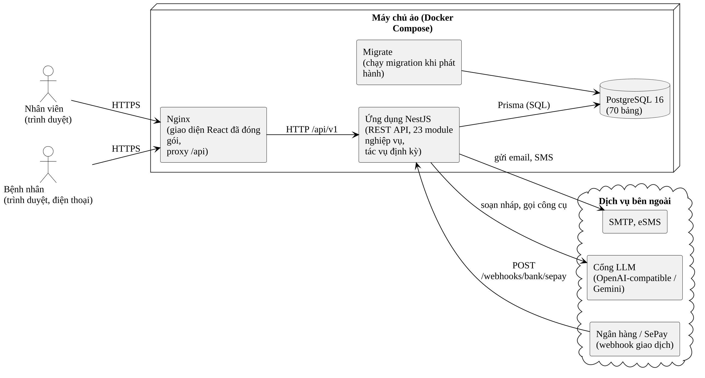{width=15cm}
:::

::: {custom-style="hình"}
Hình 3.1. Kiến trúc triển khai của hệ thống
:::

::: {custom-style="nguồn"}
Nguồn: Tác giả
:::

### 3.1.2. Các module nghiệp vụ

Máy chủ ứng dụng được chia thành 23 module nghiệp vụ theo kiến trúc phân lớp [@sommerville], mỗi module gồm controller (nhận yêu cầu, kiểm tra dữ liệu bằng DTO), service (quy tắc nghiệp vụ) và phần truy cập dữ liệu qua Prisma. Các module giao tiếp với nhau qua service được công bố hoặc qua **sự kiện miền**: ví dụ khi phiên khám đóng, module hồ sơ khám phát sự kiện `encounter.closed`; module hóa đơn lắng nghe để lập hóa đơn nháp, module lương lắng nghe để ghi ca khám vào bảng lương, module AI lắng nghe để làm mới bản tóm tắt. Cách làm này giữ cho mỗi module không phụ thuộc trực tiếp vào module khác. Bảng 3.1 liệt kê các module cùng số điểm cuối API.

::: {custom-style="bảng"}
Bảng 3.1. Các module nghiệp vụ của máy chủ ứng dụng
:::

| Module | Trách nhiệm chính | Số API |
|---|---|---|
| auth | Đăng nhập, làm mới token, quên mật khẩu, thiết lập tài khoản | 9 |
| users, roles | Người dùng, vai trò, quyền | 16 |
| patients | Hồ sơ bệnh nhân, tìm kiếm, gộp hồ sơ, xem dữ liệu liên module, lịch sử theo răng | 21 |
| patient-history | Liên kết tra cứu lịch sử khám cho bệnh nhân | 3 |
| appointments | Lịch hẹn, lịch làm việc, giờ trống, check-in, hàng chờ, bảng ghế, danh sách chờ | 54 |
| booking | Đặt lịch trực tuyến, duyệt yêu cầu, liên kết xác nhận/dời lịch, phiếu khai trước | 39 |
| medical-records | Phiên khám, ghi chú lâm sàng, điều trị, đơn thuốc, sơ đồ răng, mẫu khám | 22 |
| treatment-plans | Kế hoạch điều trị, báo giá, tiến độ, lịch sử liên hệ | 13 |
| consents | Sổ đồng thuận | 6 |
| billing | Hóa đơn, thanh toán, hoàn tiền, VietQR, webhook ngân hàng, đối soát | 22 |
| inventory | Vật tư, nhập xuất, kiểm kê, gợi ý nhập | 13 |
| catalog | Danh mục dịch vụ, bảng giá, dịch vụ của từng bác sĩ | 15 |
| staff | Nhân viên, hồ sơ bác sĩ, đăng ký và duyệt ca | 15 |
| payroll | Cấu hình lương, kỳ lương, phiếu lương | 30 |
| expense | Chi phí vận hành | 10 |
| reports | Báo cáo doanh thu, chỉ số vận hành, phễu bệnh nhân, công suất | 22 |
| recalls | Nhắc tái khám | 5 |
| messaging, notifications | Tin nhắn email, SMS, thông báo trong ứng dụng | 8 |
| ai | Soạn nháp, tóm tắt hồ sơ, trợ lý dạng chat | 7 |
| media, audit, common | Ảnh trang chủ, nhật ký kiểm toán, kiểm tra sức khỏe hệ thống | 9 |
| **Tổng** | | **339** |

::: {custom-style="nguồn"}
Nguồn: Tác giả thống kê từ mã nguồn
:::

## 3.2. Thiết kế cơ sở dữ liệu

### 3.2.1. Nguyên tắc thiết kế

Cơ sở dữ liệu gồm 70 bảng và 43 kiểu liệt kê, được xây dựng qua 52 lần migration. Các nguyên tắc chung:

- **Khóa chính UUID phiên bản 7**: không đoán được (an toàn khi xuất hiện trong đường dẫn), tăng dần theo thời gian nên chèn và đánh chỉ mục hiệu quả. Các mã con người đọc (mã bệnh nhân `PAT-2026-00461`, mã hóa đơn `INV-2026-000123`) được sinh riêng từ sequence.
- **Xóa mềm** bằng cột `deleted_at` cho dữ liệu nghiệp vụ, giữ lịch sử và cho phép khôi phục; các truy vấn mặc định bỏ qua bản ghi đã xóa.
- **Tiền** dùng kiểu `decimal`, không dùng số thực, để không sai số khi cộng dồn.
- **Thời gian** dùng `timestamptz` (có múi giờ); các phép tính "hôm nay", "giờ làm việc" quy đổi theo múi giờ phòng khám (Asia/Ho_Chi_Minh).
- **JSONB cho dữ liệu bán cấu trúc:** danh sách số răng của một thủ thuật, bản chụp sơ đồ răng (khóa là số răng FDI, giá trị là tình trạng và ghi chú), danh sách dị ứng.
- **Ràng buộc ở cơ sở dữ liệu:** khóa ngoại, duy nhất (ví dụ mỗi lịch hẹn có tối đa một phiên khám, mỗi giao dịch ngân hàng chỉ được lưu một lần), ràng buộc kiểm tra cho các giá trị có miền hữu hạn.
- **Bảng lịch sử và nhật ký** cho các thực thể quan trọng: thay đổi lịch hẹn, thay đổi phiên khám, thay đổi hóa đơn, biến động kho, nhật ký kiểm toán chung.

### 3.2.2. Sơ đồ thực thể liên kết

Do số bảng lớn, sơ đồ thực thể liên kết được chia theo miền nghiệp vụ; báo cáo trình bày bốn nhóm chính, hai nhóm còn lại được mô tả bằng lời. Các sơ đồ dưới đây được sinh tự động từ lược đồ Prisma của hệ thống để bảo đảm khớp với cơ sở dữ liệu thật; mỗi bảng hiển thị khóa chính, các khóa ngoại và một số cột nghiệp vụ chính.

::: {custom-style="Ảnh"}
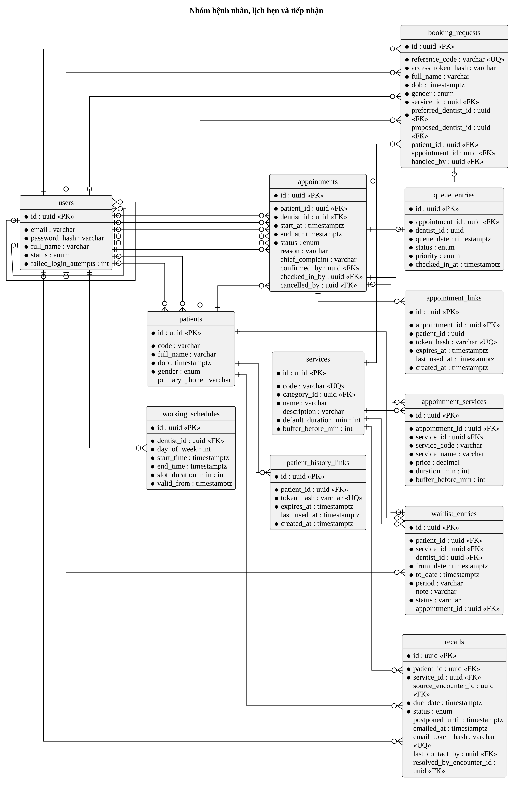{width=15cm}
:::

::: {custom-style="hình"}
Hình 3.2. Sơ đồ thực thể liên kết nhóm bệnh nhân, lịch hẹn và tiếp nhận
:::

::: {custom-style="nguồn"}
Nguồn: Tác giả, sinh từ lược đồ cơ sở dữ liệu của hệ thống
:::

Nhóm bệnh nhân và lịch hẹn (Hình 3.2) xoay quanh bảng `appointments`: mỗi lịch hẹn thuộc một bệnh nhân và một bác sĩ (bảng `users`), có thể gồm nhiều dịch vụ (`appointment_services`, lưu lại giá tại thời điểm đặt). Yêu cầu đặt lịch trực tuyến được lưu riêng trong `booking_requests` cho đến khi lễ tân duyệt. Hàng chờ (`queue_entries`), lịch làm việc (`working_schedules`), danh sách chờ (`waitlist_entries`) và nhắc tái khám (`recalls`) đều tham chiếu tới bệnh nhân hoặc lịch hẹn. Hai bảng `appointment_links` và `patient_history_links` lưu các liên kết công khai gửi cho bệnh nhân; chỉ giá trị băm SHA-256 của mã bí mật được lưu.

Nhóm phiên khám (Hình 3.3) có bảng trung tâm `encounters`, quan hệ một – một với lịch hẹn. Mỗi phiên khám có một ghi chú lâm sàng (kèm các ghi bổ sung sau khi khóa), tối đa một đơn thuốc và một bản chụp sơ đồ răng (`dental_chart_snapshots`).

Thiết kế **mỗi phiên khám một bản chụp sơ đồ răng** (thay vì một sơ đồ duy nhất bị ghi đè) là quyết định quan trọng: tình trạng răng tại từng thời điểm được giữ nguyên, nhờ đó có thể xem lịch sử một chiếc răng qua các lần khám, đáp ứng yêu cầu không ghi đè hồ sơ [@tt46]. Sơ đồ hiện tại của bệnh nhân là bản chụp của phiên khám gần nhất không bị hủy.

::: {custom-style="Ảnh"}
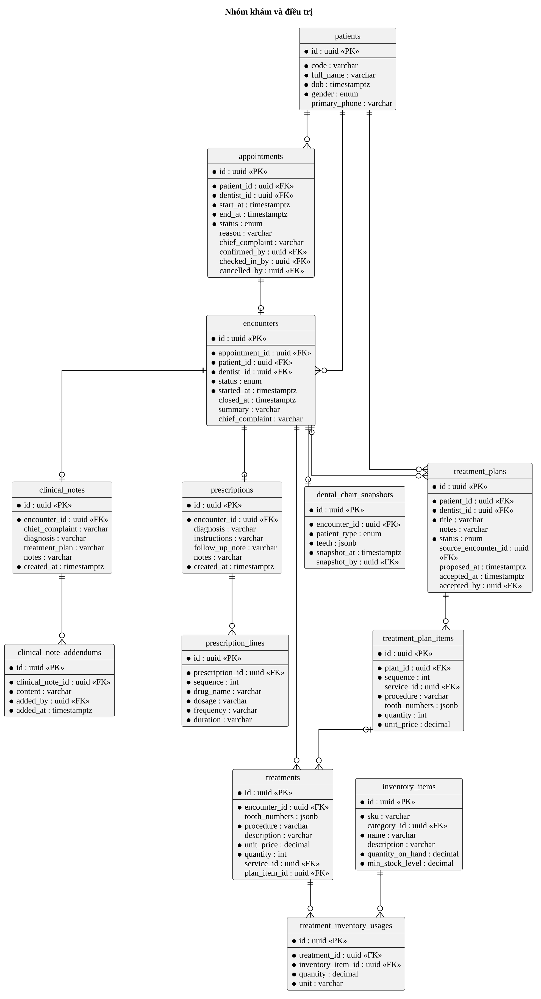{width=14cm}
:::

::: {custom-style="hình"}
Hình 3.3. Sơ đồ thực thể liên kết nhóm phiên khám, ghi chú lâm sàng và đơn thuốc
:::

::: {custom-style="nguồn"}
Nguồn: Tác giả, sinh từ lược đồ cơ sở dữ liệu của hệ thống
:::

Nhóm điều trị và kế hoạch: mỗi phiên khám có nhiều dòng điều trị (`treatments`, có cột `tooth_numbers` kiểu JSONB). Vật tư dùng cho mỗi điều trị được ghi trong `treatment_inventory_usages` để trừ kho khi đóng phiên. Kế hoạch điều trị (`treatment_plans`, `treatment_plan_items`) gắn với bệnh nhân; mỗi dòng kế hoạch được đánh dấu đã làm khi có điều trị tương ứng trong một phiên khám đã đóng.

::: {custom-style="Ảnh"}
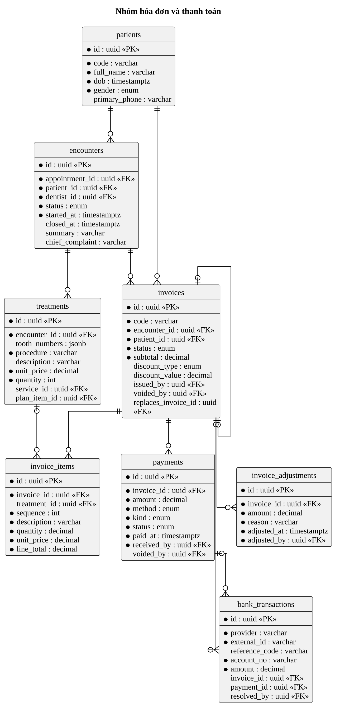{width=10cm}
:::

::: {custom-style="hình"}
Hình 3.4. Sơ đồ thực thể liên kết nhóm hóa đơn và thanh toán
:::

::: {custom-style="nguồn"}
Nguồn: Tác giả, sinh từ lược đồ cơ sở dữ liệu của hệ thống
:::

Nhóm hóa đơn (Hình 3.4): mỗi hóa đơn lập từ một phiên khám, gồm các dòng (`invoice_items`) sao chép từ điều trị; thanh toán (`payments`) có khóa `request_key` duy nhất theo hóa đơn để một lần bấm hai lần hoặc một giao dịch ngân hàng báo hai lần cũng chỉ ghi một khoản. Hóa đơn lưu sẵn các tổng đã thu, đã hoàn, đã điều chỉnh và số còn nợ để báo cáo nhanh. Giao dịch ngân hàng (`bank_transactions`) lưu toàn bộ dữ liệu ngân hàng gửi về cùng kết quả đối soát.

Nhóm người dùng và phân quyền (Hình 3.5) theo mô hình RBAC [@rbac]: người dùng – vai trò – quyền với hai bảng nối `user_roles`, `role_permissions`. Nhật ký kiểm toán (`audit_logs`) ghi người thực hiện, hành động, đối tượng và dữ liệu kèm theo của mọi thao tác nhạy cảm.

::: {custom-style="Ảnh"}
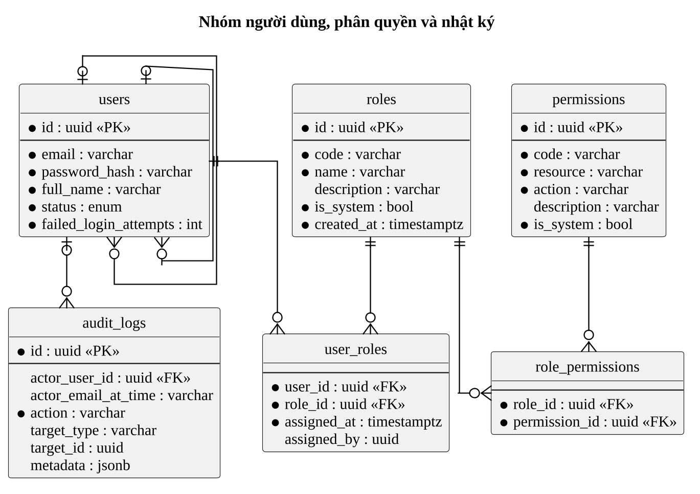{width=13cm}
:::

::: {custom-style="hình"}
Hình 3.5. Sơ đồ thực thể liên kết nhóm người dùng, phân quyền và nhật ký
:::

::: {custom-style="nguồn"}
Nguồn: Tác giả, sinh từ lược đồ cơ sở dữ liệu của hệ thống
:::

Nhóm nhân sự, lương và kho: thông tin nhân sự (`employees`, `dentist_profiles`) tách khỏi tài khoản đăng nhập. Ca làm việc được đăng ký và duyệt trong `shift_registrations`; kỳ lương (`payroll_periods`) gồm các dòng lương của từng người. Kho gồm danh mục, vật tư và biến động kho (`stock_movements`) ghi lại số lượng trước và sau mỗi lần nhập, xuất, kiểm kê.

## 3.3. Đặc tả và thiết kế các chức năng chính

Mục này đặc tả các chức năng tiêu biểu theo mẫu: tên chức năng, tác nhân, tiền điều kiện, luồng chính, luồng thay thế và ngoại lệ, hậu điều kiện. Các chức năng chính được minh họa bằng biểu đồ phù hợp: biểu đồ tuần tự cho trao đổi giữa các thành phần, biểu đồ hoạt động cho các luồng có nhiều nhánh quyết định, biểu đồ trạng thái cho vòng đời của đối tượng.

### 3.3.1. Quản lý lịch hẹn và trạng thái lịch hẹn

Vòng đời một lịch hẹn được mô hình hóa bằng biểu đồ trạng thái ở Hình 3.6. Các chuyển trạng thái đều kiểm tra quyền và điều kiện thời gian: chỉ check-in được trong ngày hẹn; chỉ đánh dấu vắng mặt khi đã qua giờ hẹn; hoàn tác check-in chỉ được trước khi bác sĩ mở phiên khám. Lịch đã check-in không hủy được: khách rời đi trước khi khám được ghi là "đã về" và có thể hoàn tác trong ngày. Khách đã bị đánh vắng mặt nhưng đến muộn vẫn được check-in nếu lễ tân ghi lý do, còn trong ngày hẹn và giờ đó chưa bị lịch khác chiếm. Sau giờ hẹn, lịch chỉ được hủy dưới dạng "phòng khám hủy" (bác sĩ vắng, đóng cửa) kèm lý do; bác sĩ chỉ tự hủy được lịch của mình trước giờ hẹn ít nhất 24 giờ. Mọi thay đổi được ghi vào bảng lịch sử lịch hẹn.

::: {custom-style="Ảnh"}
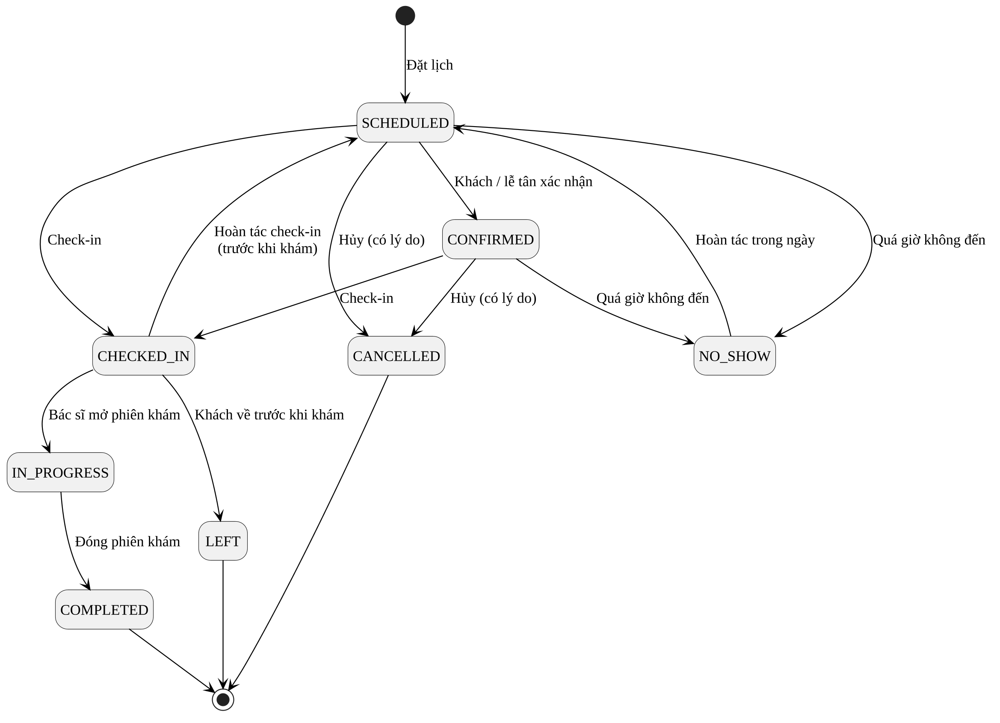{width=14cm}
:::

::: {custom-style="hình"}
Hình 3.6. Biểu đồ trạng thái của lịch hẹn
:::

::: {custom-style="nguồn"}
Nguồn: Tác giả
:::

Đặc tả chi tiết chức năng đặt lịch hẹn được trình bày ở Bảng 3.2.

::: {custom-style="bảng"}
Bảng 3.2. Đặc tả chức năng Đặt lịch hẹn
:::

| Thuộc tính | Nội dung |
|---|---|
| Tên chức năng | Đặt lịch hẹn |
| Tác nhân | Lễ tân, quản trị viên; bác sĩ (chỉ lịch của mình); trợ lý AI (qua thẻ xác nhận) |
| Tiền điều kiện | Đã đăng nhập, có quyền `appointment.create`; bệnh nhân tồn tại; bác sĩ có lịch làm việc ngày đó |
| Luồng chính | 1) Chọn bệnh nhân, bác sĩ, dịch vụ. 2) Hệ thống tính các khung giờ trống từ lịch làm việc, ngày nghỉ, lịch hẹn hiện có, thời gian đệm trước và sau. 3) Chọn giờ, nhập lý do. 4) Trong một giao dịch, hệ thống khóa lịch của bác sĩ và của bệnh nhân, kiểm tra lại không trùng, lưu lịch hẹn và giá dịch vụ tại thời điểm đặt. 5) Ghi nhật ký, gửi xác nhận cho bệnh nhân nếu có email. |
| Luồng thay thế, ngoại lệ | Giờ vừa bị người khác đặt: báo lỗi trùng, gợi ý giờ khác. Ngoài giờ làm việc, ngày phòng khám nghỉ: từ chối. Bệnh nhân đã có lịch trùng giờ: từ chối. |
| Hậu điều kiện | Lịch hẹn ở trạng thái SCHEDULED; khung giờ không còn hiển thị là trống |

::: {custom-style="nguồn"}
Nguồn: Tác giả
:::

Việc chống đặt trùng giờ được bảo đảm ở máy chủ, không chỉ ở giao diện: hai lễ tân cùng đặt một khung giờ ở hai máy khác nhau, giao dịch thứ hai phải chờ khóa của giao dịch thứ nhất, rồi kiểm tra lại và bị từ chối.

Hình 3.7 mô tả chi tiết luồng lễ tân đặt lịch hẹn, trong đó có tình huống hai lễ tân cùng đặt một bác sĩ vào cùng một giờ. Yêu cầu đi qua ba lớp kiểm tra: `PermissionsGuard` kiểm tra quyền `appointment.create`, lớp DTO kiểm tra dữ liệu đầu vào, rồi service thực hiện toàn bộ việc kiểm tra và ghi trong một giao dịch có khóa tư vấn. Giao dịch đến sau phải chờ giao dịch trước kết thúc, nên lần kiểm tra trùng của nó luôn thấy lịch vừa được ghi.

::: {custom-style="Ảnh"}
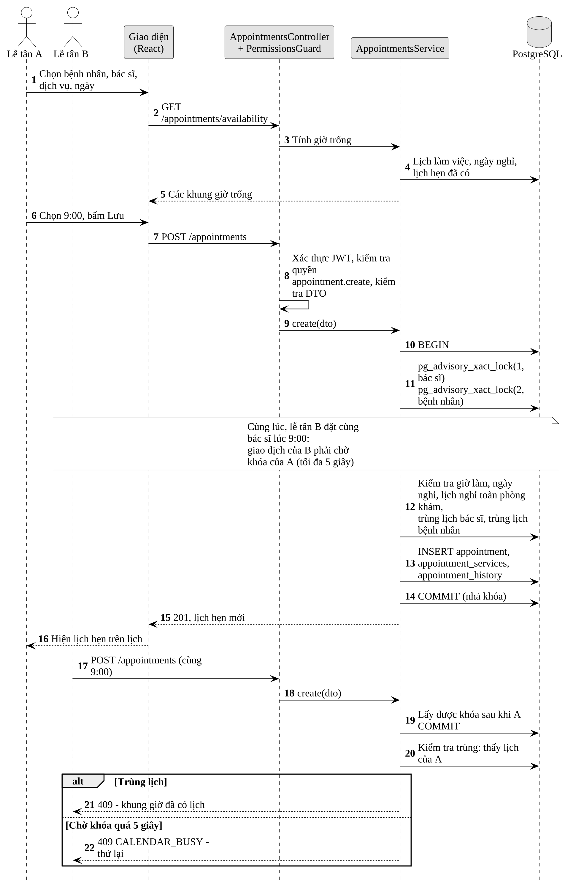{width=15cm}
:::

::: {custom-style="hình"}
Hình 3.7. Biểu đồ tuần tự lễ tân đặt lịch hẹn khi có hai yêu cầu cùng lúc
:::

::: {custom-style="nguồn"}
Nguồn: Tác giả
:::

Khi khách đến, lễ tân check-in và hệ thống đưa khách vào hàng chờ của bác sĩ (Hình 3.8). Check-in chỉ được thực hiện trong khung từ 15 phút trước đến 30 phút sau giờ hẹn; ngoài khung này phải có lý do ghi đè và phải trong ngày hẹn. Thứ tự hàng chờ không đơn thuần theo giờ đến: khách đến đúng giờ được xếp theo giờ hẹn, khách trễ quá 15 phút được xếp như thể đến muộn thêm 15 phút, khách vãng lai chờ sau khách có hẹn tối đa khoảng 45 phút, còn ca cấp cứu luôn được đưa lên đầu. Cách xếp này được viết thành một hàm thuần và kiểm thử bằng bảng quyết định.

::: {custom-style="Ảnh"}
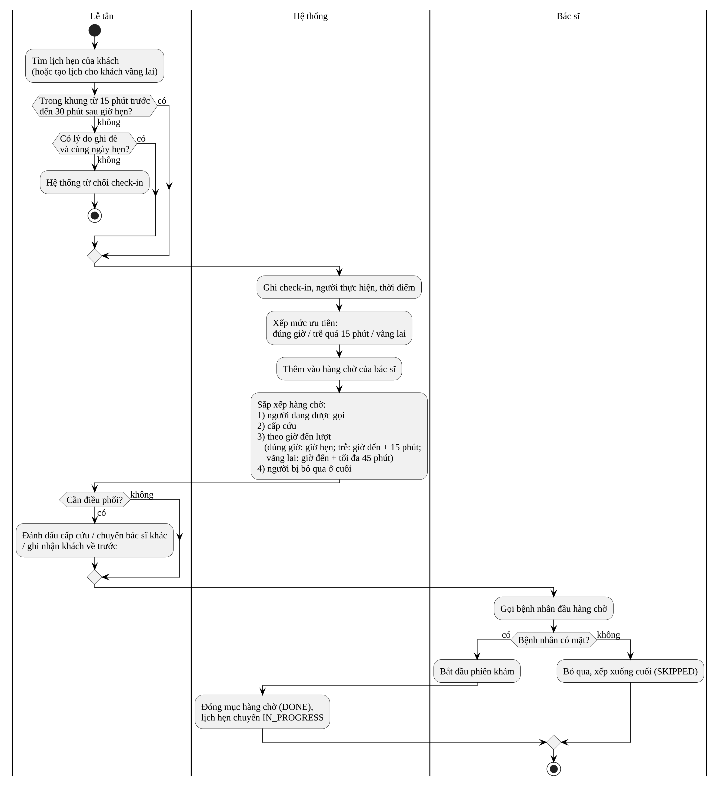{width=11.5cm}
:::

::: {custom-style="hình"}
Hình 3.8. Biểu đồ hoạt động tiếp nhận và hàng chờ
:::

::: {custom-style="nguồn"}
Nguồn: Tác giả
:::

Khi một lịch hẹn bị hủy hoặc khách vắng mặt, giờ trống đó có thể dành cho bệnh nhân trong danh sách chờ. Mỗi yêu cầu chờ ghi dịch vụ, bác sĩ mong muốn (hoặc bất kỳ), khoảng ngày và buổi. Cứ hai phút, hệ thống tìm các giờ vừa trống, tính phần còn lại và chỉ giữ những dịch vụ mà bác sĩ đó làm được trong khoảng thời gian ấy; nếu có yêu cầu phù hợp, lễ tân nhận thông báo để liên hệ khách. Khi đặt lịch từ yêu cầu chờ, điều kiện khớp được kiểm tra lại trong cùng giao dịch tạo lịch, nên hai lễ tân không thể cùng xếp một yêu cầu vào hai giờ khác nhau.

### 3.3.2. Đặt lịch trực tuyến

Bệnh nhân đặt lịch không cần tài khoản (Hình 3.9). Yêu cầu đặt lịch không trở thành lịch hẹn ngay mà chờ lễ tân duyệt, để phòng khám kiểm soát được những lịch phức tạp và tránh lịch giả; lễ tân có thể đề xuất giờ khác. Khách đồng ý hoặc từ chối (kèm lời nhắn) qua trang tra cứu; khi khách đồng ý, hệ thống kiểm tra lại giờ đó còn dùng được rồi báo lễ tân xác nhận lần cuối để tạo lịch hẹn, còn khi khách từ chối, yêu cầu quay về chờ duyệt. Yêu cầu không được xử lý kịp sẽ tự hết hạn.

::: {custom-style="Ảnh"}
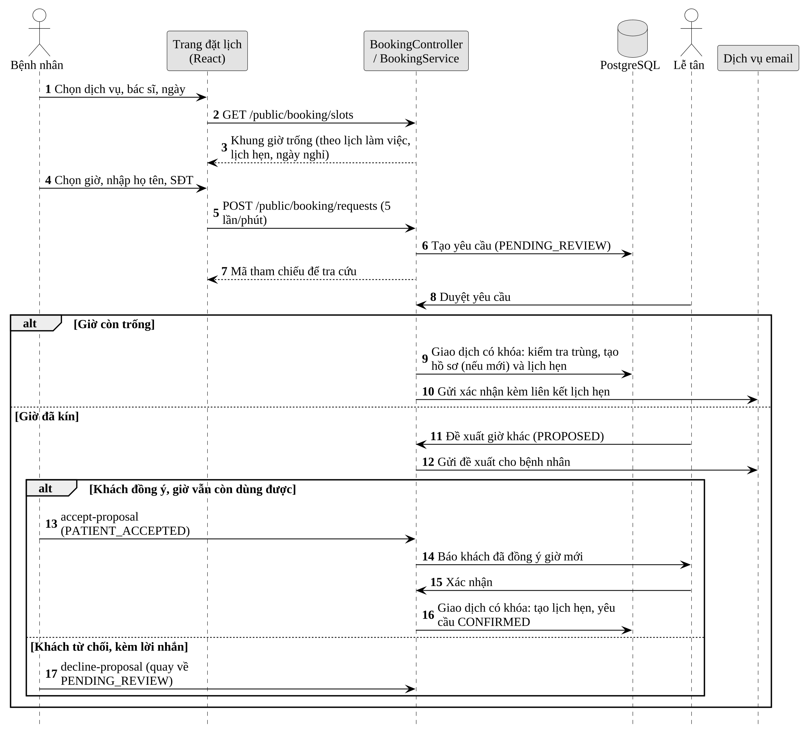{width=15cm}
:::

::: {custom-style="hình"}
Hình 3.9. Biểu đồ tuần tự đặt lịch trực tuyến
:::

::: {custom-style="nguồn"}
Nguồn: Tác giả
:::

### 3.3.3. Khám, điều trị và sơ đồ răng

Bảng 3.3 đặc tả chức năng trung tâm của bác sĩ: khám và ghi điều trị theo răng.

::: {custom-style="bảng"}
Bảng 3.3. Đặc tả chức năng Khám và ghi điều trị theo răng
:::

| Thuộc tính | Nội dung |
|---|---|
| Tên chức năng | Khám và ghi điều trị theo răng |
| Tác nhân | Bác sĩ được phân công lịch hẹn |
| Tiền điều kiện | Lịch hẹn đã check-in; bác sĩ có quyền `encounter.start`, `treatment.write`, `dental_chart.write` |
| Luồng chính | 1) Bác sĩ mở phiên khám từ hàng chờ. 2) Ghi lý do khám, khám thực thể, chẩn đoán (có thể dùng mẫu khám nhanh hoặc AI soạn nháp từ ghi nhanh). 3) Mở tab "Điều trị & sơ đồ răng", bấm một răng trên sơ đồ dạng cung. 4) Hệ thống hiển thị tình trạng răng, điều trị trong phiên này và các lần điều trị trước của răng đó. 5) Bác sĩ đổi tình trạng răng (tự lưu sau 1,5 giây, có hoàn tác) và bấm "Thêm điều trị cho răng này": chọn dịch vụ, giá lấy theo bảng giá, vật tư sử dụng. 6) Kê đơn thuốc nếu cần. 7) Đóng phiên khám. |
| Luồng thay thế, ngoại lệ | Sửa giá khác bảng giá: cần quyền `treatment.price_override` và lý do, ghi nhật ký. Thuốc trùng dị ứng: hiện cảnh báo bắt buộc, phải nhập lý do nếu vẫn giữ. Không đủ tồn kho khi đóng: báo lỗi, giữ phiên mở. Mở nhầm phiên: hủy khi chưa có điều trị. |
| Hậu điều kiện | Phiên khám COMPLETED, hồ sơ khóa (chỉ được ghi bổ sung); tồn kho giảm; có hóa đơn nháp; ca khám được ghi vào bảng lương của bác sĩ (hoa hồng tính khi hóa đơn được phát hành); các dòng kế hoạch điều trị tương ứng được đánh dấu đã làm |

::: {custom-style="nguồn"}
Nguồn: Tác giả
:::

Hình 3.10 trình bày tuần tự xử lý, trong đó việc đóng phiên khám là một giao dịch duy nhất (trừ kho, ghi biến động kho, khóa hồ sơ). Các việc phụ (lập hóa đơn nháp, ghi ca khám cho bảng lương) được thực hiện qua sự kiện, nên module hồ sơ khám không cần biết về hóa đơn hay lương.

::: {custom-style="Ảnh"}
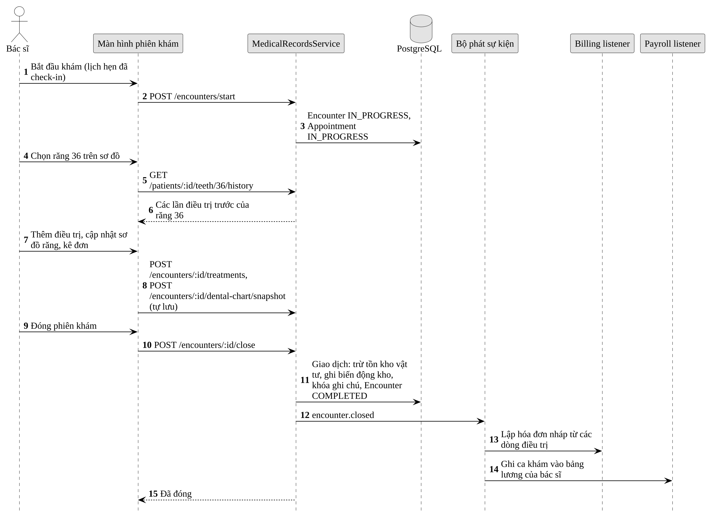{width=15cm}
:::

::: {custom-style="hình"}
Hình 3.10. Biểu đồ tuần tự khám, ghi điều trị theo răng và đóng phiên khám
:::

::: {custom-style="nguồn"}
Nguồn: Tác giả
:::

Lịch sử điều trị theo răng được thiết kế thành một API riêng `GET /patients/:id/teeth/:fdi/history`: máy chủ lọc ngay trong cơ sở dữ liệu các điều trị có chứa số răng cần xem (toán tử chứa của JSONB) và chỉ lấy mục sơ đồ của răng đó, thay vì để trình duyệt tải toàn bộ các phiên khám rồi tự lọc. Hiệu quả của thiết kế này được đo ở Chương 5.

Phiên khám có ba trạng thái: đang khám, đã đóng và đã hủy (chỉ hủy được phiên mở nhầm, chưa có điều trị và đơn thuốc). Phiên đã đóng bị khóa, chỉ thêm được ghi bổ sung; muốn mở lại phải có quyền riêng, ghi lý do và hóa đơn của phiên chưa được phát hành.

Hình 3.11 trình bày chi tiết luồng xem lịch sử và thêm điều trị cho một răng. Lớp phân quyền thứ hai nằm ở service: bác sĩ chỉ có quyền xem hồ sơ của mình sẽ nhận lỗi "không tìm thấy bệnh nhân" nếu không có quan hệ khám chữa với bệnh nhân đó. Mỗi lần xem lịch sử răng đều được ghi nhật ký kiểm toán.

::: {custom-style="Ảnh"}
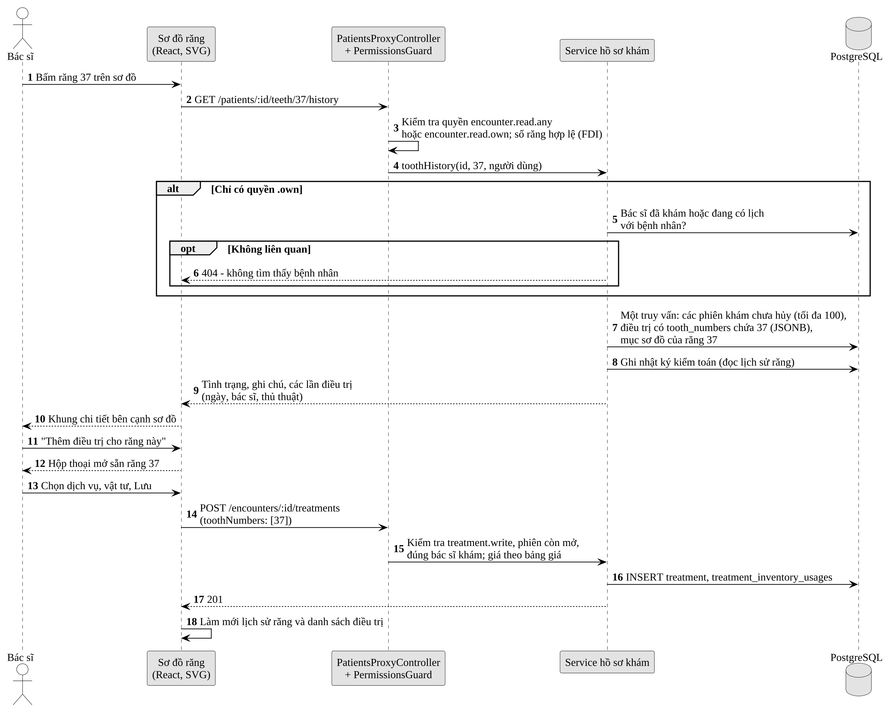{width=15cm}
:::

::: {custom-style="hình"}
Hình 3.11. Biểu đồ tuần tự xem lịch sử và thêm điều trị cho một răng
:::

::: {custom-style="nguồn"}
Nguồn: Tác giả
:::

Đóng phiên khám là thao tác có nhiều hệ quả nhất của bác sĩ. Trước khi ghi bất cứ thứ gì, hệ thống yêu cầu phiên khám đã có lý do khám hoặc chẩn đoán, và sàng lọc lại đơn thuốc với danh sách dị ứng hiện tại: một dị ứng vừa được bổ sung sau khi kê đơn vẫn bị phát hiện, bác sĩ phải sửa đơn hoặc ghi lý do vượt cảnh báo (lý do này được lưu vào nhật ký kiểm toán). Việc trừ kho nằm trong cùng giao dịch với việc đóng phiên khám, bằng câu lệnh cập nhật có điều kiện "tồn kho đủ", nên chỉ cần một vật tư không đủ là toàn bộ thay đổi được hoàn tác và phiên khám vẫn mở. Cùng giao dịch đó cũng tạo các lần nhắc tái khám cho những dịch vụ có chu kỳ. Sau khi giao dịch thành công, sự kiện `encounter.closed` được phát cho ba module độc lập: hóa đơn, lương và AI.

### 3.3.4. Kế hoạch điều trị

Kế hoạch điều trị gồm nhiều dòng, mỗi dòng là một thủ thuật kèm số răng, số lượng và đơn giá. Khi bệnh nhân đồng ý, giá trong kế hoạch trở thành giá đã chốt: lúc bác sĩ chọn dòng kế hoạch trong phiên khám, giá được lấy theo kế hoạch thay vì bảng giá hiện hành. Trạng thái kế hoạch được tính từ tiến độ các dòng; nếu bác sĩ sửa các bước của một báo giá đã gửi, kế hoạch quay về nháp để báo giá cũ không bị hiểu là đã chốt. Các kế hoạch đã đồng ý mà bệnh nhân chưa đặt lịch được đưa vào danh sách "điều trị chờ đặt lịch" để lễ tân gọi mời.

### 3.3.5. Hóa đơn và thanh toán qua VietQR

Hóa đơn đi qua các trạng thái ở Hình 3.12. Khoản thanh toán có thể đến từ ba nguồn: lễ tân ghi tiền mặt, lễ tân ghi chuyển khoản, hoặc hệ thống tự ghi khi ngân hàng báo tiền về. Trạng thái không được đặt tay mà luôn tính lại từ số đã thu, đã hoàn và đã điều chỉnh so với tổng tiền; vì vậy khi một phiếu thu ghi nhầm bị hủy, hóa đơn tự lùi về "thu một phần" hoặc "đã phát hành". Hóa đơn chỉ hủy được khi không còn khoản thu nào hiệu lực, để tiền không thể "biến mất" khỏi sổ sách; hóa đơn đã hủy có thể được lập lại thành bản nháp mới từ cùng phiên khám.

::: {custom-style="Ảnh"}
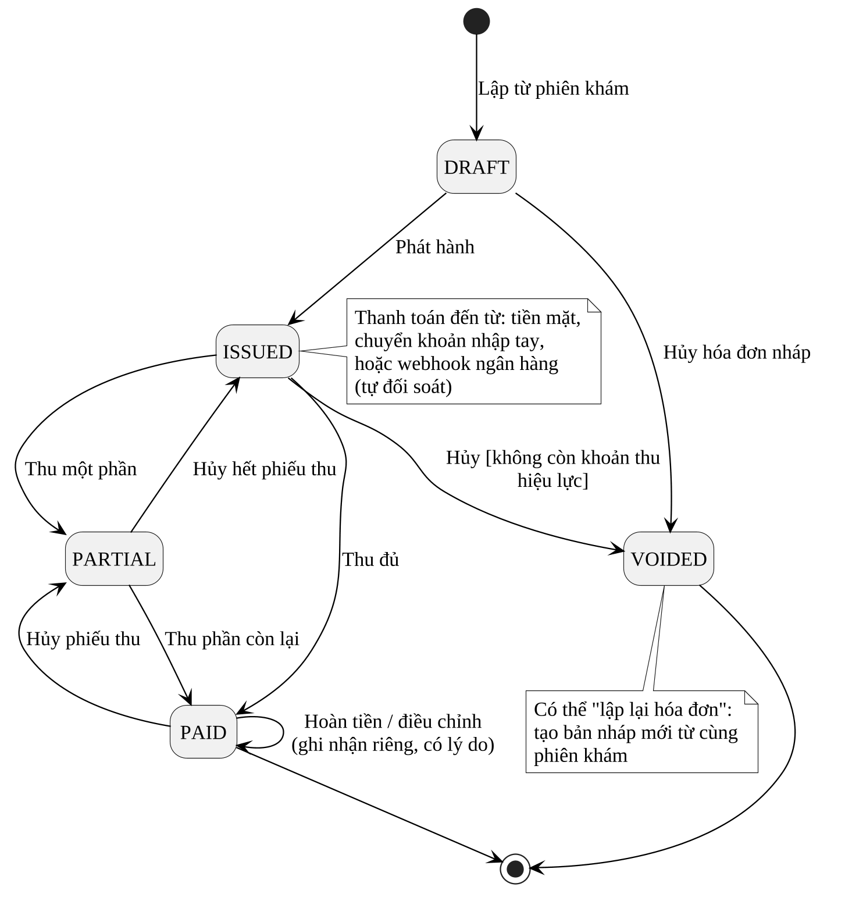{width=12cm}
:::

::: {custom-style="hình"}
Hình 3.12. Biểu đồ trạng thái của hóa đơn
:::

::: {custom-style="nguồn"}
Nguồn: Tác giả
:::

Bảng 3.4 đặc tả cách hệ thống tự ghi nhận khoản chuyển khoản; trình tự xử lý giữa khách, ngân hàng và hệ thống được thể hiện ở Hình 3.13.

::: {custom-style="bảng"}
Bảng 3.4. Đặc tả chức năng Tự đối soát chuyển khoản
:::

| Thuộc tính | Nội dung |
|---|---|
| Tên chức năng | Tự đối soát chuyển khoản qua webhook ngân hàng |
| Tác nhân | Ngân hàng (qua SePay); lễ tân xử lý các trường hợp cần xem xét |
| Tiền điều kiện | Hóa đơn đã phát hành, có mã VietQR với nội dung là mã hóa đơn; khóa webhook đã cấu hình |
| Luồng chính | 1) Khách quét mã, chuyển khoản. 2) SePay gọi webhook kèm khóa xác thực. 3) Hệ thống so khóa theo thời gian hằng, lưu giao dịch (duy nhất theo mã giao dịch). 4) Tách mã hóa đơn từ nội dung chuyển khoản (chấp nhận các biến thể như "inv 2026 123"). 5) Nếu hóa đơn còn nợ và số tiền không vượt số nợ, ghi thanh toán với khóa chống trùng theo giao dịch. 6) Trang hóa đơn tự cập nhật trạng thái. |
| Luồng thay thế, ngoại lệ | Không có mã hóa đơn, không tìm thấy hóa đơn, hóa đơn không còn nợ, số tiền vượt nợ: đánh dấu "cần xem xét" kèm lý do để lễ tân xử lý tay. Ngân hàng gửi lại cùng giao dịch: không ghi thêm. Sai khóa: từ chối. |
| Hậu điều kiện | Thanh toán được ghi đúng một lần; hóa đơn chuyển PARTIAL hoặc PAID; giao dịch được lưu vết |

::: {custom-style="nguồn"}
Nguồn: Tác giả
:::

::: {custom-style="Ảnh"}
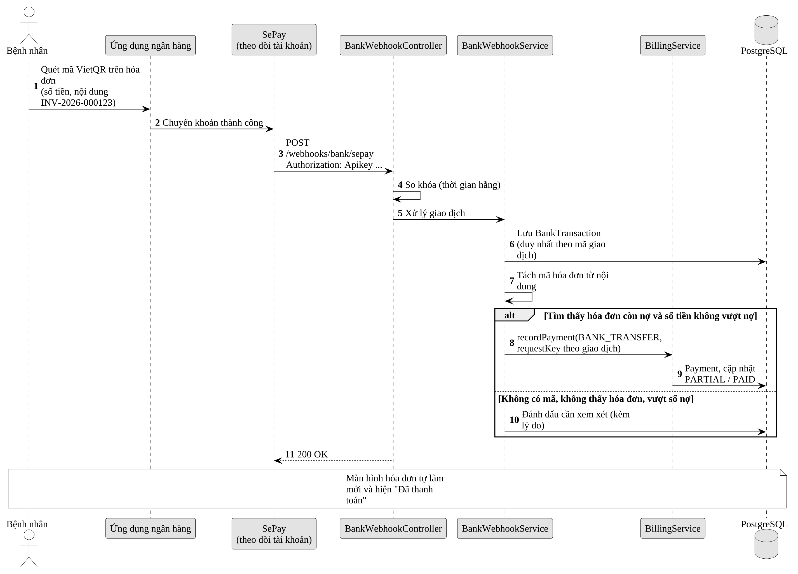{width=15cm}
:::

::: {custom-style="hình"}
Hình 3.13. Biểu đồ tuần tự thanh toán VietQR và tự đối soát
:::

::: {custom-style="nguồn"}
Nguồn: Tác giả
:::

Khi ngân hàng báo một giao dịch, nguyên tắc là chỉ tự ghi khi chắc chắn: có mã hóa đơn, hóa đơn tồn tại, đang còn nợ, số tiền không vượt quá số nợ và đã cấu hình tài khoản hệ thống đứng tên ghi nhận; mọi trường hợp khác, kể cả khi bước ghi thanh toán bị lỗi, đều được lưu lại với lý do cụ thể để lễ tân xử lý, không đoán bừa.

### 3.3.6. Nhắc lịch và nhắc tái khám

Hai tác vụ định kỳ độc lập, một cho email (đầu mỗi giờ) và một cho SMS (phút 20 mỗi giờ), cùng quét các lịch hẹn trong vòng 24 giờ tới (chậm nhất 30 phút trước giờ hẹn) chưa được nhắc. Email kèm liên kết xác nhận, dời, hủy lịch; nếu bật SMS, khách nhận thêm một tin nhắn nhắc ngắn qua điện thoại. Tách hai tác vụ giúp một kênh lỗi (ví dụ máy chủ email không phản hồi) không làm khách mất tin nhắn ở kênh kia. Mỗi tin SMS có khóa chống trùng và mỗi lịch hẹn lưu thời điểm đã gửi email, nên khi tác vụ chạy lại hoặc chạy trên nhiều máy, khách không nhận hai tin. Tin SMS lỗi được thử lại tối đa ba lần. Nhắc tái khám qua SMS hoạt động tương tự nhưng chạy mỗi ngày một lần lúc 9 giờ 15, dựa trên ngày đến hạn tính từ lần điều trị gần nhất.

Hình 3.14 mô tả một lần chạy của tác vụ nhắc lịch. Ngoài khung thời gian nêu trên, tác vụ không gửi tin trong giờ yên lặng từ 21 giờ đến 7 giờ và bỏ qua những lịch hẹn được đặt quá sát giờ (dưới 2 giờ), vì khách vừa đặt thì không cần nhắc.

::: {custom-style="Ảnh"}
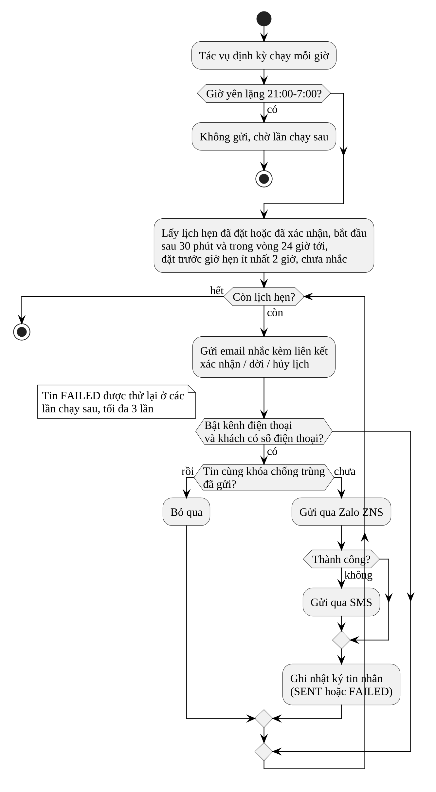{width=10cm}
:::

::: {custom-style="hình"}
Hình 3.14. Biểu đồ hoạt động gửi nhắc lịch tự động
:::

::: {custom-style="nguồn"}
Nguồn: Tác giả
:::

Nhắc tái khám là một đối tượng riêng. Lần nhắc được tạo tự động khi đóng phiên khám có dịch vụ được cấu hình chu kỳ nhắc; lễ tân gọi cho khách đến hạn và ghi lại kết quả từng lần gọi. Khi khách quay lại khám cùng dịch vụ, lần nhắc tự đóng, kể cả khi khách tự đến mà không qua cuộc gọi nào.

### 3.3.7. Bệnh nhân tra cứu lịch sử khám

Chức năng này hướng tới mục tiêu "tra cứu lịch sử khám dễ dàng" mà không yêu cầu bệnh nhân tạo tài khoản. Thách thức là bảo vệ dữ liệu sức khỏe: biết số điện thoại của một người không được phép đủ để xem hồ sơ của họ. Thiết kế (Hình 3.15) giải quyết bằng ba nguyên tắc:

- Đường dẫn chứa mã ngẫu nhiên 256 bit, hết hạn sau 7 ngày; cơ sở dữ liệu chỉ lưu SHA-256 của mã, nên kể cả khi lộ dữ liệu cũng không dựng lại được đường dẫn.
- Khi bệnh nhân tự xin đường dẫn bằng số điện thoại, đường dẫn chỉ được gửi tới email và số điện thoại đã có trong hồ sơ, không hiện trên màn hình; màn hình luôn trả một câu giống nhau để không dò được ai là bệnh nhân. Số điện thoại phải là của chính bệnh nhân; số người giám hộ chỉ được chấp nhận với trẻ em chưa có số riêng.
- Dữ liệu trả về chỉ gồm những gì bệnh nhân đã được biết (lần khám, điều trị, đơn thuốc, kế hoạch, lịch hẹn, hóa đơn), không có ghi chú nội bộ, mã bản ghi hay thông tin liên lạc; mỗi lần cấp và mở đường dẫn đều ghi nhật ký kiểm toán.

::: {custom-style="Ảnh"}
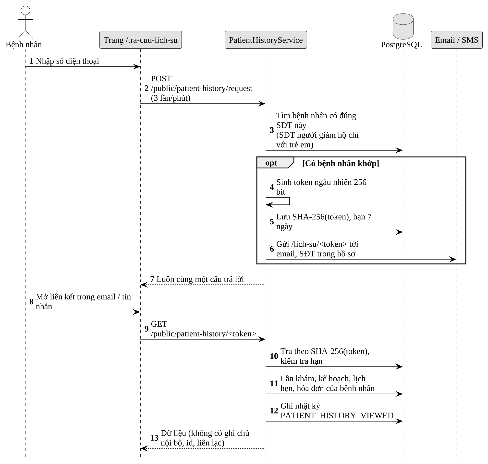{width=15cm}
:::

::: {custom-style="hình"}
Hình 3.15. Biểu đồ tuần tự bệnh nhân tra cứu lịch sử khám
:::

::: {custom-style="nguồn"}
Nguồn: Tác giả
:::

### 3.3.8. Nhân sự, ca làm việc và tính lương

Bác sĩ đăng ký ca theo tuần, quản trị viên duyệt; hệ thống cảnh báo khung giờ có lịch hẹn nhưng thiếu bác sĩ. Lương bác sĩ theo mô hình kết hợp: lương nền cộng hoa hồng theo phần trăm doanh thu điều trị, chỉ tính trên các hóa đơn đã phát hành trong kỳ (trừ phần đã hoàn tiền); giờ làm và số ca khám được ghi lên phiếu lương. Kỳ lương đi qua các trạng thái nháp, đang rà soát, đã duyệt, đã trả, đã khóa; sau khi khóa không sửa được, mọi điều chỉnh tạo bản ghi riêng có lý do.

Khi duyệt, hệ thống tính lại lương theo dữ liệu mới nhất (ca làm, nghỉ phép, mức lương có thể vừa thay đổi); nếu kết quả khác với số người duyệt đang xem thì kỳ lương không được duyệt mà báo thay đổi để xem lại. Mỗi bước chuyển trạng thái dùng câu lệnh cập nhật có điều kiện theo trạng thái hiện tại, nên hai quản trị viên thao tác cùng lúc không ghi đè lên nhau.

Lịch làm việc của bác sĩ được xây dựng từ các đăng ký ca. Mọi điều kiện được kiểm tra hai lần, khi đăng ký và khi duyệt, vì giữa hai thời điểm có thể đã phát sinh ca khác hoặc ngày nghỉ. Ca đã duyệt chỉ hủy được khi chưa có lịch hẹn nào, để không bỏ rơi khách đã đặt.

### 3.3.9. Kho vật tư

Mỗi vật tư có số tồn, đơn vị, giá vốn và mức tồn tối thiểu. Mọi thay đổi tồn kho (nhập từ nhà cung cấp, xuất thủ công, trừ theo điều trị khi đóng phiên khám, kiểm kê) tạo một bản ghi biến động kho có số lượng trước, sau và người thực hiện. Việc trừ kho dùng câu lệnh cập nhật có điều kiện "tồn kho đủ" trong cùng giao dịch đóng phiên khám, nên không bao giờ âm kho. Vật tư dưới mức tối thiểu được cảnh báo, kèm gợi ý số lượng nhập dựa trên mức tiêu thụ gần đây.

### 3.3.10. Báo cáo và chỉ số vận hành

Bảng điều khiển cho quản lý hiển thị các con số tổng (lịch hẹn, doanh thu, thực thu, công nợ) và sáu chỉ số vận hành so với mục tiêu do phòng khám tự đặt (Bảng 3.5). Mỗi chỉ số được tính bằng một hàm thuần không phụ thuộc cơ sở dữ liệu, có kiểm thử riêng, rồi được service gọi với dữ liệu của kỳ đã chọn.

::: {custom-style="bảng"}
Bảng 3.5. Các chỉ số vận hành trên bảng điều khiển
:::

| Chỉ số | Cách tính | Mục tiêu mặc định | Ngưỡng chấp nhận |
|---|---|---|---|
| Tỷ lệ vắng mặt | Lịch vắng mặt ÷ lịch đã đến hạn (không tính lịch phòng khám tự hủy) | ≤ 5% | ≤ 10% |
| Tỷ lệ đặt lịch tiếp | Lượt khám xong mà bệnh nhân có lịch hẹn sau đó ÷ lượt khám xong | ≥ 85% | ≥ 70% |
| Tỷ lệ chấp nhận kế hoạch | Kế hoạch được đồng ý ÷ kế hoạch đã báo giá trong kỳ | ≥ 75% | ≥ 60% |
| Thời gian chờ trung vị | Trung vị khoảng từ giờ hẹn (hoặc giờ check-in nếu đến muộn) đến lúc bắt đầu khám | ≤ 15 phút | ≤ 30 phút |
| Tỷ lệ hủy sát giờ | Lịch khách hủy trước giờ hẹn dưới 24 giờ ÷ tổng lịch | ≤ 5% | ≤ 10% |
| Tỷ lệ thu | Đã thu ÷ doanh thu điều trị của kỳ | ≥ 95% | ≥ 85% |

::: {custom-style="nguồn"}
Nguồn: Tác giả
:::

Mỗi chỉ số được tô ba mức: đạt mục tiêu, trong ngưỡng chấp nhận, hoặc dưới ngưỡng cần chú ý; quản trị viên chỉnh được cả hai mức trong phần cài đặt mà không phải sửa mã.

Ngoài ra, báo cáo gồm doanh thu theo kỳ, theo bác sĩ, theo dịch vụ; tuổi nợ; bản đồ nhiệt công suất ghế theo giờ trong tuần; và phễu hành trình bệnh nhân từ đặt lịch tới thanh toán đủ và đặt lịch tiếp.

Dữ liệu thô của kỳ hiện tại và kỳ trước được lấy từ cơ sở dữ liệu theo ngày giờ Việt Nam, sau đó các hàm tính thuần chuyển thành chỉ số. Tách phần tính toán khỏi phần truy vấn giúp mỗi công thức được kiểm thử độc lập với dữ liệu giả định, không cần cơ sở dữ liệu.

### 3.3.11. Trợ lý AI

Trợ lý AI dạng chat cho nhân viên được thiết kế theo vòng lặp gọi công cụ [@react_agent]: mô hình nhận câu hỏi và danh sách công cụ được phép (chỉ những công cụ người dùng có quyền), mỗi lượt trả về một JSON hoặc là yêu cầu gọi công cụ, hoặc là câu trả lời; tối đa bốn lần gọi công cụ cho một câu hỏi (Hình 3.16). Có hai nhóm công cụ: nhóm tra cứu (tìm bệnh nhân, giờ trống, điều trị chờ đặt lịch, hóa đơn chưa trả, lịch hẹn theo ngày, ca làm việc, hàng chờ, số liệu tổng) và nhóm đề xuất (đặt, hủy, dời lịch). Nhóm đề xuất chỉ tạo thẻ xác nhận; hành động chỉ được thực hiện khi người dùng bấm xác nhận, qua đúng service và quyền như thao tác tay, và được ghi nhật ký riêng.

::: {custom-style="Ảnh"}
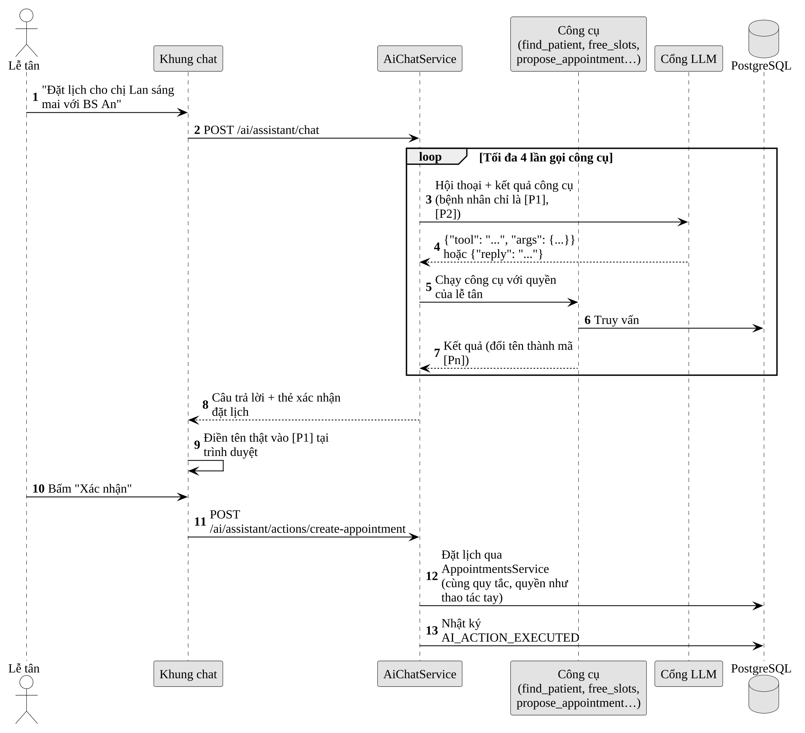{width=15cm}
:::

::: {custom-style="hình"}
Hình 3.16. Biểu đồ tuần tự trợ lý AI đề xuất đặt lịch
:::

::: {custom-style="nguồn"}
Nguồn: Tác giả
:::

Các biện pháp an toàn được tổng hợp trong Bảng 3.6, đối chiếu với các rủi ro của ứng dụng dùng mô hình ngôn ngữ lớn [@owaspllm].

::: {custom-style="bảng"}
Bảng 3.6. Rủi ro khi dùng mô hình ngôn ngữ lớn và biện pháp trong hệ thống
:::

| Rủi ro | Biện pháp |
|---|---|
| Lộ dữ liệu cá nhân cho dịch vụ ngoài | Kết quả công cụ thay bệnh nhân bằng mã `[P1]`, `[P2]`; tên được trình duyệt điền lại; không gửi số điện thoại |
| Mô hình bịa số liệu | Lời nhắc hệ thống yêu cầu chỉ dùng số liệu từ công cụ; câu trả lời hiển thị kèm công cụ đã dùng |
| Chèn lệnh qua dữ liệu (prompt injection) | Dữ liệu công cụ được đánh dấu là dữ liệu, không phải chỉ dẫn; mô hình không có quyền ghi trực tiếp |
| Hành động ngoài ý muốn | Mọi thay đổi chỉ là đề xuất, người dùng xác nhận; công cụ chạy với quyền của người hỏi |
| Phụ thuộc dịch vụ AI | Khi AI lỗi hoặc chưa cấu hình: trợ lý chuyển sang chế độ tra cứu theo từ khóa, các chức năng soạn nháp dùng mẫu soạn sẵn |
| Lạm dụng, chi phí | Giới hạn 20 lượt/phút mỗi người, giới hạn độ dài hội thoại và thời gian xử lý |

::: {custom-style="nguồn"}
Nguồn: Tác giả
:::

### 3.3.12. Hồ sơ bệnh nhân và các module hỗ trợ

Trùng hồ sơ là lỗi thường gặp nhất ở quầy lễ tân: cùng một người được tạo hai lần với cách viết tên khác nhau. Hệ thống gợi ý các hồ sơ có thể trùng ngay lúc tạo và cho phép quản trị viên gộp khi phát hiện muộn; việc gộp chỉ được phép khi hai hồ sơ cùng họ tên (bỏ qua dấu và chữ hoa) và cùng ngày sinh, trong một giao dịch khóa cả hai hồ sơ.

Sổ đồng thuận lưu nguyên văn và phiên bản văn bản mà bệnh nhân đã đồng ý, nên khi văn bản thay đổi về sau vẫn biết chính xác bệnh nhân đã đồng ý với điều gì [@nd13]. Phiếu chi phí vận hành đi qua quy trình duyệt, người tạo phiếu không tự duyệt được phiếu của mình. Thông báo trong ứng dụng chỉ gửi tới người có quyền xử lý và có khóa chống trùng; ảnh tải lên trang chủ được kiểm tra cả dung lượng lẫn chữ ký nhị phân ở đầu tệp.

## 3.4. Thiết kế bảo mật

### 3.4.1. Xác thực

Luồng xác thực theo Hình 3.17: mã truy cập JWT ngắn hạn gửi kèm mỗi yêu cầu, mã làm mới dài hạn nằm trong cookie HttpOnly, được thay mới sau mỗi lần dùng và lưu dạng băm trong cơ sở dữ liệu để thu hồi được. Nếu một mã làm mới đã dùng rồi lại được gửi lên (dấu hiệu bị đánh cắp), hệ thống thu hồi toàn bộ phiên đăng nhập của tài khoản đó và ghi sự kiện REFRESH_REUSE_DETECTED vào nhật ký kiểm toán. Để chống dò mật khẩu, mỗi địa chỉ chỉ được thử đăng nhập 5 lần mỗi phút, và tài khoản bị khóa 15 phút khi nhập sai mật khẩu quá 5 lần liên tiếp.

::: {custom-style="Ảnh"}
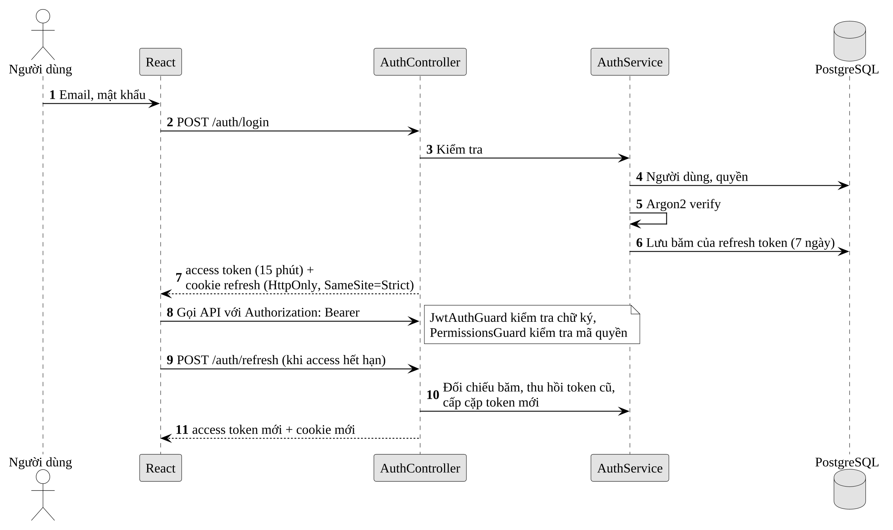{width=14cm}
:::

::: {custom-style="hình"}
Hình 3.17. Biểu đồ tuần tự xác thực và làm mới token
:::

::: {custom-style="nguồn"}
Nguồn: Tác giả
:::

### 3.4.2. Phân quyền hai lớp

Mỗi điểm cuối API khai báo các mã quyền cần có; `PermissionsGuard` so với danh sách quyền trong token trước khi vào controller. Lớp thứ hai nằm trong service: với người dùng chỉ có quyền "riêng" (ví dụ `encounter.read.own`), truy vấn được thêm điều kiện theo quan hệ bác sĩ – bệnh nhân (bác sĩ đã khám hoặc đang có lịch với bệnh nhân). Khi không thỏa, hệ thống trả lỗi "không tìm thấy" thay vì "không có quyền" để không tiết lộ sự tồn tại của bản ghi.

Phân quyền chỉ an toàn khi chính việc phân quyền cũng được kiểm soát. Hình 3.18 trình bày cơ chế chống leo thang quyền: người thực hiện chỉ cấp được những quyền mình đang giữ, và không sửa được vai trò của người có nhiều quyền hơn mình. Nhờ vậy, một tài khoản được giao quyền quản lý người dùng cũng không thể tự nâng mình lên quyền cao hơn.

::: {custom-style="Ảnh"}
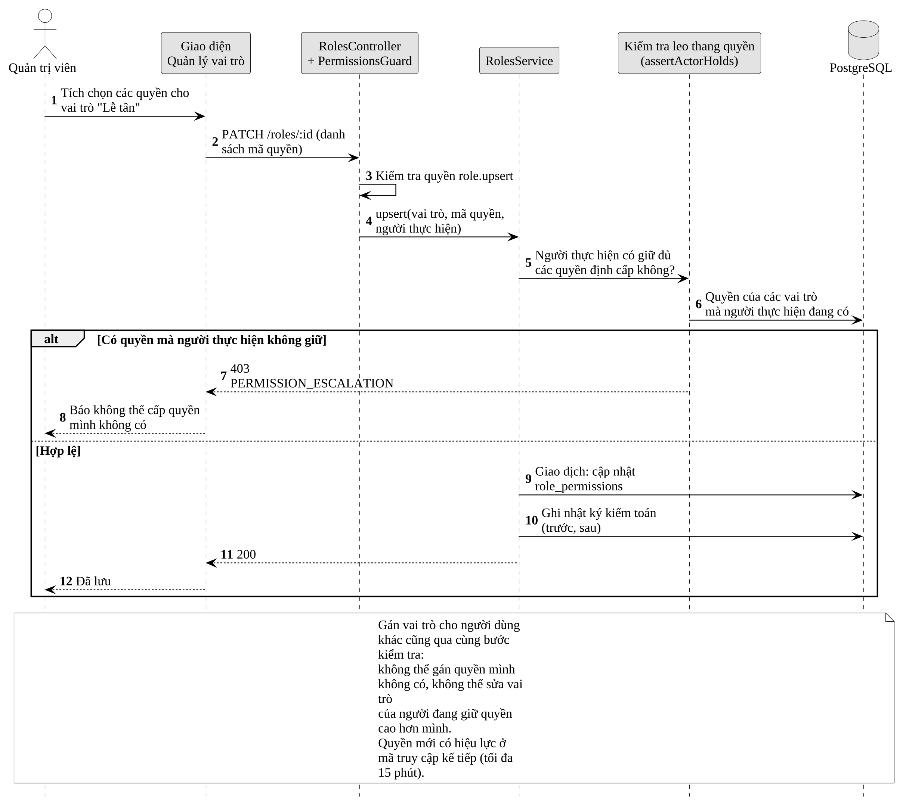{width=15cm}
:::

::: {custom-style="hình"}
Hình 3.18. Biểu đồ tuần tự cập nhật quyền của vai trò, có kiểm tra leo thang quyền
:::

::: {custom-style="nguồn"}
Nguồn: Tác giả
:::

### 3.4.3. Đối chiếu với các rủi ro OWASP Top 10

Bảng 3.7 đối chiếu thiết kế của hệ thống với các rủi ro trong danh sách OWASP Top 10 [@owasp]: với mỗi rủi ro, nêu biện pháp cụ thể đã áp dụng. Các biện pháp này được kiểm chứng bằng các ca kiểm thử bảo mật ở Chương 5.

::: {custom-style="bảng"}
Bảng 3.7. Biện pháp phòng chống các rủi ro bảo mật phổ biến
:::

| Rủi ro [@owasp] | Biện pháp trong hệ thống |
|---|---|
| A01 Kiểm soát truy cập sai | Guard kiểm quyền ở mọi API nội bộ; giới hạn theo dòng dữ liệu; trả 404 cho bản ghi không được thấy; kiểm thử phân quyền tự động |
| A02 Lỗi mật mã | Mật khẩu Argon2; token liên kết công khai và refresh token chỉ lưu băm; HTTPS |
| A03 Chèn mã | Prisma tham số hóa truy vấn; DTO kiểm tra kiểu, độ dài, định dạng; React tự thoát ký tự khi hiển thị; email thoát HTML |
| A04 Thiết kế không an toàn | Hành động AI cần xác nhận; liên kết công khai chỉ đọc, hết hạn; tra cứu bằng SĐT không lộ kết quả |
| A05 Cấu hình sai | Khóa bí mật chỉ nằm trong biến môi trường của máy chủ, không nằm trong mã nguồn; tiêu đề `Cache-Control: no-store`, `Referrer-Policy: no-referrer` cho trang công khai |
| A07 Lỗi xác thực | Token ngắn hạn, refresh xoay vòng, cookie HttpOnly SameSite=Strict, giới hạn 5 lần đăng nhập mỗi phút |
| A09 Thiếu ghi nhận, giám sát | Nhật ký kiểm toán cho thao tác nhạy cảm; nhật ký tin nhắn; kiểm tra sức khỏe và phiên bản sau triển khai |

::: {custom-style="nguồn"}
Nguồn: Tác giả
:::

### 3.4.4. Nhật ký kiểm toán

Nhật ký kiểm toán được ghi trong cùng giao dịch với thay đổi mà nó ghi lại: thay đổi và dòng nhật ký cùng thành công hoặc cùng bị hủy, nên không có thay đổi nào thiếu dấu vết. Mỗi dòng lưu người thực hiện, hành động, đối tượng, dữ liệu trước và sau, địa chỉ IP và trình duyệt. Quản trị viên xem và lọc nhật ký theo người, hành động, khoảng thời gian; ứng dụng không cung cấp API sửa hay xóa nhật ký.

## 3.5. Thiết kế giao diện

Giao diện nội bộ gồm thanh điều hướng bên trái được lọc theo quyền (người dùng chỉ thấy mục mình được dùng) và thanh trên cùng có ô tìm bệnh nhân nhanh, nút trợ lý AI, chuyển ngôn ngữ và thông báo. Lễ tân làm việc chủ yếu với tổng quan ngày, lịch hẹn, hàng chờ, bệnh nhân và hóa đơn; bác sĩ với hàng chờ của mình và màn hình phiên khám; quản trị viên với bảng điều khiển, báo cáo, nhân sự, lương và phân quyền. Bệnh nhân dùng các trang công khai: trang chủ, đặt lịch, xác nhận hoặc dời lịch và tra cứu lịch sử khám.

Sơ đồ răng ban đầu được thiết kế dạng lưới ô vuông 16 × 2, nhưng dạng này khó nhận biết vị trí răng vì không giống hình dạng hàm thật. Phiên bản cuối vẽ hai cung răng như nhìn từ mặt nhai (Hình 1.1): mỗi răng có hình dạng theo loại răng, tô màu theo tình trạng; trẻ em có thêm cung răng sữa phía trong. Sơ đồ được đặt chung với danh sách điều trị trên một tab, bấm một răng là thấy ngay lịch sử của răng đó.

Giao diện tuân theo các nguyên tắc khả dụng và khả năng tiếp cận: trạng thái hệ thống luôn hiển thị, ngăn lỗi từ đầu (chỉ hiện giờ trống, chặn số răng sai chuẩn FDI), cho phép hoàn tác, mọi điều khiển có nhãn cho trình đọc màn hình và dùng được bằng bàn phím, bố cục co giãn xuống điện thoại 390 px.

## 3.6. Kết luận chương

Chương 3 đã trình bày thiết kế của hệ thống theo kiến trúc container hóa với 23 module nghiệp vụ và 339 điểm cuối API. Cơ sở dữ liệu gồm 70 bảng, trong đó hồ sơ khám được lưu theo từng phiên và sơ đồ răng theo từng bản chụp để không ghi đè lịch sử.

Các chức năng chính được đặc tả kèm 13 biểu đồ tuần tự, hoạt động và trạng thái, tập trung vào những tình huống khó: nhiều người đặt lịch cùng lúc, đóng phiên khám khi thiếu vật tư, chuyển khoản không khớp hóa đơn và chống leo thang quyền. Phần bảo mật gồm xác thực, phân quyền hai lớp, nhật ký kiểm toán ghi trong cùng giao dịch và đối chiếu với OWASP Top 10.

Chương 4 trình bày việc hiện thực thiết kế này thành phần mềm hoàn chỉnh và triển khai thực tế.
