# CHƯƠNG 4. XÂY DỰNG VÀ TRIỂN KHAI HỆ THỐNG

Chương này trình bày quá trình hiện thực thiết kế ở Chương 3 thành phần mềm: môi trường phát triển, tổ chức mã nguồn, các điểm cài đặt quan trọng ở máy chủ và giao diện, kết quả giao diện của từng chức năng và cách hệ thống được triển khai, cập nhật. Các hình ảnh giao diện trong chương được chụp từ hệ thống chạy thật trên bộ dữ liệu mẫu 6 tháng (500 bệnh nhân, 4 bác sĩ, 2 lễ tân); tên người trong dữ liệu mẫu là giả lập.

## 4.1. Môi trường và công cụ phát triển

Bảng 4.1 tóm tắt ngôn ngữ, khung phát triển và công cụ được dùng cho từng phần của hệ thống.

::: {custom-style="bảng"}
Bảng 4.1. Môi trường và công cụ phát triển
:::

| Thành phần | Công cụ, phiên bản |
|---|---|
| Ngôn ngữ | TypeScript 5 (cả máy chủ và giao diện) |
| Máy chủ ứng dụng | Node.js (22 khi kiểm thử, 24 trong bản triển khai), NestJS 10, Prisma 5, class-validator, Zod, Passport JWT, Argon2 |
| Cơ sở dữ liệu | PostgreSQL 16 |
| Giao diện | React 18, Vite 5, TanStack Query 5, React Router 6, React Hook Form, Zod, Tailwind CSS 3, Recharts 3, i18next |
| Kiểm thử | Jest 29 (đơn vị và API), Playwright (đầu cuối) |
| Chất lượng mã | ESLint, Prettier, kiểm tra kiểu TypeScript |
| Triển khai | Docker, Docker Compose, Nginx, máy chủ ảo Linux |
| Quản lý mã nguồn, CI | Git, GitHub, GitHub Actions |
| Tài liệu API | OpenAPI (Swagger) sinh tự động |

::: {custom-style="nguồn"}
Nguồn: Tác giả
:::

## 4.2. Tổ chức mã nguồn

Mã nguồn được đặt trong một kho duy nhất gồm hai phần chính và các thư mục hỗ trợ (Bảng 4.2). Tổng cộng phần máy chủ có khoảng 51 nghìn dòng mã (không tính kiểm thử), phần giao diện khoảng 55 nghìn dòng.

::: {custom-style="bảng"}
Bảng 4.2. Cấu trúc thư mục chính của mã nguồn
:::

| Thư mục | Nội dung |
|---|---|
| `backend/src/<module>/` | Mỗi module nghiệp vụ: `*.controller.ts` (API), `*.service.ts` (quy tắc nghiệp vụ), `dto/` (kiểm tra dữ liệu vào), `domain/` (hàm thuần tính toán), `*.spec.ts` (kiểm thử) |
| `backend/src/common/` | Guard xác thực, phân quyền, giới hạn theo dòng; tiện ích ngày giờ theo múi giờ phòng khám; sự kiện miền; dịch vụ email |
| `backend/prisma/` | Lược đồ dữ liệu, 52 migration, dữ liệu khởi tạo và dữ liệu mẫu |
| `backend/test/` | Kiểm thử API chạy trên PostgreSQL thật |
| `frontend/src/features/<chức năng>/` | Trang và thành phần giao diện theo chức năng, kèm hook gọi API |
| `frontend/src/components/ui/` | Thư viện thành phần dùng chung (nút, ô nhập, bảng, hộp thoại, thông báo…) |
| `frontend/src/locales/` | Chữ giao diện tiếng Việt; `locales/en/` tiếng Anh |
| `frontend/e2e/` | Kịch bản kiểm thử đầu cuối Playwright |
| `docs/` | Đặc tả nghiệp vụ, thiết kế, tài liệu API, hướng dẫn triển khai, báo cáo |
| `scripts/` | Script triển khai, kiểm tra sau triển khai, dữ liệu mẫu |

::: {custom-style="nguồn"}
Nguồn: Tác giả
:::

## 4.3. Cài đặt phía máy chủ

Các đoạn mã trong mục này được trích từ mã nguồn của hệ thống và rút gọn để dễ đọc: lược bớt một số trường, phần xử lý lỗi và ghi nhật ký không liên quan, các chỗ lược được đánh dấu bằng chú thích; ghi chú tiếng Việt sau dấu `//` là của tác giả.

### 4.3.1. Khai báo API và phân quyền

Mỗi điểm cuối API khai báo rõ mã quyền cần có. Đoạn mã sau là API lịch sử một răng: `JwtAuthGuard` xác thực mã truy cập, `PermissionsGuard` kiểm tra người dùng có ít nhất một trong hai quyền đọc hồ sơ khám, `ParseIntPipe` bảo đảm số răng là số nguyên trước khi vào hàm xử lý.

```typescript
@UseGuards(JwtAuthGuard, PermissionsGuard)
@Controller('patients/:id')
export class PatientsProxyController {
  @Get('teeth/:fdi/history')
  @RequirePermissions('encounter.read.any', 'encounter.read.own')
  async toothHistory(
    @Param('id', ParseUUIDPipe) id: string,
    @Param('fdi', ParseIntPipe) fdi: number,
    @User() actor: JwtPayload,
  ) { /* kiểm tra FDI, phạm vi bác sĩ, truy vấn, ghi nhật ký */ }
}
```

Bên trong hàm, lớp phân quyền thứ hai kiểm tra phạm vi theo dòng: nếu người dùng không có quyền xem mọi hồ sơ, hệ thống chỉ trả kết quả khi bác sĩ đã khám hoặc đang có lịch với bệnh nhân, ngược lại trả lỗi "không tìm thấy bệnh nhân".

### 4.3.2. Chống đặt trùng lịch bằng khóa tư vấn

Kiểm tra "giờ này còn trống không" rồi mới ghi là hai bước tách rời; nếu hai lễ tân cùng đặt một khung giờ, cả hai có thể cùng thấy giờ còn trống. Hệ thống giải quyết bằng khóa tư vấn của PostgreSQL theo phạm vi giao dịch [@postgres]: trong giao dịch đặt lịch, việc đầu tiên là lấy khóa theo mã bác sĩ và mã bệnh nhân, sau đó mới kiểm tra trùng và ghi. Giao dịch thứ hai phải chờ giao dịch thứ nhất kết thúc, lúc đó lần kiểm tra của nó thấy lịch vừa được ghi và từ chối.

```typescript
const write = async (tx: Prisma.TransactionClient) => {
  await this.lockDentist(tx, dto.dentistId);   // pg_advisory_xact_lock(1, hash(dentistId))
  await this.lockPatient(tx, dto.patientId);   // pg_advisory_xact_lock(2, hash(patientId))
  // … kiểm tra giờ làm việc, ngày nghỉ, trùng lịch bác sĩ và bệnh nhân …
  return tx.appointment.create({ data: /* … */ });
};
```

Thời gian chờ khóa được giới hạn 5 giây; quá thời gian, người dùng nhận thông báo "Đang có thao tác khác trên lịch này, vui lòng thử lại" (mã 409, CALENDAR_BUSY) thay vì lỗi hệ thống. Các không gian khóa (bác sĩ, bệnh nhân, số điện thoại đặt lịch, lịch nghỉ toàn phòng khám, lương) được khai báo tập trung trong một tệp để không bao giờ trùng nhau.

### 4.3.3. Đóng phiên khám và sự kiện miền

Đóng phiên khám là một giao dịch: với mỗi vật tư của mỗi điều trị, hệ thống giảm tồn kho bằng câu lệnh cập nhật có điều kiện "tồn kho hiện tại không nhỏ hơn số lượng cần trừ"; nếu không cập nhật được dòng nào nghĩa là không đủ hàng, toàn bộ giao dịch bị hủy và bác sĩ nhận danh sách vật tư thiếu. Khi giao dịch thành công, sự kiện `encounter.closed` được phát; module hóa đơn tạo hóa đơn nháp từ các dòng điều trị, module lương ghi ca khám, module AI xóa bản tóm tắt hồ sơ cũ để tạo lại khi cần. Các bộ lắng nghe được viết để không ném lỗi ra ngoài, nên một lỗi ở phần phụ không làm hỏng việc đóng phiên khám.

### 4.3.4. Truy vấn lịch sử theo răng

Số răng của mỗi điều trị được lưu dạng mảng JSONB. Prisma cho phép lọc trực tiếp bằng toán tử chứa của PostgreSQL, nên chỉ các dòng điều trị có răng cần xem được trả về:

```typescript
const rows = await this.prisma.encounter.findMany({
  where: { patientId: id, status: { not: 'CANCELLED' } },
  orderBy: { startedAt: 'desc' },
  take: 100,
  select: {
    id: true, startedAt: true, closedAt: true,
    dentist: { select: { fullName: true } },
    dentalChart: { select: { teeth: true } },
    treatments: {
      where: { deletedAt: null, toothNumbers: { array_contains: [fdi] } },
      select: { procedure: true, unitPrice: true, quantity: true, createdAt: true /* … */ },
    },
  },
});
```

Một truy vấn duy nhất thay cho cách cũ là tải danh sách phiên khám rồi gọi chi tiết từng phiên (tối đa 50 yêu cầu cho một bệnh nhân).

### 4.3.5. Webhook ngân hàng không ghi trùng

Ngân hàng có thể gửi lại cùng một giao dịch khi mạng chập chờn. Hệ thống chống ghi trùng ở hai tầng: bảng giao dịch ngân hàng có chỉ mục duy nhất theo (nhà cung cấp, mã giao dịch), và khoản thanh toán được ghi với khóa `request_key` tạo từ mã giao dịch, duy nhất theo hóa đơn. Khóa xác thực của webhook được so sánh theo thời gian hằng để không lộ thông tin qua thời gian phản hồi.

### 4.3.6. Xếp thứ tự hàng chờ bằng hàm thuần

Quy tắc xếp hàng chờ (Hình 3.10) được viết thành hàm thuần, không đọc cơ sở dữ liệu, nên kiểm thử được bằng bảng quyết định với đủ các tình huống: khách đến sớm, đúng giờ, trễ, vãng lai, cấp cứu, bị bỏ qua.

```typescript
export function dueAt(e: Orderable): number {
  switch (e.priority) {
    case QueuePriority.ON_TIME: return e.appointment.startAt.getTime();
    case QueuePriority.LATE:    return e.checkedInAt.getTime() + LATE_PENALTY_MIN * 60_000;
    case QueuePriority.WALK_IN: return e.checkedInAt.getTime() + WALK_IN_WAIT_CAP_MIN * 60_000;
    default:                    return e.checkedInAt.getTime();
  }
}

export function compareQueue(a: Orderable, b: Orderable): number {
  return (
    STATUS_RANK[a.status] - STATUS_RANK[b.status] ||          // đang gọi, đang chờ, bị bỏ qua
    Number(a.priority !== QueuePriority.EMERGENCY) -
      Number(b.priority !== QueuePriority.EMERGENCY) ||       // cấp cứu lên trước
    dueAt(a) - dueAt(b) ||                                    // theo giờ đến lượt
    a.checkedInAt.getTime() - b.checkedInAt.getTime()         // cùng lượt: ai đến trước
  );
}
```

### 4.3.7. Ẩn danh bệnh nhân khi làm việc với AI

Trợ lý AI không bao giờ nhận họ tên hay mã định danh thật của bệnh nhân. Mỗi khi một công cụ tra cứu trả về bệnh nhân, máy chủ cấp cho bệnh nhân đó một mã tạm `P1`, `P2`… chỉ có ý nghĩa trong cuộc hội thoại; mô hình chỉ thấy mã tạm, còn tên được trình duyệt điền vào câu trả lời sau khi nhận về. Khi mô hình đề xuất đặt lịch cho `P1`, máy chủ đổi ngược mã tạm thành mã bệnh nhân thật; mã không có trong bảng bị từ chối.

```typescript
/** Mã tạm P1, P2… thay cho bệnh nhân trong một cuộc hội thoại với AI. */
refFor(id: string, name: string): string {
  let ref = this.byId.get(id);
  if (!ref) {
    ref = `P${this.next++}`;      // cấp mã mới lần đầu gặp bệnh nhân
    this.byId.set(id, ref);
    this.ids.set(ref, id);
  }
  this.names.set(ref, name);      // tên chỉ gửi cho trình duyệt, không gửi cho mô hình
  return ref;
}

idOf(ref: string): string | undefined {
  return this.ids.get(ref.trim().replace(/^\[|\]$/g, ''));   // "[P1]" → mã thật
}
```

## 4.4. Cài đặt phía giao diện

- **Định tuyến và tải theo trang:** mỗi trang được tải lười (`React.lazy`), trình duyệt chỉ tải mã của trang đang mở. Các trang công khai (trang chủ, đặt lịch, tra cứu) và trang nội bộ dùng chung một ứng dụng, phân biệt bằng bộ bảo vệ tuyến đường theo quyền.
- **Dữ liệu từ máy chủ:** mọi lời gọi API đi qua TanStack Query [@tanstack] với khóa truy vấn theo tài nguyên; sau khi ghi (thêm điều trị, thu tiền…), các khóa liên quan được làm mới để mọi màn hình đồng bộ. Hàng chờ của bác sĩ tự làm mới mỗi 30 giây; hóa đơn đang chờ thanh toán tự làm mới mỗi 8 giây để hiện ngay khoản chuyển khoản vừa về.
- **Chữ giao diện hai ngôn ngữ:** toàn bộ chữ nằm trong tệp ngôn ngữ; một script kiểm tra mọi khóa đều có đủ bản tiếng Việt và tiếng Anh, khớp tham số. Bản tiếng Anh được tách thành gói riêng, chỉ tải khi người dùng chọn tiếng Anh, giúp gói mã chính giảm khoảng 30%.
- **Sơ đồ răng:** vẽ bằng SVG. Vị trí các răng được tính theo một đường cong dạng chữ U; mỗi răng chiếm độ dài cung tương ứng với độ rộng thân răng trung bình, hình dạng là một siêu elip có độ vuông và độ thu hẹp khác nhau theo loại răng. Mỗi răng là một phần tử có vai trò nút, dùng được bằng bàn phím và có nhãn cho trình đọc màn hình. Thay đổi tình trạng răng được lưu tự động sau 1,5 giây không thao tác và có hàng đợi hoàn tác.

## 4.5. Kết quả giao diện các chức năng

Các hình trong mục này được chụp từ hệ thống chạy với dữ liệu mẫu, đăng nhập bằng tài khoản của từng vai trò. Thanh menu bên trái chỉ hiện các mục mà vai trò đó có quyền (Hình 4.4); ở các hình còn lại, thanh menu được cắt bỏ để phần nội dung đủ rõ khi in.

### 4.5.1. Trang công khai và đặt lịch trực tuyến

Trang chủ (Hình 4.1) giới thiệu phòng khám, dịch vụ, bảng giá, đội ngũ bác sĩ; khách bấm vào một răng trên sơ đồ để xem các dịch vụ liên quan. Từ đây khách vào trang đặt lịch (Hình 4.2): chọn dịch vụ, bác sĩ, ngày, hệ thống hiện các khung giờ còn trống; khách nhập họ tên, số điện thoại và nhận mã tra cứu yêu cầu.

::: {custom-style="Ảnh"}
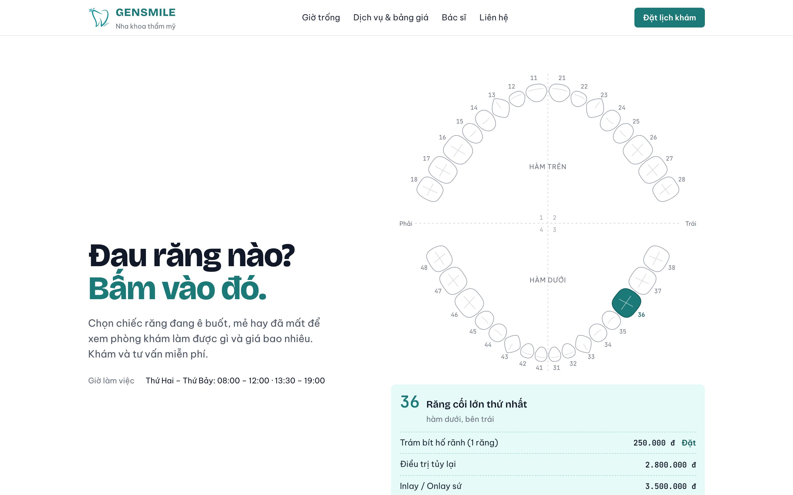{width=15cm}
:::

::: {custom-style="hình"}
Hình 4.1. Trang chủ phòng khám
:::

::: {custom-style="nguồn"}
Nguồn: Tác giả, chụp từ hệ thống GenSmile
:::

::: {custom-style="Ảnh"}
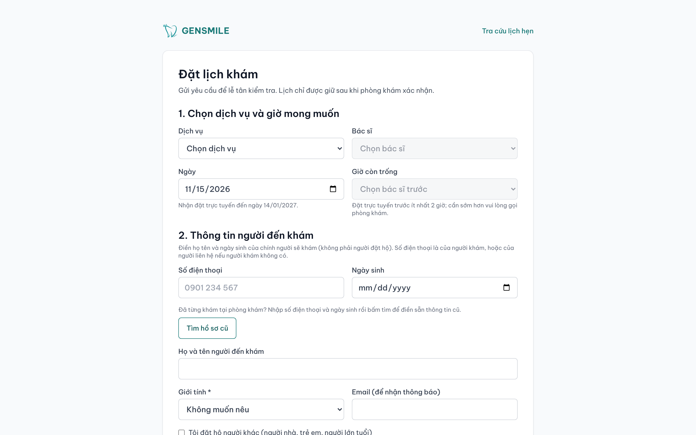{width=15cm}
:::

::: {custom-style="hình"}
Hình 4.2. Trang đặt lịch trực tuyến
:::

::: {custom-style="nguồn"}
Nguồn: Tác giả, chụp từ hệ thống GenSmile
:::

Khi lịch hẹn đã được xác nhận, bệnh nhân nhận một đường dẫn riêng qua email hoặc tin nhắn. Mở trên điện thoại (Hình 4.3), bệnh nhân thấy giờ hẹn, bác sĩ, dịch vụ, có thể điền phiếu khai trước khi đến, xác nhận lịch, xin dời sang ngày giờ khác hoặc hủy lịch mà không cần tài khoản.

::: {custom-style="Ảnh"}
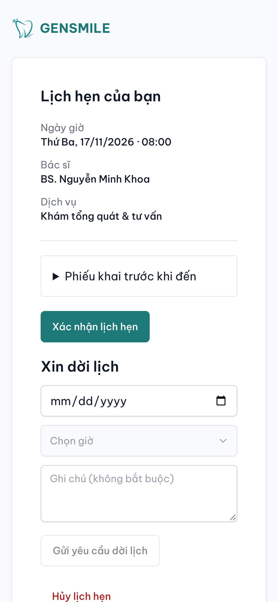{width=6cm}
:::

::: {custom-style="hình"}
Hình 4.3. Trang lịch hẹn của bệnh nhân mở từ đường dẫn riêng
:::

::: {custom-style="nguồn"}
Nguồn: Tác giả, chụp từ hệ thống GenSmile
:::

### 4.5.2. Lễ tân: tiếp nhận và điều phối trong ngày

Màn hình "Hôm nay" (Hình 4.4) tóm tắt số lịch, số khách chưa đến, đã đến, đang khám và danh sách lịch hẹn trong ngày theo giờ, mỗi lịch có nút check-in. Màn hình điều phối (Hình 4.5) hiển thị từng bác sĩ cùng khách đang khám và hàng chờ của bác sĩ đó; lễ tân có thể chuyển khách sang bác sĩ khác, ưu tiên cấp cứu hoặc ghi nhận khách về trước. Lịch hẹn (Hình 4.6) hiển thị theo ngày, tuần hoặc tháng; mỗi lịch có chấm màu theo bác sĩ và có thể lọc riêng từng bác sĩ, bấm vào khung giờ trống để tạo lịch mới.

::: {custom-style="Ảnh"}
{width=15cm}
:::

::: {custom-style="hình"}
Hình 4.4. Màn hình tổng quan trong ngày của lễ tân
:::

::: {custom-style="nguồn"}
Nguồn: Tác giả, chụp từ hệ thống GenSmile
:::

::: {custom-style="Ảnh"}
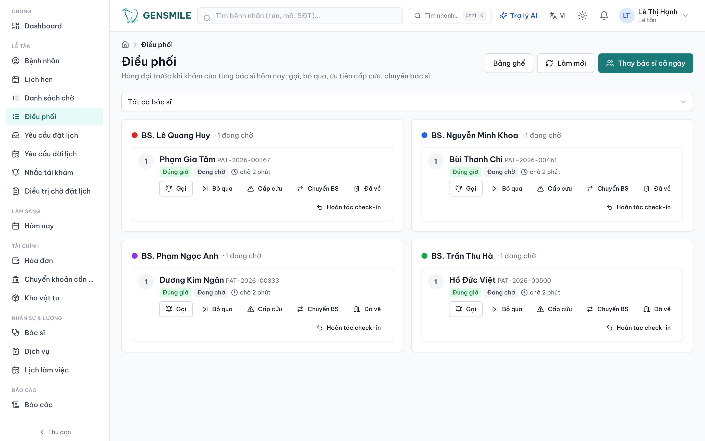{width=15cm}
:::

::: {custom-style="hình"}
Hình 4.5. Màn hình điều phối: khách đang khám và hàng chờ theo bác sĩ
:::

::: {custom-style="nguồn"}
Nguồn: Tác giả, chụp từ hệ thống GenSmile
:::

::: {custom-style="Ảnh"}
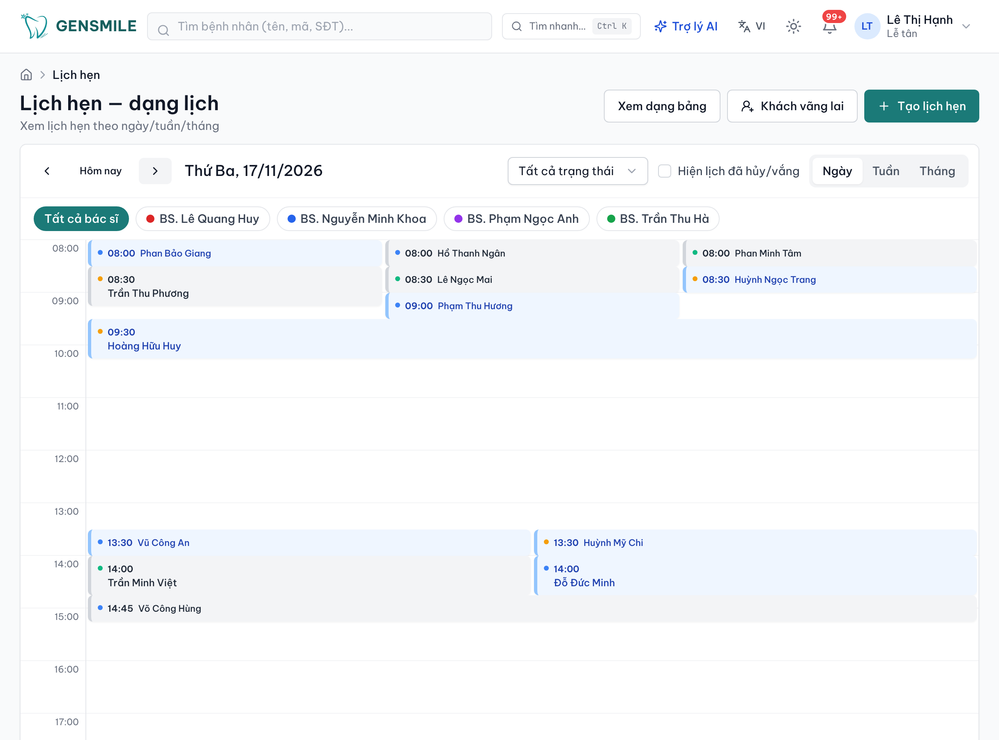{width=15cm}
:::

::: {custom-style="hình"}
Hình 4.6. Lịch hẹn theo ngày của các bác sĩ
:::

::: {custom-style="nguồn"}
Nguồn: Tác giả, chụp từ hệ thống GenSmile
:::

Yêu cầu khách gửi từ trang đặt lịch trực tuyến được gom ở màn hình "Yêu cầu đặt lịch" (Hình 4.7), kèm số đếm theo từng trạng thái xử lý; lễ tân mở từng yêu cầu để duyệt, đề xuất giờ khác hoặc ghi nhận đã gọi điện. Màn hình "Nhắc tái khám" (Hình 4.8) liệt kê khách đến hạn trong khoảng ngày chọn, kèm dịch vụ, lần khám trước, trạng thái email nhắc; lễ tân bấm "Ghi kết quả gọi", đặt lịch ngay, hoặc nhờ AI soạn tin nhắn cho khách.

::: {custom-style="Ảnh"}
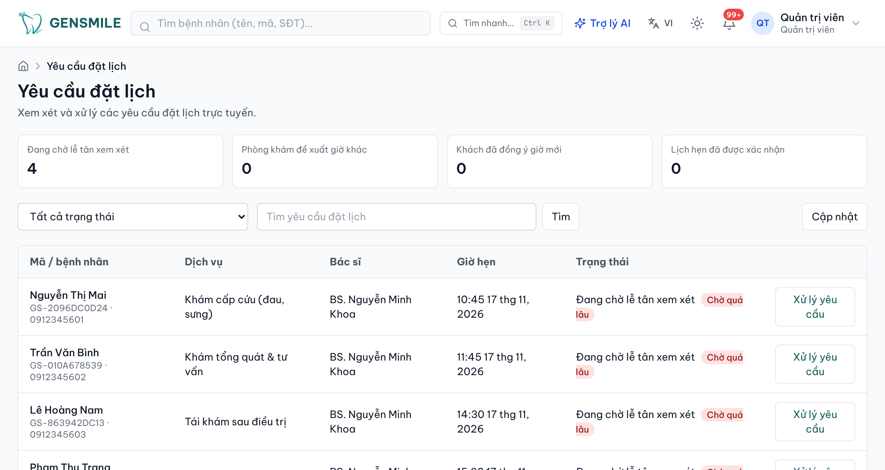{width=15cm}
:::

::: {custom-style="hình"}
Hình 4.7. Danh sách yêu cầu đặt lịch trực tuyến chờ lễ tân xử lý
:::

::: {custom-style="nguồn"}
Nguồn: Tác giả, chụp từ hệ thống GenSmile
:::

::: {custom-style="Ảnh"}
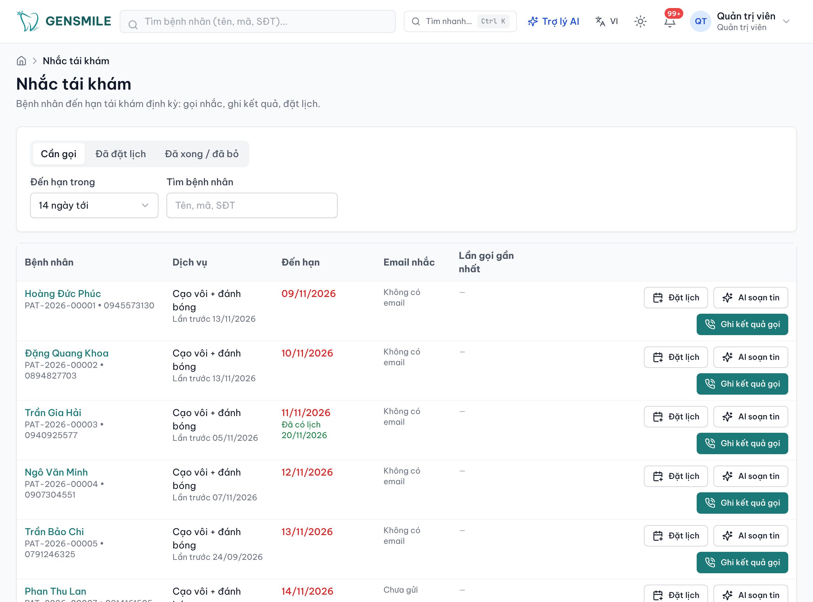{width=15cm}
:::

::: {custom-style="hình"}
Hình 4.8. Danh sách khách đến hạn nhắc tái khám
:::

::: {custom-style="nguồn"}
Nguồn: Tác giả, chụp từ hệ thống GenSmile
:::

Khách muốn được khám sớm hơn lịch hiện có được ghi vào danh sách chờ (Hình 4.9) với dịch vụ, bác sĩ mong muốn, khoảng ngày và buổi; khi có lịch bị hủy, lễ tân nhập khung giờ vừa trống vào phần "Gợi ý theo giờ trống" để hệ thống tìm người phù hợp, rồi đặt lịch hoặc nhờ AI soạn tin mời.

::: {custom-style="Ảnh"}
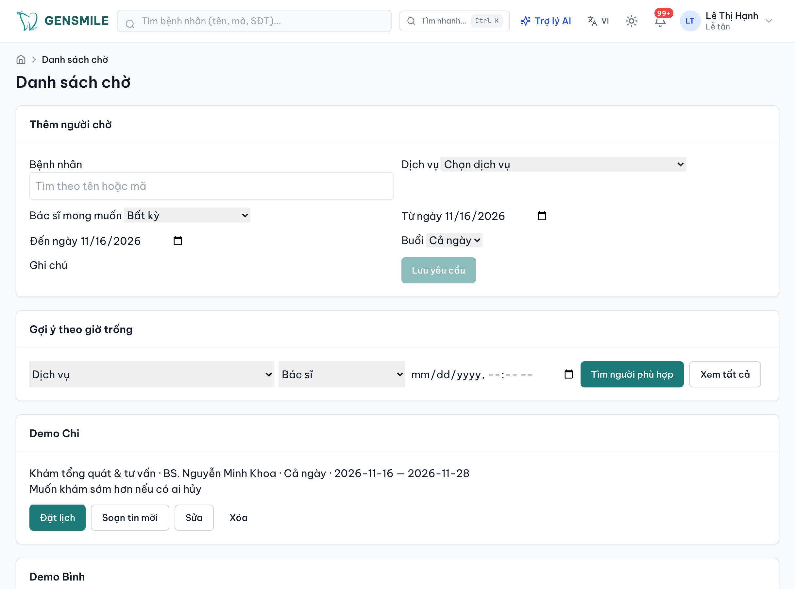{width=15cm}
:::

::: {custom-style="hình"}
Hình 4.9. Danh sách chờ lấp giờ trống
:::

::: {custom-style="nguồn"}
Nguồn: Tác giả, chụp từ hệ thống GenSmile
:::

Hồ sơ bệnh nhân (Hình 4.10) gom trên một trang thông tin cá nhân, tiền sử, dị ứng và các thẻ lịch hẹn, phiên khám, kế hoạch điều trị, hóa đơn, sổ đồng thuận điều trị.

::: {custom-style="Ảnh"}
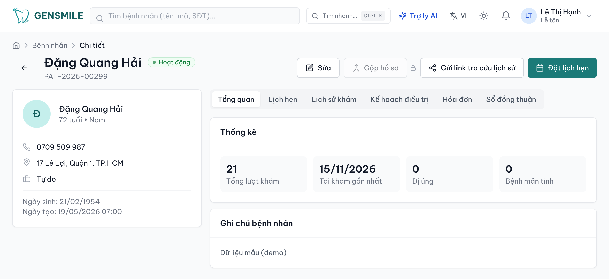{width=15cm}
:::

::: {custom-style="hình"}
Hình 4.10. Trang hồ sơ bệnh nhân
:::

::: {custom-style="nguồn"}
Nguồn: Tác giả, chụp từ hệ thống GenSmile
:::

Khi phát hiện hai hồ sơ là cùng một người, lễ tân dùng chức năng "Gộp hồ sơ" (Hình 4.11): chọn hồ sơ chính, nhập lý do; hộp thoại nhắc rõ điều kiện gộp (cùng họ tên, cùng ngày sinh, không có phiên khám đang mở) và việc gộp không hoàn tác được.

::: {custom-style="Ảnh"}
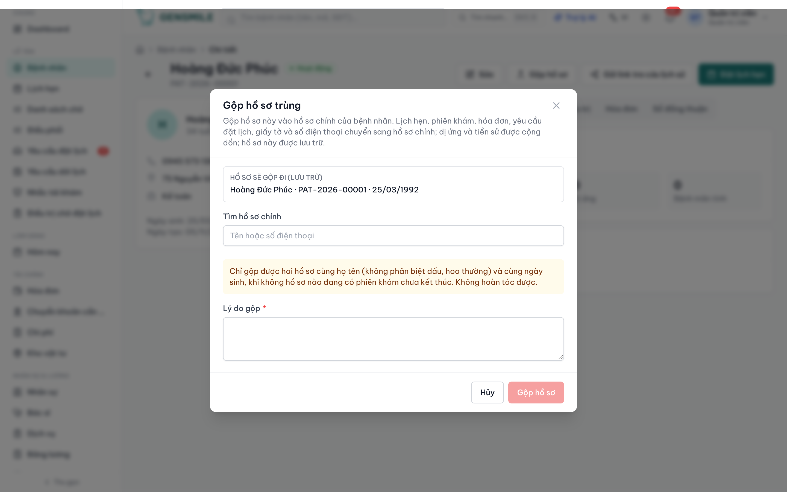{width=15cm}
:::

::: {custom-style="hình"}
Hình 4.11. Hộp thoại gộp hồ sơ trùng
:::

::: {custom-style="nguồn"}
Nguồn: Tác giả, chụp từ hệ thống GenSmile
:::

### 4.5.3. Bác sĩ: khám và điều trị theo răng

Mục này minh họa một ca khám hoàn chỉnh. Bác sĩ mở "Hàng chờ của tôi" (Hình 4.12), thứ tự được sắp theo quy tắc ở Mục 4.3.6: ca cấp cứu lên trước, sau đó theo giờ đến lượt, trong đó khách trễ quá 15 phút được xếp như thể đến muộn thêm 15 phút. Bác sĩ bấm "Bắt đầu khám" với bệnh nhân Đặng Quang Hải.

::: {custom-style="Ảnh"}
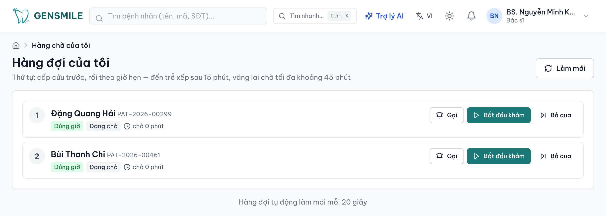{width=15cm}
:::

::: {custom-style="hình"}
Hình 4.12. Hàng chờ của bác sĩ
:::

::: {custom-style="nguồn"}
Nguồn: Tác giả, chụp từ hệ thống GenSmile
:::

Trong tab "Ghi chú" (Hình 4.13), bác sĩ ghi lý do khám và chẩn đoán. Có thể dùng mẫu khám nhanh cho các ca thường gặp, hoặc nhập ghi nhanh để AI soạn nháp ghi chú có cấu trúc rồi bác sĩ duyệt.

::: {custom-style="Ảnh"}
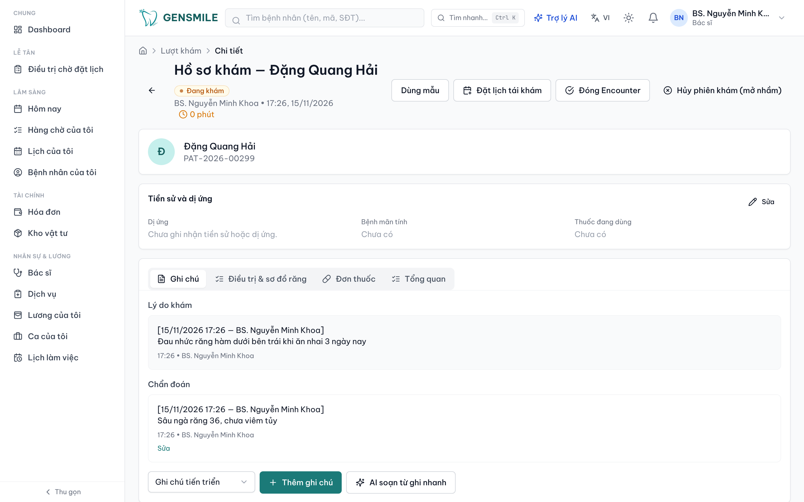{width=15cm}
:::

::: {custom-style="hình"}
Hình 4.13. Ghi chú lâm sàng của phiên khám
:::

::: {custom-style="nguồn"}
Nguồn: Tác giả, chụp từ hệ thống GenSmile
:::

Tab "Điều trị & sơ đồ răng" (Hình 4.14) là màn hình chính của bác sĩ. Sơ đồ hai cung răng hiển thị tình trạng hiện tại: răng 12, 16, 37, 46, 48 đã hàn (xanh), răng 38 đã nhổ (nét đứt). Bác sĩ bấm răng 37: khung bên phải hiện tình trạng, ghi chú và hai lần điều trị trước của răng này (ngày, bác sĩ thực hiện, có liên kết mở lại phiên khám cũ). Toàn bộ thông tin này được lấy trong một yêu cầu.

::: {custom-style="Ảnh"}
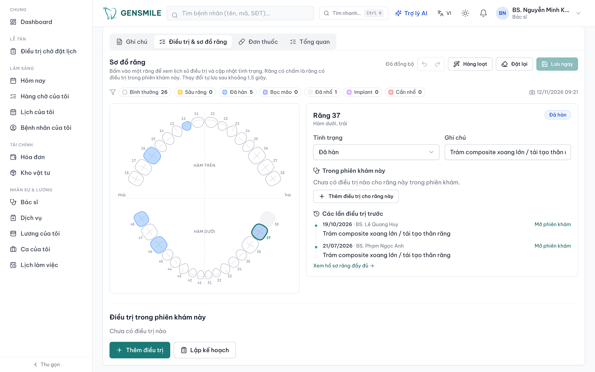{width=15cm}
:::

::: {custom-style="hình"}
Hình 4.14. Chọn răng 37 trên sơ đồ để xem lịch sử điều trị
:::

::: {custom-style="nguồn"}
Nguồn: Tác giả, chụp từ hệ thống GenSmile
:::

Bác sĩ chọn răng 36 (sâu ngà), bấm "Thêm điều trị cho răng này": hộp thoại mở sẵn số răng 36; bác sĩ chọn dịch vụ "Trám răng composite" từ danh mục, đơn giá tự lấy theo bảng giá; có thể khai báo vật tư sử dụng để trừ kho (Hình 4.15).

::: {custom-style="Ảnh"}
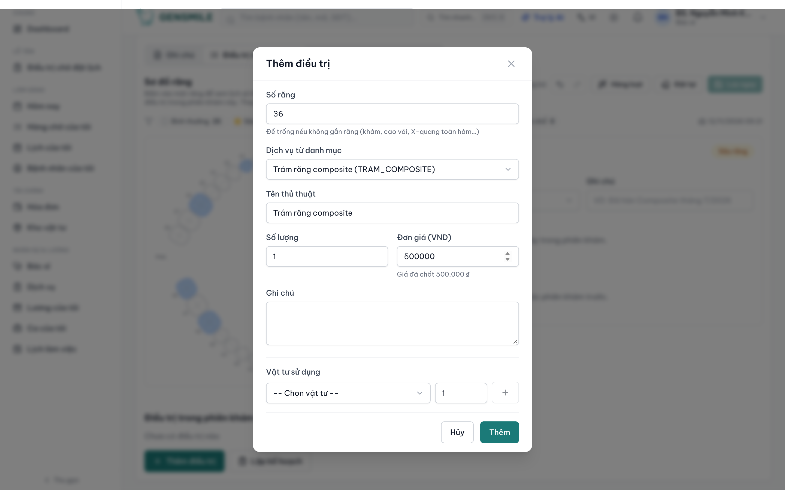{width=15cm}
:::

::: {custom-style="hình"}
Hình 4.15. Thêm điều trị cho răng 36 từ danh mục dịch vụ
:::

::: {custom-style="nguồn"}
Nguồn: Tác giả, chụp từ hệ thống GenSmile
:::

Sau khi trám, bác sĩ đổi tình trạng răng 36 thành "Đã hàn" ngay trong khung bên cạnh; sơ đồ cập nhật màu và đánh dấu chấm cho răng có điều trị trong phiên này; danh sách điều trị phía dưới hiện dòng mới cùng tổng tiền (Hình 4.16).

::: {custom-style="Ảnh"}
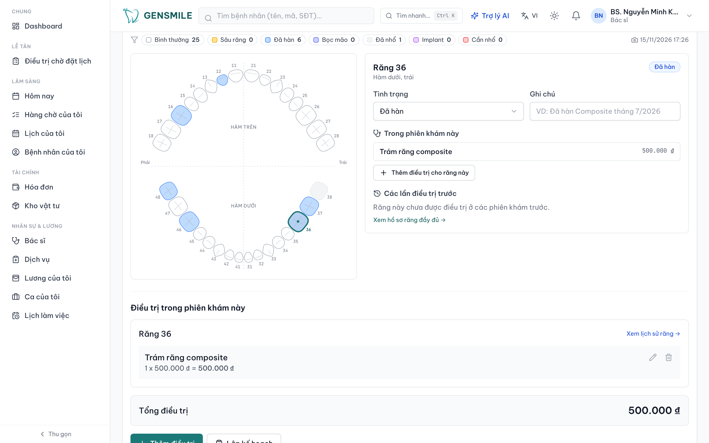{width=15cm}
:::

::: {custom-style="hình"}
Hình 4.16. Sơ đồ răng và danh sách điều trị sau khi trám răng 36
:::

::: {custom-style="nguồn"}
Nguồn: Tác giả, chụp từ hệ thống GenSmile
:::

Bác sĩ kê đơn thuốc (Hình 4.17); nếu thuốc trùng tiền sử dị ứng, hệ thống hiện cảnh báo bắt buộc. Cuối cùng, bác sĩ đóng phiên khám (Hình 4.18): màn hình tóm tắt nhắc lại các điều trị, đơn thuốc và yêu cầu xác nhận trước khi khóa hồ sơ.

::: {custom-style="Ảnh"}
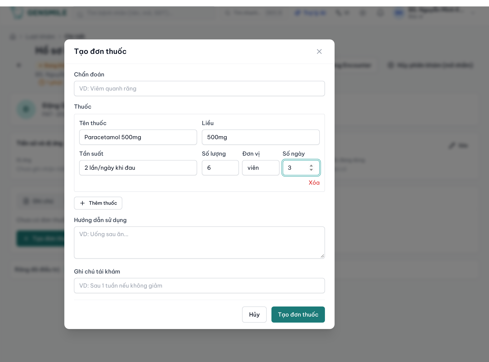{width=15cm}
:::

::: {custom-style="hình"}
Hình 4.17. Kê đơn thuốc
:::

::: {custom-style="nguồn"}
Nguồn: Tác giả, chụp từ hệ thống GenSmile
:::

::: {custom-style="Ảnh"}
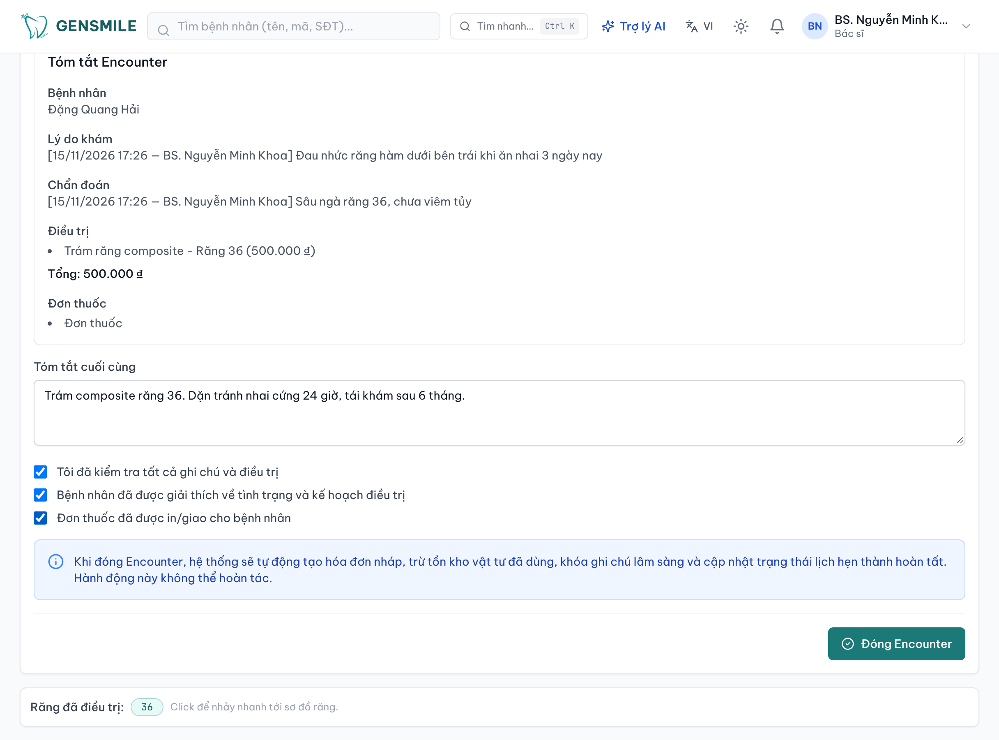{width=15cm}
:::

::: {custom-style="hình"}
Hình 4.18. Xác nhận đóng phiên khám
:::

::: {custom-style="nguồn"}
Nguồn: Tác giả, chụp từ hệ thống GenSmile
:::

### 4.5.4. Kế hoạch điều trị

Bác sĩ lập kế hoạch gồm các dòng thủ thuật theo răng, có báo giá; khi bệnh nhân đồng ý, kế hoạch hiển thị tiến độ từng dòng (Hình 4.19). Các kế hoạch đã đồng ý mà khách chưa đặt lịch được gom vào màn hình "Điều trị chờ đặt lịch" để lễ tân gọi mời (Hình 4.20).

::: {custom-style="Ảnh"}
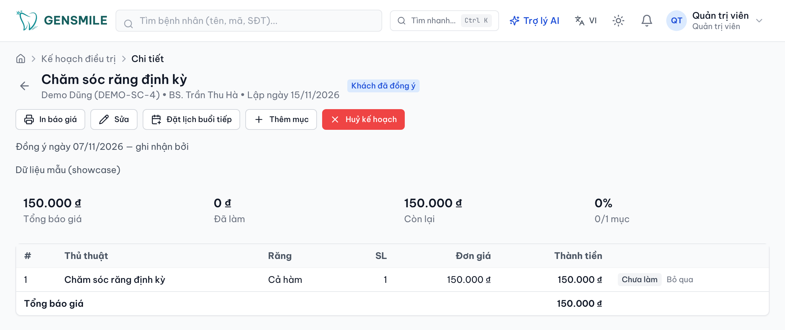{width=15cm}
:::

::: {custom-style="hình"}
Hình 4.19. Chi tiết kế hoạch điều trị
:::

::: {custom-style="nguồn"}
Nguồn: Tác giả, chụp từ hệ thống GenSmile
:::

::: {custom-style="Ảnh"}
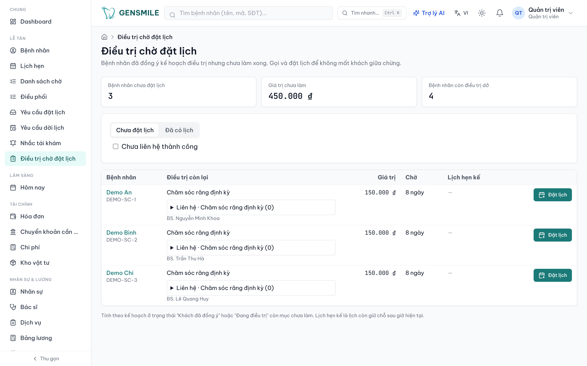{width=15cm}
:::

::: {custom-style="hình"}
Hình 4.20. Danh sách điều trị chờ đặt lịch
:::

::: {custom-style="nguồn"}
Nguồn: Tác giả, chụp từ hệ thống GenSmile
:::

### 4.5.5. Hóa đơn và thanh toán VietQR

Khi phiên khám đóng, hóa đơn nháp INV-2026-002380 được tạo tự động. Lễ tân phát hành hóa đơn; khung bên phải hiện mã VietQR chứa số tài khoản, số tiền và nội dung là mã hóa đơn (Hình 4.21). Khách quét mã và chuyển trước 200.000 đ. Khi ngân hàng báo tiền về, hóa đơn tự chuyển sang "Thanh toán một phần" và hiển thị thông báo đã nhận chuyển khoản, không cần lễ tân thao tác (Hình 4.22). Trong lần thử, ngân hàng gửi lại cùng giao dịch lần thứ hai, hệ thống trả kết quả "trùng" và không ghi thêm.

::: {custom-style="Ảnh"}
{width=15cm}
:::

::: {custom-style="hình"}
Hình 4.21. Hóa đơn đã phát hành kèm mã VietQR
:::

::: {custom-style="nguồn"}
Nguồn: Tác giả, chụp từ hệ thống GenSmile
:::

::: {custom-style="Ảnh"}
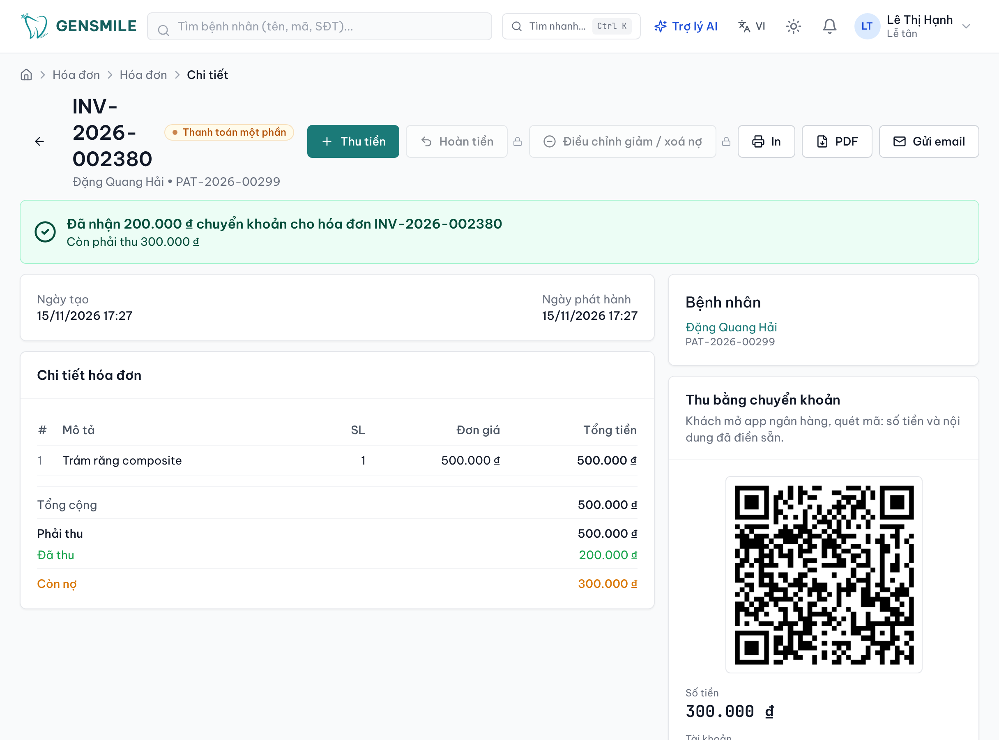{width=15cm}
:::

::: {custom-style="hình"}
Hình 4.22. Hóa đơn tự ghi nhận khoản chuyển khoản từ ngân hàng
:::

::: {custom-style="nguồn"}
Nguồn: Tác giả, chụp từ hệ thống GenSmile
:::

Một khoản chuyển khoản khác có nội dung "chuyen tien kham rang" không chứa mã hóa đơn nên không tự ghi được; giao dịch xuất hiện trong màn hình "Chuyển khoản cần xử lý" kèm lý do để lễ tân đối chiếu và xử lý tay (Hình 4.23).

::: {custom-style="Ảnh"}
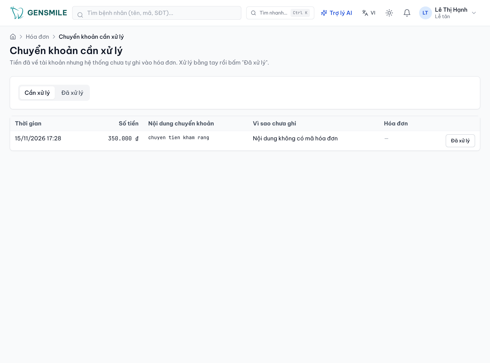{width=15cm}
:::

::: {custom-style="hình"}
Hình 4.23. Danh sách chuyển khoản cần xử lý
:::

::: {custom-style="nguồn"}
Nguồn: Tác giả, chụp từ hệ thống GenSmile
:::

Hoàn tiền là thao tác cần quyền riêng (Hình 4.24). Hộp thoại cho biết số tiền tối đa được hoàn, hình thức hoàn và bắt buộc nhập lý do; phiếu hoàn được tính vào ngày thực hiện, không sửa số thu của ngày cũ, để báo cáo các kỳ trước không bị thay đổi.

::: {custom-style="Ảnh"}
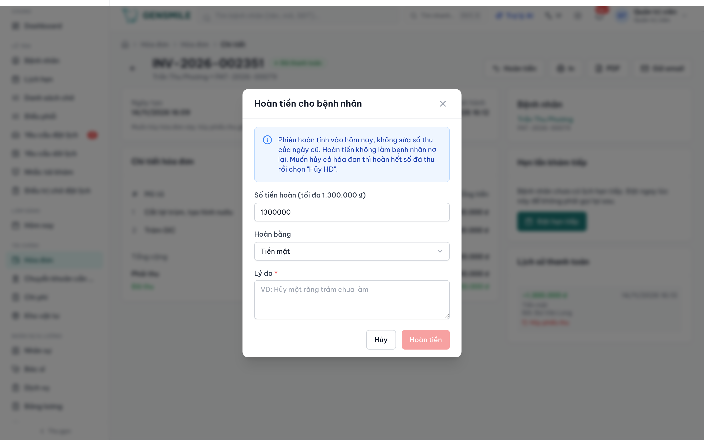{width=15cm}
:::

::: {custom-style="hình"}
Hình 4.24. Hộp thoại hoàn tiền cho bệnh nhân
:::

::: {custom-style="nguồn"}
Nguồn: Tác giả, chụp từ hệ thống GenSmile
:::

### 4.5.6. Bệnh nhân tra cứu lịch sử khám

Tại hồ sơ bệnh nhân, lễ tân bấm "Gửi link tra cứu lịch sử": hệ thống gửi đường dẫn tới email và số điện thoại trong hồ sơ, đồng thời hiện đường dẫn để sao chép khi cần gửi qua kênh khác (Hình 4.25). Bệnh nhân cũng có thể tự xin đường dẫn ở trang "Tra cứu lịch sử khám" bằng số điện thoại (Hình 4.26, trái). Mở đường dẫn trên điện thoại, bệnh nhân thấy lịch hẹn sắp tới, các lần khám kèm điều trị và số răng, đơn thuốc, kế hoạch điều trị và hóa đơn (Hình 4.26, phải).

::: {custom-style="Ảnh"}
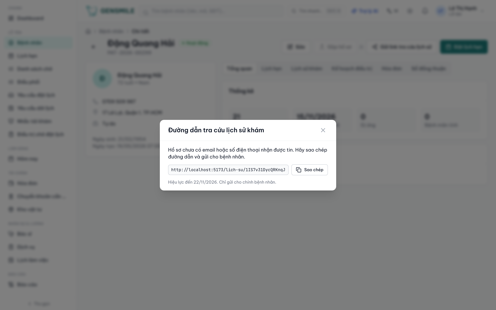{width=15cm}
:::

::: {custom-style="hình"}
Hình 4.25. Lễ tân gửi đường dẫn tra cứu lịch sử cho bệnh nhân
:::

::: {custom-style="nguồn"}
Nguồn: Tác giả, chụp từ hệ thống GenSmile
:::

::: {custom-style="Ảnh"}
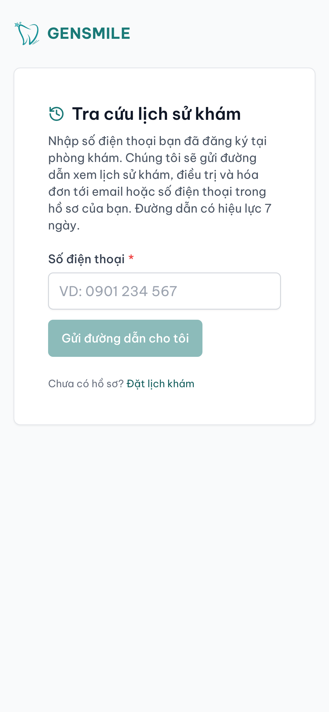{width=6cm} {width=6cm}
:::

::: {custom-style="hình"}
Hình 4.26. Trang xin đường dẫn (trái) và trang lịch sử khám trên điện thoại (phải)
:::

::: {custom-style="nguồn"}
Nguồn: Tác giả, chụp từ hệ thống GenSmile
:::

### 4.5.7. Kho, nhân sự và danh mục

Màn hình kho (Hình 4.27) liệt kê vật tư, tồn kho, mức tối thiểu và trạng thái; vật tư sắp hết được đánh dấu cùng gợi ý số lượng nhập. Lịch làm việc (Hình 4.28) cho phép đặt ca theo tuần và ghi ngày nghỉ cho từng bác sĩ; đây là cơ sở để tính giờ trống khi đặt lịch.

::: {custom-style="Ảnh"}
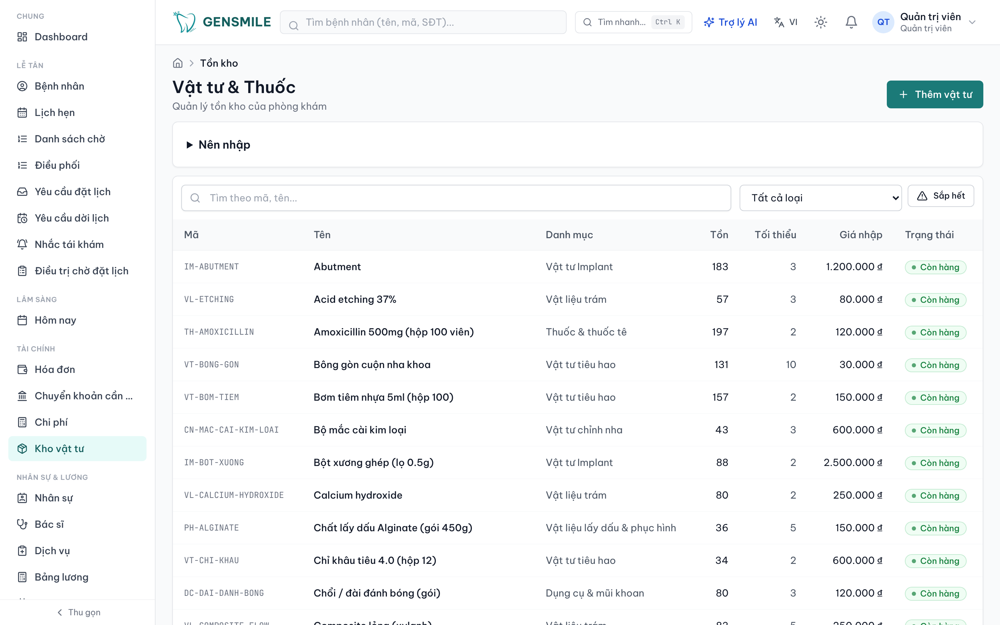{width=15cm}
:::

::: {custom-style="hình"}
Hình 4.27. Quản lý vật tư và tồn kho
:::

::: {custom-style="nguồn"}
Nguồn: Tác giả, chụp từ hệ thống GenSmile
:::

::: {custom-style="Ảnh"}
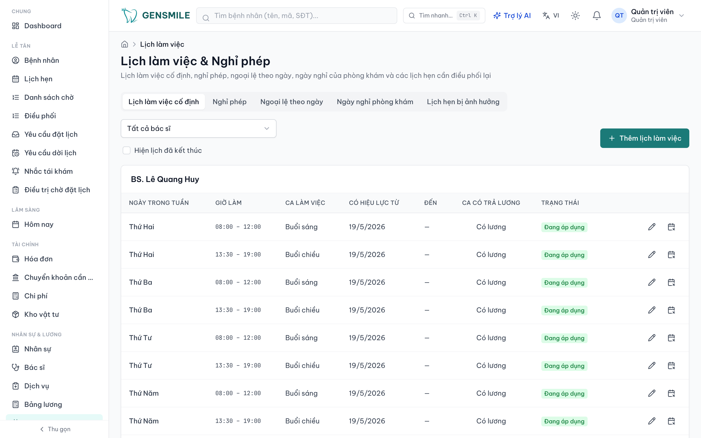{width=15cm}
:::

::: {custom-style="hình"}
Hình 4.28. Lịch làm việc của bác sĩ
:::

::: {custom-style="nguồn"}
Nguồn: Tác giả, chụp từ hệ thống GenSmile
:::

Màn hình nhân sự (Hình 4.29) quản lý hồ sơ nhân viên tách khỏi tài khoản đăng nhập: mã nhân viên, loại (quản lý, bác sĩ, lễ tân), tài khoản liên kết và trạng thái làm việc. Đăng ký ca thêm của bác sĩ được quản trị viên duyệt hoặc từ chối ở Hình 4.30; phần "Phủ ca so với lịch đặt" cho biết khung giờ nào đã có khách đặt mà chưa có bác sĩ.

::: {custom-style="Ảnh"}
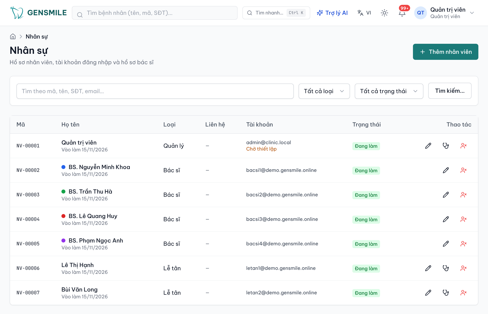{width=15cm}
:::

::: {custom-style="hình"}
Hình 4.29. Danh sách nhân sự
:::

::: {custom-style="nguồn"}
Nguồn: Tác giả, chụp từ hệ thống GenSmile
:::

::: {custom-style="Ảnh"}
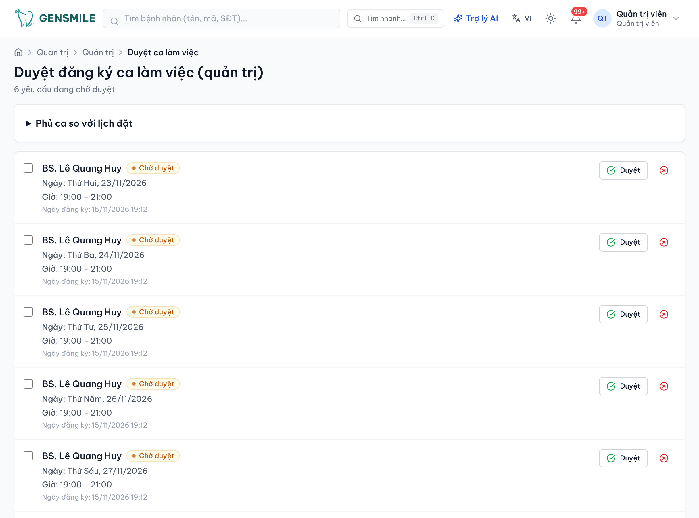{width=15cm}
:::

::: {custom-style="hình"}
Hình 4.30. Duyệt đăng ký ca làm việc của bác sĩ
:::

::: {custom-style="nguồn"}
Nguồn: Tác giả, chụp từ hệ thống GenSmile
:::

Chi tiết một kỳ lương (Hình 4.31) hiển thị tổng lương, thực nhận, thuế thu nhập cá nhân, bảo hiểm xã hội và bảng lương từng bác sĩ: số phiên khám, giờ làm, giờ làm thêm, tổng lương, các khoản khấu trừ; quản trị viên tính lại, duyệt kỳ lương, xuất phiếu lương PDF và thêm điều chỉnh cho từng người.

::: {custom-style="Ảnh"}
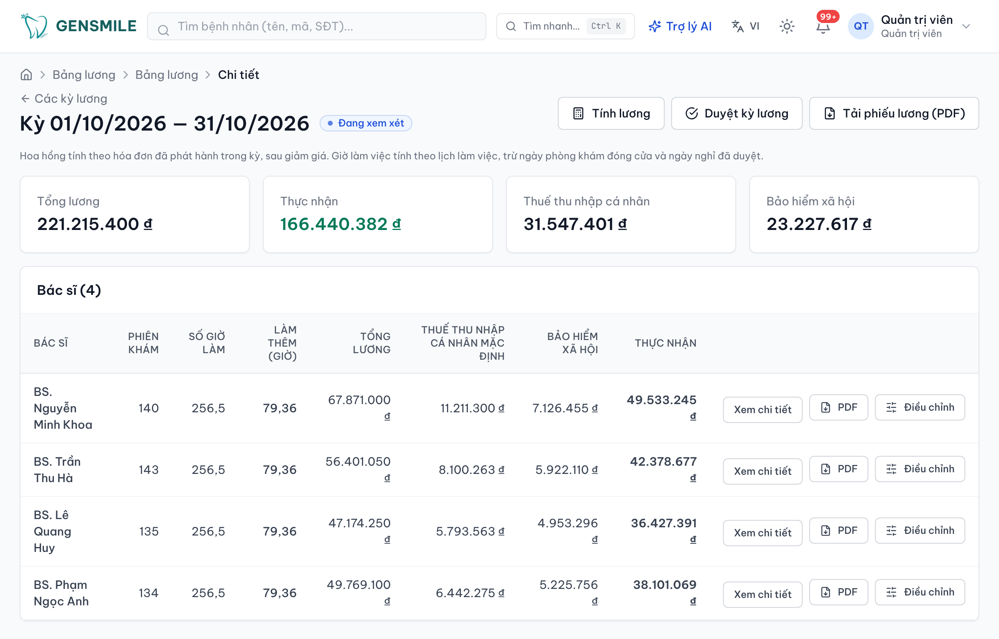{width=15cm}
:::

::: {custom-style="hình"}
Hình 4.31. Chi tiết kỳ lương tháng 10/2026 đang rà soát
:::

::: {custom-style="nguồn"}
Nguồn: Tác giả, chụp từ hệ thống GenSmile
:::

Danh mục dịch vụ (Hình 4.32) được nhóm theo loại, mỗi dịch vụ có mã, thời lượng, thời gian chuẩn bị, giá và số bác sĩ được phân công; cùng trang có các mẫu khám nhanh. Chi phí vận hành (Hình 4.33) hiển thị tổng chi, phần đã duyệt và danh sách phiếu với trạng thái từng phiếu.

::: {custom-style="Ảnh"}
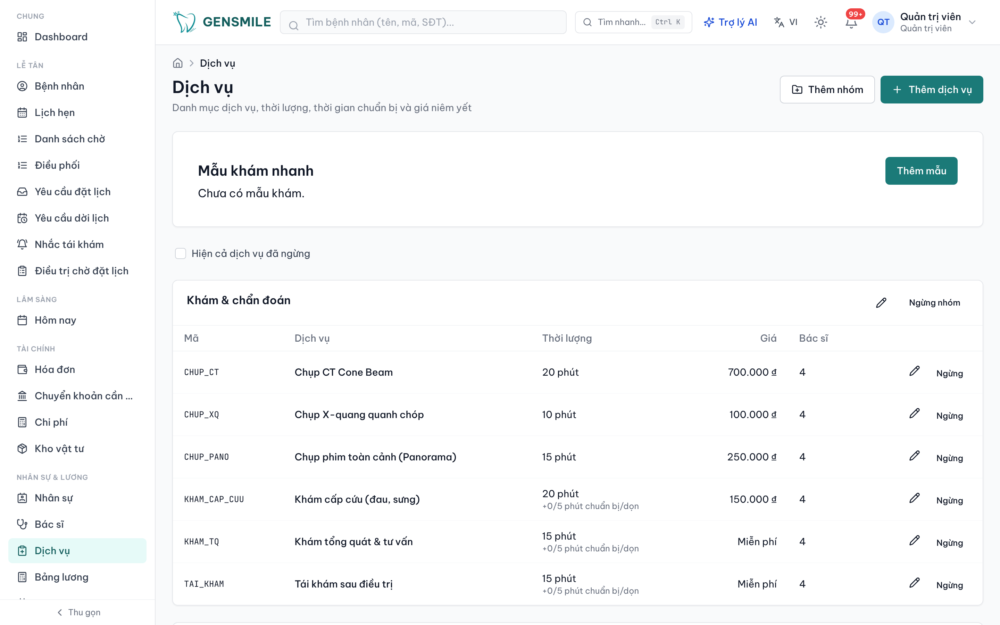{width=15cm}
:::

::: {custom-style="hình"}
Hình 4.32. Danh mục dịch vụ và bảng giá
:::

::: {custom-style="nguồn"}
Nguồn: Tác giả, chụp từ hệ thống GenSmile
:::

::: {custom-style="Ảnh"}
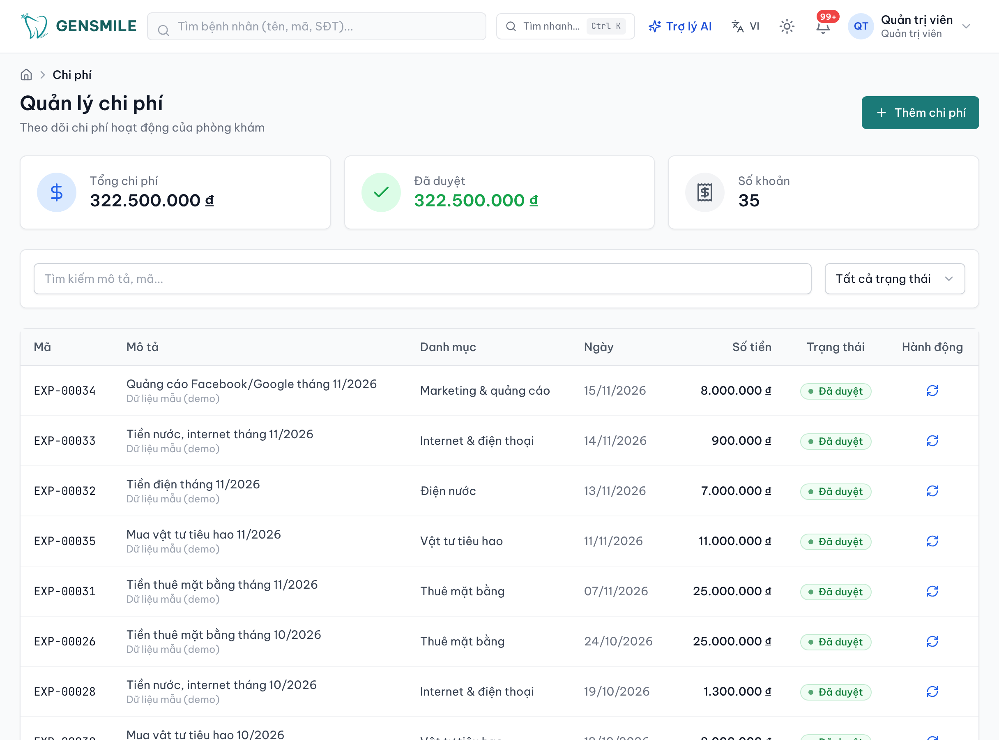{width=15cm}
:::

::: {custom-style="hình"}
Hình 4.33. Quản lý chi phí vận hành
:::

::: {custom-style="nguồn"}
Nguồn: Tác giả, chụp từ hệ thống GenSmile
:::

### 4.5.8. Bảng điều khiển và báo cáo cho quản lý

Bảng điều khiển (Hình 4.34) cho phép chọn kỳ (hôm nay, 7, 15, 30 ngày, 6 tháng), hiển thị số lịch hẹn, doanh thu, thực thu, công nợ có so sánh với kỳ trước. Phần dưới (Hình 4.35) là sáu chỉ số vận hành dạng biểu đồ thanh so với mục tiêu và bản đồ nhiệt công suất ghế theo giờ trong tuần; tiếp theo là phễu hành trình bệnh nhân và các biểu đồ tài chính (Hình 4.36). Trang báo cáo (Hình 4.37) cho phép xem doanh thu theo khoảng ngày, theo bác sĩ, theo dịch vụ, xuất tệp và nhờ AI viết nhận xét.

::: {custom-style="Ảnh"}
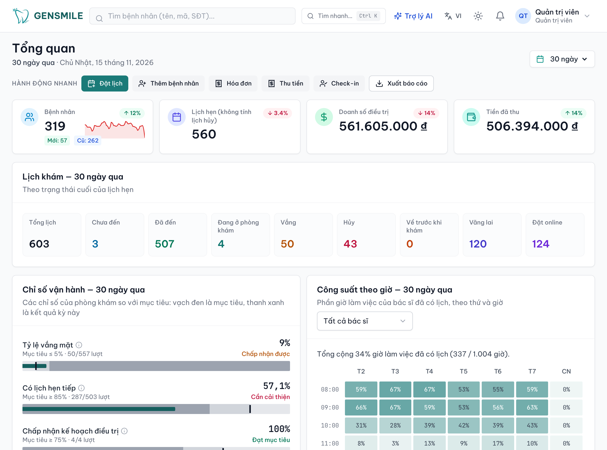{width=15cm}
:::

::: {custom-style="hình"}
Hình 4.34. Bảng điều khiển của quản lý (kỳ 30 ngày)
:::

::: {custom-style="nguồn"}
Nguồn: Tác giả, chụp từ hệ thống GenSmile
:::

::: {custom-style="Ảnh"}
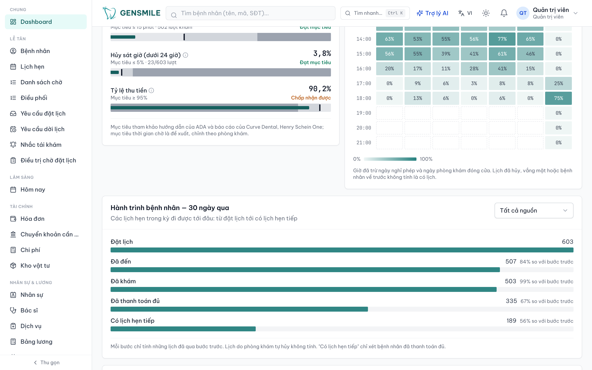{width=15cm}
:::

::: {custom-style="hình"}
Hình 4.35. Chỉ số vận hành so với mục tiêu và công suất ghế theo giờ
:::

::: {custom-style="nguồn"}
Nguồn: Tác giả, chụp từ hệ thống GenSmile
:::

::: {custom-style="Ảnh"}
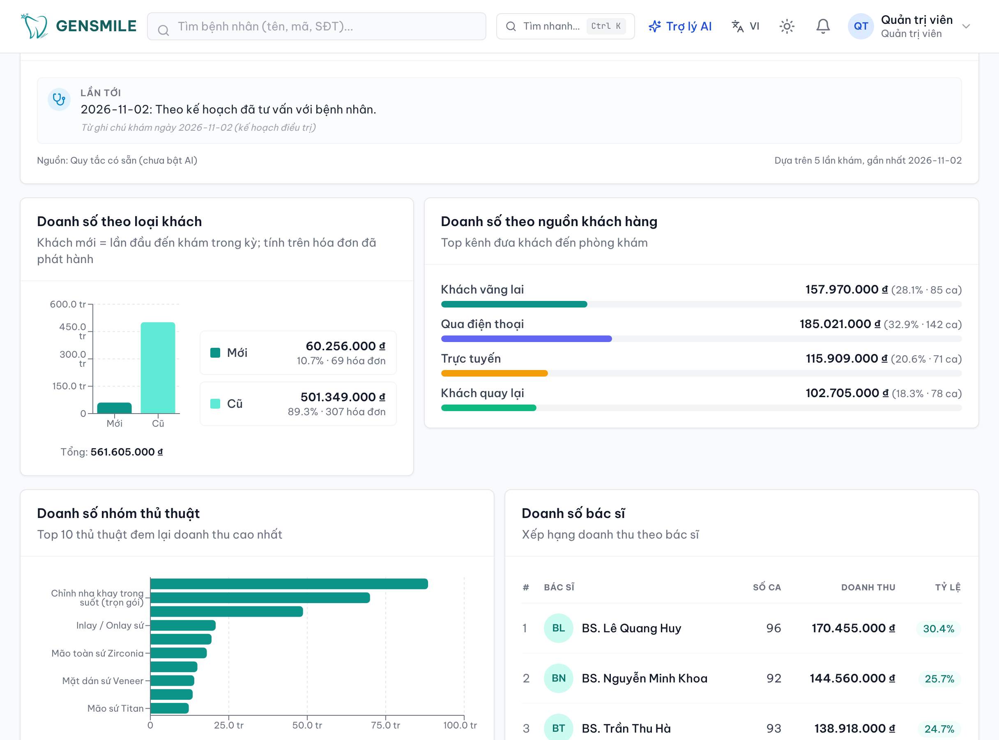{width=15cm}
:::

::: {custom-style="hình"}
Hình 4.36. Hành trình bệnh nhân và các biểu đồ tài chính
:::

::: {custom-style="nguồn"}
Nguồn: Tác giả, chụp từ hệ thống GenSmile
:::

::: {custom-style="Ảnh"}
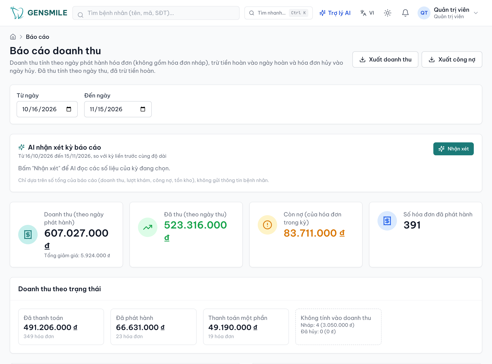{width=15cm}
:::

::: {custom-style="hình"}
Hình 4.37. Báo cáo doanh thu
:::

::: {custom-style="nguồn"}
Nguồn: Tác giả, chụp từ hệ thống GenSmile
:::

### 4.5.9. Người dùng, phân quyền, nhật ký và thông báo

Quản trị viên quản lý vai trò và tích chọn từng quyền cho vai trò (Hình 4.38). Nhật ký kiểm toán (Hình 4.39) cho phép lọc theo người thực hiện, loại hành động, khoảng thời gian và xem chi tiết từng thay đổi.

::: {custom-style="Ảnh"}
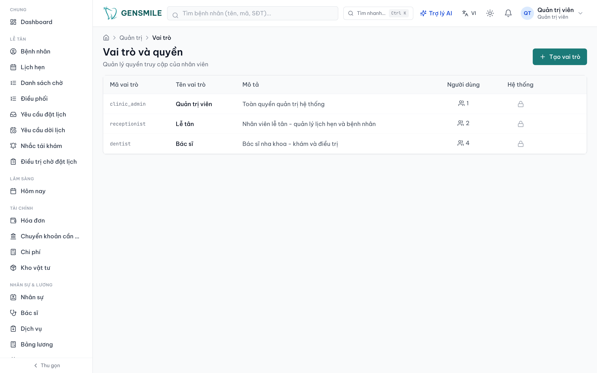{width=15cm}
:::

::: {custom-style="hình"}
Hình 4.38. Quản lý vai trò và quyền
:::

::: {custom-style="nguồn"}
Nguồn: Tác giả, chụp từ hệ thống GenSmile
:::

::: {custom-style="Ảnh"}
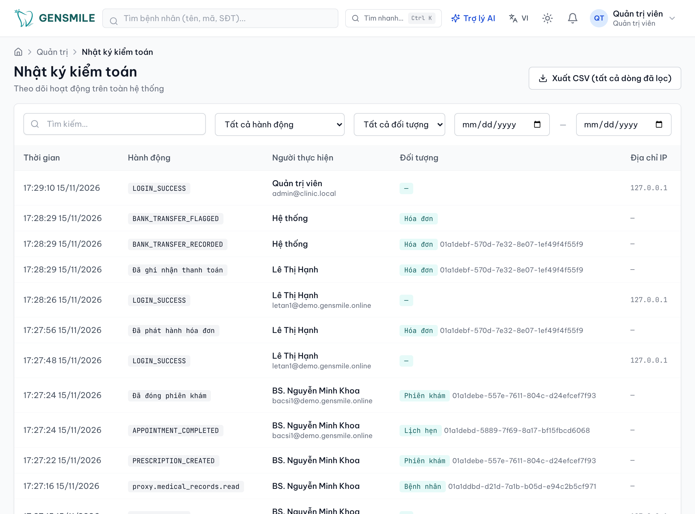{width=15cm}
:::

::: {custom-style="hình"}
Hình 4.39. Nhật ký kiểm toán
:::

::: {custom-style="nguồn"}
Nguồn: Tác giả, chụp từ hệ thống GenSmile
:::

Màn hình người dùng (Hình 4.40) quản lý tài khoản đăng nhập, vai trò, trạng thái và lần đăng nhập gần nhất; quản trị viên có thể sửa thông tin, gửi đường dẫn đặt mật khẩu, cấp mật khẩu tạm, vô hiệu hóa hoặc kích hoạt lại tài khoản. Sổ đồng thuận (Hình 4.41) liệt kê mọi bản ghi đồng ý của bệnh nhân với mục đích, phiên bản văn bản, kênh ghi nhận và trạng thái còn hiệu lực hay đã rút lại; chỉ người có quyền riêng mới xuất được tệp CSV. Trang thông báo (Hình 4.42) lưu lịch sử thông báo của người dùng trong 90 ngày, ví dụ các hóa đơn nháp cần phát hành sau khi bác sĩ đóng phiên khám.

::: {custom-style="Ảnh"}
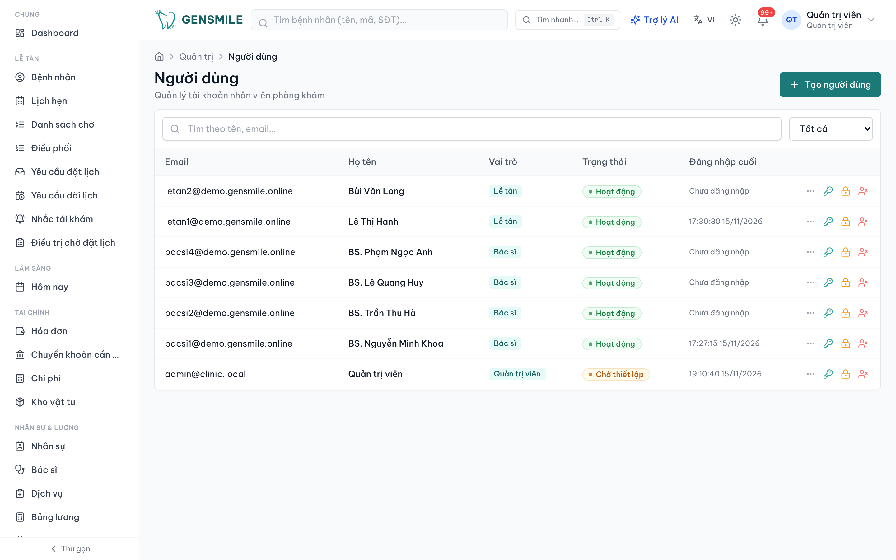{width=15cm}
:::

::: {custom-style="hình"}
Hình 4.40. Quản lý người dùng
:::

::: {custom-style="nguồn"}
Nguồn: Tác giả, chụp từ hệ thống GenSmile
:::

::: {custom-style="Ảnh"}
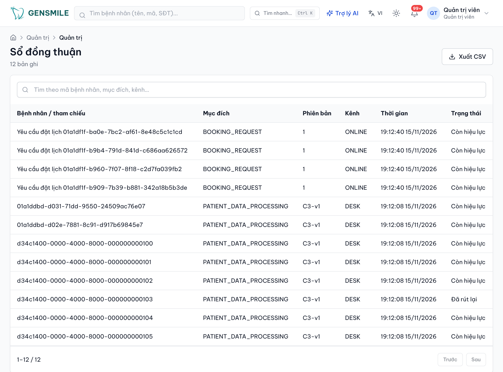{width=15cm}
:::

::: {custom-style="hình"}
Hình 4.41. Sổ đồng thuận của bệnh nhân
:::

::: {custom-style="nguồn"}
Nguồn: Tác giả, chụp từ hệ thống GenSmile
:::

::: {custom-style="Ảnh"}
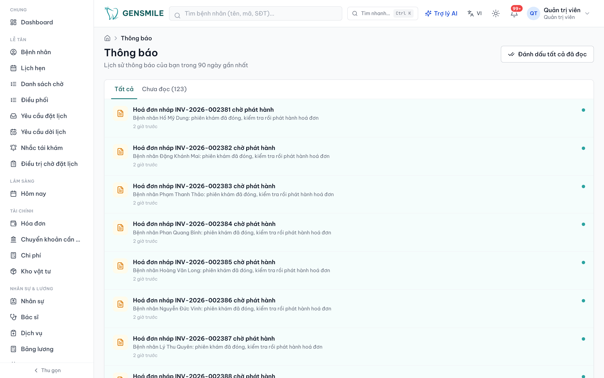{width=15cm}
:::

::: {custom-style="hình"}
Hình 4.42. Trang thông báo trong ứng dụng
:::

::: {custom-style="nguồn"}
Nguồn: Tác giả, chụp từ hệ thống GenSmile
:::

### 4.5.10. Trợ lý AI

Trợ lý AI mở từ nút trên thanh tiêu đề, hiển thị thành khung chat bên phải (Hình 4.43). Hình được chụp ở chế độ dự phòng, khi chưa cấu hình dịch vụ AI: trợ lý vẫn nhận ra ý định của câu hỏi theo từ khóa, gọi đúng công cụ tra cứu, trả lời từ dữ liệu thật và ghi rõ "Trả lời theo mẫu". Khi có dịch vụ AI, câu trả lời được viết tự nhiên và trợ lý có thể đề xuất đặt, hủy, dời lịch dưới dạng thẻ xác nhận. Dòng chú thích dưới ô nhập nhắc người dùng rằng tên bệnh nhân không được gửi cho AI.

::: {custom-style="Ảnh"}
{width=15cm}
:::

::: {custom-style="hình"}
Hình 4.43. Trợ lý AI ở chế độ dự phòng
:::

::: {custom-style="nguồn"}
Nguồn: Tác giả, chụp từ hệ thống GenSmile
:::

## 4.6. Triển khai và vận hành

### 4.6.1. Quy trình tích hợp liên tục

Mỗi thay đổi được đưa lên một nhánh riêng và mở yêu cầu gộp (pull request). GitHub Actions chạy 10 bước kiểm tra song song (Bảng 4.3); chỉ khi tất cả đạt mới được gộp vào nhánh chính.

::: {custom-style="bảng"}
Bảng 4.3. Các bước kiểm tra trong quy trình tích hợp liên tục
:::

| Bước | Nội dung |
|---|---|
| Backend TypeScript Check | Kiểm tra kiểu toàn bộ mã máy chủ |
| Backend Lint | Kiểm tra quy chuẩn mã máy chủ |
| Backend Tests | Chạy toàn bộ kiểm thử đơn vị máy chủ |
| Backend Build | Biên dịch máy chủ |
| Release migrations and PostgreSQL API tests | Chạy toàn bộ migration trên cơ sở dữ liệu sạch, rồi chạy kiểm thử API trên PostgreSQL thật |
| Frontend TypeScript Check | Kiểm tra kiểu giao diện và kịch bản E2E |
| Frontend Lint | Kiểm tra quy chuẩn mã giao diện |
| Frontend Build | Đóng gói giao diện |
| Playwright E2E | Dựng cơ sở dữ liệu, máy chủ, giao diện; chạy các kịch bản đầu cuối trên trình duyệt |
| Production container builds | Đóng gói các container dùng cho môi trường thật |

::: {custom-style="nguồn"}
Nguồn: Tác giả
:::

### 4.6.2. Triển khai lên máy chủ ảo

Môi trường thật gồm các container mô tả trong tệp Docker Compose (Hình 3.1). Script triển khai thực hiện tuần tự: lấy mã mới nhất của nhánh chính, sao lưu cơ sở dữ liệu, đóng gói lại các container, chạy container migrate để cập nhật cơ sở dữ liệu, khởi động lại máy chủ ứng dụng và giao diện, rồi chạy kiểm tra sau triển khai (smoke test). Bước kiểm tra gọi điểm cuối sức khỏe qua Nginx, so mã phiên bản (mã commit) mà máy chủ báo với mã vừa triển khai, và kiểm tra cơ sở dữ liệu sẵn sàng; nếu không khớp, script báo lỗi để người vận hành biết bản mới chưa chạy. Toàn bộ quá trình được thực hiện bằng một lệnh trên máy chủ.

Các khóa bí mật (khóa ký JWT, mật khẩu cơ sở dữ liệu, khóa dịch vụ AI, khóa webhook ngân hàng, tài khoản nhắn tin) chỉ nằm trong tệp biến môi trường trên máy chủ, không có trong mã nguồn. Dữ liệu mẫu cho buổi trình diễn được nạp bằng các script riêng, chỉ tác động lên bệnh nhân được đánh dấu là dữ liệu mẫu.

## 4.7. Kết luận chương

Chương 4 đã trình bày:

- **Môi trường và mã nguồn:** công cụ phát triển và cách tổ chức khoảng 100 nghìn dòng mã.
- **Cài đặt máy chủ:** phân quyền khai báo trên từng API, chống đặt trùng lịch bằng khóa tư vấn, đóng phiên khám bằng giao dịch và sự kiện miền, truy vấn lịch sử theo răng, webhook không ghi trùng.
- **Cài đặt giao diện:** tải theo trang, đồng bộ dữ liệu, hai ngôn ngữ, sơ đồ răng SVG.
- **Kết quả giao diện:** một ca khám hoàn chỉnh từ hàng chờ đến hóa đơn và thanh toán VietQR tự đối soát, cùng các chức năng tra cứu cho bệnh nhân, quản lý, báo cáo và trợ lý AI.
- **Triển khai:** quy trình tích hợp liên tục và triển khai bằng Docker.

Chương 5 đánh giá hệ thống qua kiểm thử và đối chiếu với mục tiêu đề tài.
