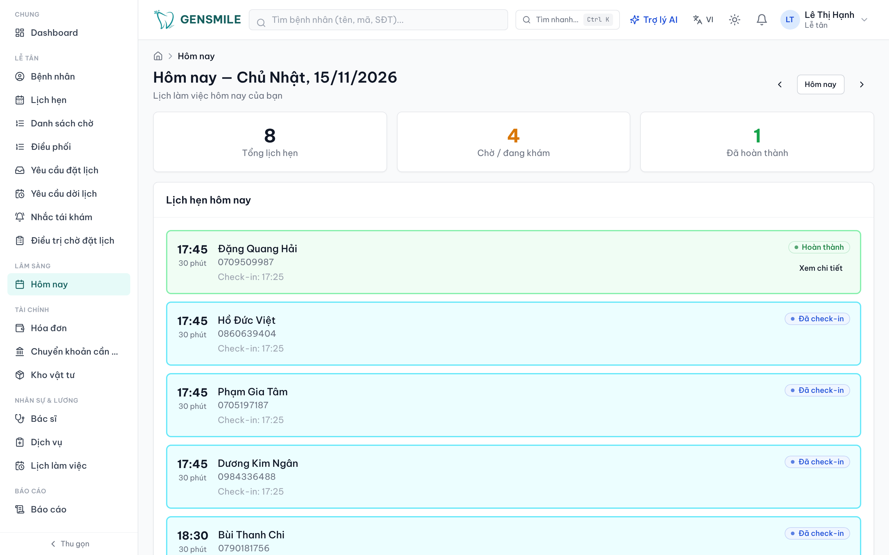
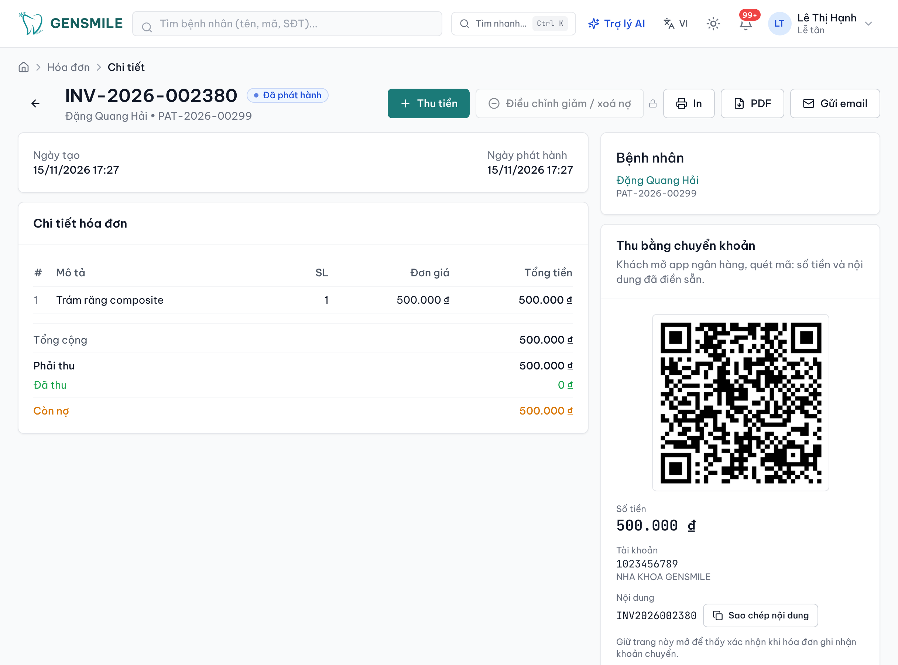
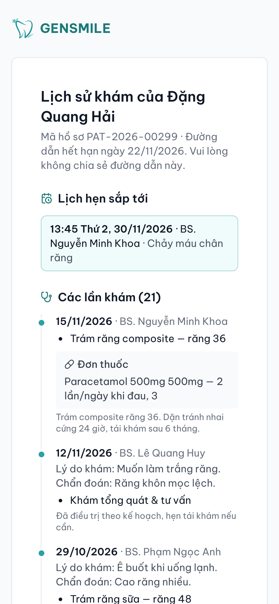
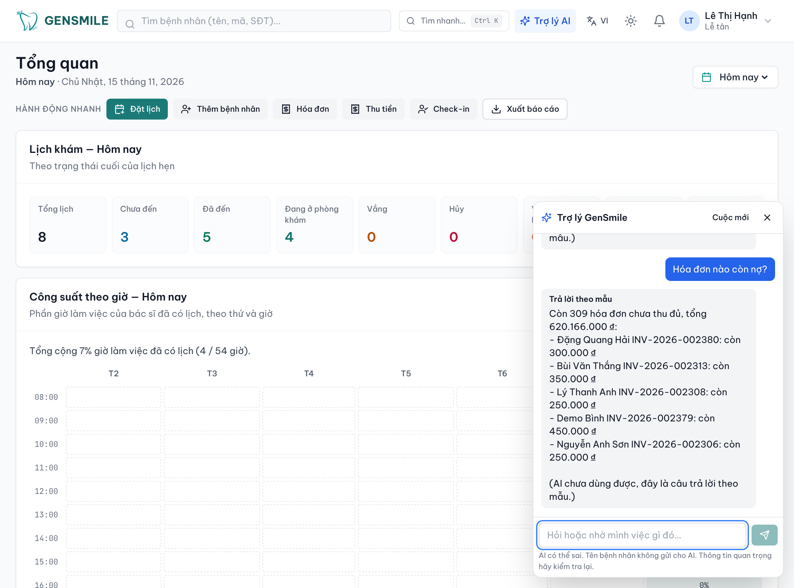

# CHƯƠNG 4. XÂY DỰNG VÀ TRIỂN KHAI HỆ THỐNG

Chương này trình bày quá trình hiện thực thiết kế ở Chương 3 thành phần mềm: môi trường phát triển, tổ chức mã nguồn, các điểm cài đặt quan trọng ở máy chủ và giao diện, giao diện các chức năng tiêu biểu và cách hệ thống được triển khai, cập nhật.

## 4.1. Môi trường và công cụ phát triển

Bảng 4.1 tóm tắt ngôn ngữ, khung phát triển và công cụ được dùng cho từng phần của hệ thống.

::: {custom-style="bảng"}
Bảng 4.1. Môi trường và công cụ phát triển
:::

| Thành phần | Công cụ, phiên bản |
|---|---|
| Ngôn ngữ | TypeScript 5 (cả máy chủ và giao diện) |
| Máy chủ ứng dụng | Node.js (22 khi kiểm thử, 24 trong bản triển khai), NestJS 10, Prisma 5, class-validator, Zod, Passport JWT, Argon2 |
| Cơ sở dữ liệu | PostgreSQL 16 |
| Giao diện | React 18, Vite 5, TanStack Query 5, React Router 6, React Hook Form, Zod, Tailwind CSS 3, Recharts 3, i18next |
| Kiểm thử | Jest 29 (đơn vị và API), Playwright (đầu cuối) |
| Chất lượng mã | ESLint, Prettier, kiểm tra kiểu TypeScript |
| Triển khai | Docker, Docker Compose, Nginx, máy chủ ảo Linux |
| Quản lý mã nguồn, CI | Git, GitHub, GitHub Actions |
| Tài liệu API | OpenAPI (Swagger) sinh tự động |

::: {custom-style="nguồn"}
Nguồn: Tác giả
:::

## 4.2. Tổ chức mã nguồn

Mã nguồn được đặt trong một kho duy nhất gồm hai phần chính và các thư mục hỗ trợ (Bảng 4.2). Tổng cộng phần máy chủ có khoảng 51 nghìn dòng mã (không tính kiểm thử), phần giao diện khoảng 55 nghìn dòng.

::: {custom-style="bảng"}
Bảng 4.2. Cấu trúc thư mục chính của mã nguồn
:::

| Thư mục | Nội dung |
|---|---|
| `backend/src/<module>/` | Mỗi module nghiệp vụ: `*.controller.ts` (API), `*.service.ts` (quy tắc nghiệp vụ), `dto/` (kiểm tra dữ liệu vào), `domain/` (hàm thuần tính toán), `*.spec.ts` (kiểm thử) |
| `backend/src/common/` | Guard xác thực, phân quyền, giới hạn theo dòng; tiện ích ngày giờ theo múi giờ phòng khám; sự kiện miền; dịch vụ email |
| `backend/prisma/` | Lược đồ dữ liệu, 52 migration, dữ liệu khởi tạo và dữ liệu mẫu |
| `backend/test/` | Kiểm thử API chạy trên PostgreSQL thật |
| `frontend/src/features/<chức năng>/` | Trang và thành phần giao diện theo chức năng, kèm hook gọi API |
| `frontend/src/components/ui/` | Thư viện thành phần dùng chung (nút, ô nhập, bảng, hộp thoại, thông báo…) |
| `frontend/src/locales/` | Chữ giao diện tiếng Việt; `locales/en/` tiếng Anh |
| `frontend/e2e/` | Kịch bản kiểm thử đầu cuối Playwright |
| `docs/` | Đặc tả nghiệp vụ, thiết kế, tài liệu API, hướng dẫn triển khai, báo cáo |
| `scripts/` | Script triển khai, kiểm tra sau triển khai, dữ liệu mẫu |

::: {custom-style="nguồn"}
Nguồn: Tác giả
:::

## 4.3. Cài đặt phía máy chủ

Các đoạn mã dưới đây được trích từ mã nguồn và rút gọn để dễ đọc; chỗ lược được đánh dấu bằng chú thích, ghi chú tiếng Việt sau dấu `//` là của tác giả.

### 4.3.1. Phân quyền và chống đặt trùng lịch

Mỗi điểm cuối API khai báo mã quyền cần có; `JwtAuthGuard` xác thực mã truy cập, `PermissionsGuard` kiểm tra quyền trước khi vào hàm xử lý. Bên trong service, lớp phân quyền thứ hai giới hạn theo dòng dữ liệu: bác sĩ chỉ có quyền "riêng" chỉ thấy bệnh nhân mình đã khám hoặc đang có lịch.

Kiểm tra "giờ này còn trống không" rồi mới ghi là hai bước tách rời, nên hai lễ tân cùng đặt một khung giờ có thể cùng thấy giờ còn trống. Hệ thống giải quyết bằng khóa tư vấn của PostgreSQL theo phạm vi giao dịch [@postgres]: việc đầu tiên trong giao dịch đặt lịch là lấy khóa theo bác sĩ và bệnh nhân, sau đó mới kiểm tra trùng và ghi. Giao dịch thứ hai phải chờ giao dịch thứ nhất kết thúc nên thấy lịch vừa được ghi và bị từ chối.

```typescript
const write = async (tx: Prisma.TransactionClient) => {
  await this.lockDentist(tx, dto.dentistId);   // pg_advisory_xact_lock(1, hash(dentistId))
  await this.lockPatient(tx, dto.patientId);   // pg_advisory_xact_lock(2, hash(patientId))
  // … kiểm tra giờ làm việc, ngày nghỉ, trùng lịch bác sĩ và bệnh nhân …
  return tx.appointment.create({ data: /* … */ });
};
```

Thời gian chờ khóa được giới hạn 5 giây; quá thời gian, người dùng nhận thông báo "Đang có thao tác khác trên lịch này, vui lòng thử lại" (mã 409) thay vì lỗi hệ thống.

### 4.3.2. Đóng phiên khám, hàng chờ và webhook ngân hàng

Đóng phiên khám là một giao dịch: vật tư được trừ bằng câu lệnh cập nhật có điều kiện "tồn kho không nhỏ hơn số lượng cần trừ"; chỉ cần một vật tư không đủ là toàn bộ giao dịch bị hủy. Khi giao dịch thành công, sự kiện `encounter.closed` được phát để module hóa đơn tạo hóa đơn nháp, module lương ghi ca khám và module AI làm mới bản tóm tắt hồ sơ; lỗi ở các module này không làm hỏng việc đóng phiên.

Quy tắc xếp hàng chờ được viết thành hàm thuần `compareQueue`, không đọc cơ sở dữ liệu, nên kiểm thử được bằng bảng quyết định cho mọi tình huống: đến sớm, đúng giờ, trễ, vãng lai, cấp cứu, bị bỏ qua. Lịch sử một răng được lấy bằng một truy vấn duy nhất, lọc theo mảng số răng kiểu JSONB thay vì tải từng phiên khám.

Ngân hàng có thể gửi lại cùng một giao dịch khi mạng chập chờn. Hệ thống chống ghi trùng ở hai tầng: bảng giao dịch ngân hàng có chỉ mục duy nhất theo mã giao dịch, và khoản thanh toán được ghi với khóa `request_key` tạo từ mã giao dịch. Khóa xác thực của webhook được so sánh theo thời gian hằng.

### 4.3.3. Ẩn danh bệnh nhân khi làm việc với AI

Trợ lý AI không nhận họ tên hay mã định danh thật của bệnh nhân. Mỗi bệnh nhân xuất hiện trong kết quả tra cứu được cấp một mã tạm `P1`, `P2`… chỉ có nghĩa trong cuộc hội thoại; tên được trình duyệt điền vào câu trả lời sau khi nhận về. Khi mô hình đề xuất đặt lịch cho `P1`, máy chủ đổi ngược mã tạm thành mã thật; mã không có trong bảng bị từ chối.

```typescript
/** Mã tạm P1, P2… thay cho bệnh nhân trong một cuộc hội thoại với AI. */
refFor(id: string, name: string): string {
  let ref = this.byId.get(id);
  if (!ref) {
    ref = `P${this.next++}`;      // cấp mã mới lần đầu gặp bệnh nhân
    this.byId.set(id, ref);
    this.ids.set(ref, id);
  }
  this.names.set(ref, name);      // tên chỉ gửi cho trình duyệt, không gửi cho mô hình
  return ref;
}

idOf(ref: string): string | undefined {
  return this.ids.get(ref.trim().replace(/^\[|\]$/g, ''));   // "[P1]" → mã thật
}
```

## 4.4. Cài đặt phía giao diện

Mỗi trang được tải lười (`React.lazy`) nên trình duyệt chỉ tải mã của trang đang mở. Mọi lời gọi API đi qua TanStack Query với khóa truy vấn theo tài nguyên; sau mỗi thao tác ghi, các khóa liên quan được làm mới để mọi màn hình đồng bộ. Hóa đơn đang chờ thanh toán tự làm mới mỗi 8 giây để hiện ngay khoản chuyển khoản vừa về.

Toàn bộ chữ giao diện nằm trong tệp ngôn ngữ tiếng Việt và tiếng Anh; bản tiếng Anh được tách thành gói riêng, chỉ tải khi cần. Sơ đồ răng được vẽ bằng SVG theo đường cong hình chữ U, mỗi răng là một nút dùng được bằng bàn phím; thay đổi tình trạng răng tự lưu sau 1,5 giây và có hoàn tác.

## 4.5. Kết quả giao diện các chức năng

Mục này trình bày các màn hình tiêu biểu theo luồng nghiệp vụ chính, chụp từ hệ thống chạy với dữ liệu mẫu 6 tháng (500 bệnh nhân, 4 bác sĩ, 2 lễ tân; tên người là giả lập). Thanh menu bên trái chỉ hiện các mục vai trò đó có quyền (Hình 4.3); ở các hình còn lại, thanh menu được cắt bỏ để nội dung đủ rõ khi in.

### 4.5.1. Bệnh nhân đặt lịch trực tuyến

Trang chủ (Hình 4.1) giới thiệu phòng khám, dịch vụ, bảng giá và đội ngũ bác sĩ; khách bấm vào một răng trên sơ đồ để xem dịch vụ liên quan. Ở trang đặt lịch (Hình 4.2), khách chọn dịch vụ, bác sĩ, ngày; hệ thống hiện các khung giờ còn trống, khách nhập họ tên, số điện thoại và nhận mã tra cứu yêu cầu.

::: {custom-style="Ảnh"}
{width=15cm}
:::

::: {custom-style="hình"}
Hình 4.1. Trang chủ phòng khám
:::

::: {custom-style="nguồn"}
Nguồn: Tác giả, chụp từ hệ thống GenSmile
:::

::: {custom-style="Ảnh"}
{width=15cm}
:::

::: {custom-style="hình"}
Hình 4.2. Trang đặt lịch trực tuyến
:::

::: {custom-style="nguồn"}
Nguồn: Tác giả, chụp từ hệ thống GenSmile
:::

### 4.5.2. Lễ tân tiếp nhận và điều phối

Màn hình "Hôm nay" (Hình 4.3) tóm tắt tổng số lịch hẹn, số khách đang chờ hoặc đang khám, số ca đã hoàn thành, và liệt kê lịch trong ngày kèm trạng thái (lịch chưa đến có nút check-in). Lịch hẹn (Hình 4.4) hiển thị theo ngày, tuần hoặc tháng, mỗi lịch có chấm màu theo bác sĩ; bấm vào khung giờ trống để tạo lịch mới.

::: {custom-style="Ảnh"}
{width=15cm}
:::

::: {custom-style="hình"}
Hình 4.3. Màn hình tổng quan trong ngày của lễ tân
:::

::: {custom-style="nguồn"}
Nguồn: Tác giả, chụp từ hệ thống GenSmile
:::

::: {custom-style="Ảnh"}
{width=15cm}
:::

::: {custom-style="hình"}
Hình 4.4. Lịch hẹn theo ngày của các bác sĩ
:::

::: {custom-style="nguồn"}
Nguồn: Tác giả, chụp từ hệ thống GenSmile
:::

Màn hình điều phối hiển thị hàng chờ của từng bác sĩ, mỗi khách kèm mức ưu tiên và thời gian đã chờ. Lễ tân có thể gọi, bỏ qua, đánh dấu cấp cứu, chuyển khách sang bác sĩ khác, ghi nhận khách về trước, hoàn tác check-in, hoặc chuyển toàn bộ lịch trong ngày sang bác sĩ khác khi một bác sĩ vắng.

### 4.5.3. Bác sĩ khám và điều trị theo răng

Hồ sơ bệnh nhân (Hình 4.5) gom trên một trang thông tin cá nhân, tiền sử, dị ứng và các thẻ lịch hẹn, phiên khám, kế hoạch điều trị, hóa đơn, sổ đồng thuận.

::: {custom-style="Ảnh"}
{width=15cm}
:::

::: {custom-style="hình"}
Hình 4.5. Trang hồ sơ bệnh nhân
:::

::: {custom-style="nguồn"}
Nguồn: Tác giả, chụp từ hệ thống GenSmile
:::

Tab "Điều trị & sơ đồ răng" (Hình 4.6) là màn hình chính của bác sĩ. Sơ đồ hai cung răng hiển thị tình trạng hiện tại: răng 12, 16, 37, 46, 48 đã hàn (xanh), răng 38 đã nhổ (nét đứt). Khi bác sĩ bấm răng 37, khung bên phải hiện tình trạng, ghi chú và hai lần điều trị trước của răng này, kèm ngày, bác sĩ thực hiện và liên kết mở lại phiên khám cũ.

::: {custom-style="Ảnh"}
{width=15cm}
:::

::: {custom-style="hình"}
Hình 4.6. Chọn răng 37 trên sơ đồ để xem lịch sử điều trị
:::

::: {custom-style="nguồn"}
Nguồn: Tác giả, chụp từ hệ thống GenSmile
:::

Bác sĩ chọn răng 36 (sâu ngà), thêm điều trị "Trám răng composite" từ danh mục; đơn giá tự lấy theo bảng giá và có thể khai báo vật tư để trừ kho. Sau khi trám, bác sĩ đổi tình trạng răng 36 thành "Đã hàn"; sơ đồ cập nhật màu, đánh dấu chấm cho răng có điều trị trong phiên và danh sách điều trị hiện dòng mới cùng tổng tiền (Hình 4.7).

::: {custom-style="Ảnh"}
{width=15cm}
:::

::: {custom-style="hình"}
Hình 4.7. Sơ đồ răng và danh sách điều trị sau khi trám răng 36
:::

::: {custom-style="nguồn"}
Nguồn: Tác giả, chụp từ hệ thống GenSmile
:::

Bác sĩ kê đơn thuốc; nếu thuốc trùng tiền sử dị ứng, hệ thống hiện cảnh báo bắt buộc. Cuối cùng, bác sĩ đóng phiên khám: màn hình tóm tắt nhắc lại lý do khám, chẩn đoán, điều trị, đơn thuốc và yêu cầu xác nhận trước khi khóa hồ sơ.

### 4.5.4. Hóa đơn và thanh toán VietQR

Khi phiên khám đóng, hóa đơn nháp INV-2026-002380 được tạo tự động. Lễ tân phát hành hóa đơn; khung bên phải hiện mã VietQR chứa số tài khoản, số tiền và nội dung là mã hóa đơn (Hình 4.8).

::: {custom-style="Ảnh"}
{width=15cm}
:::

::: {custom-style="hình"}
Hình 4.8. Hóa đơn đã phát hành kèm mã VietQR
:::

::: {custom-style="nguồn"}
Nguồn: Tác giả, chụp từ hệ thống GenSmile
:::

Khách quét mã và chuyển trước 200.000 đ. Khi ngân hàng báo tiền về, hóa đơn tự chuyển sang "Thanh toán một phần" và hiện thông báo đã nhận chuyển khoản mà lễ tân không cần thao tác (Hình 4.9). Khi ngân hàng gửi lại cùng giao dịch lần thứ hai, hệ thống trả kết quả "trùng" và không ghi thêm; chuyển khoản không có mã hóa đơn được đưa vào danh sách "Chuyển khoản cần xử lý" kèm lý do.

::: {custom-style="Ảnh"}
{width=15cm}
:::

::: {custom-style="hình"}
Hình 4.9. Hóa đơn tự ghi nhận khoản chuyển khoản từ ngân hàng
:::

::: {custom-style="nguồn"}
Nguồn: Tác giả, chụp từ hệ thống GenSmile
:::

### 4.5.5. Bệnh nhân tra cứu lịch sử khám

Lễ tân bấm "Gửi link tra cứu lịch sử" tại hồ sơ bệnh nhân, hoặc bệnh nhân tự xin đường dẫn bằng số điện thoại (Hình 4.10, trái). Mở đường dẫn trên điện thoại, bệnh nhân thấy lịch hẹn sắp tới, các lần khám kèm điều trị và số răng, đơn thuốc, kế hoạch điều trị và hóa đơn (Hình 4.10, phải).

::: {custom-style="Ảnh"}
{width=6cm}
:::

::: {custom-style="hình"}
Hình 4.10. Trang xin đường dẫn (trái) và trang lịch sử khám trên điện thoại (phải)
:::

::: {custom-style="nguồn"}
Nguồn: Tác giả, chụp từ hệ thống GenSmile
:::

### 4.5.6. Quản lý: lương, bảng điều khiển và trợ lý AI

Chi tiết kỳ lương hiển thị tổng lương, thực nhận, thuế thu nhập cá nhân, bảo hiểm xã hội và bảng lương từng bác sĩ theo số phiên khám, giờ làm, giờ làm thêm; quản trị viên tính lại, duyệt kỳ lương và xuất phiếu lương PDF.

Bảng điều khiển (Hình 4.11) cho phép chọn kỳ (hôm nay, 7, 15, 30 ngày, 6 tháng), hiển thị số bệnh nhân mới và cũ, số lịch hẹn, doanh số điều trị, tiền đã thu kèm mức tăng giảm so với kỳ trước, cùng bảng phân loại lịch khám theo trạng thái cuối.

::: {custom-style="Ảnh"}
{width=15cm}
:::

::: {custom-style="hình"}
Hình 4.11. Bảng điều khiển của quản lý (kỳ 30 ngày)
:::

::: {custom-style="nguồn"}
Nguồn: Tác giả, chụp từ hệ thống GenSmile
:::

Phần dưới bảng điều khiển gồm sáu chỉ số vận hành so với mục tiêu, mỗi chỉ số ghi rõ mức "đạt mục tiêu", "chấp nhận được" hoặc "cần cải thiện", và bản đồ nhiệt công suất ghế theo giờ trong tuần.

Trợ lý AI mở từ nút trên thanh tiêu đề, hiển thị thành khung chat bên phải (Hình 4.12). Hình được chụp ở chế độ dự phòng khi chưa cấu hình dịch vụ AI: trợ lý vẫn nhận ra ý định của câu hỏi, gọi đúng công cụ tra cứu, trả lời từ dữ liệu thật và ghi rõ "Trả lời theo mẫu". Khi có dịch vụ AI, câu trả lời được viết tự nhiên và trợ lý có thể đề xuất đặt, hủy, dời lịch dưới dạng thẻ xác nhận.

::: {custom-style="Ảnh"}
{width=15cm}
:::

::: {custom-style="hình"}
Hình 4.12. Trợ lý AI ở chế độ dự phòng
:::

::: {custom-style="nguồn"}
Nguồn: Tác giả, chụp từ hệ thống GenSmile
:::

## 4.6. Triển khai và vận hành

### 4.6.1. Quy trình tích hợp liên tục

Mỗi thay đổi được đưa lên một nhánh riêng và mở yêu cầu gộp (pull request). GitHub Actions chạy 10 bước kiểm tra song song (Bảng 4.3); chỉ khi tất cả đạt mới được gộp vào nhánh chính.

::: {custom-style="bảng"}
Bảng 4.3. Các bước kiểm tra trong quy trình tích hợp liên tục
:::

| Bước | Nội dung |
|---|---|
| Backend TypeScript Check | Kiểm tra kiểu toàn bộ mã máy chủ |
| Backend Lint | Kiểm tra quy chuẩn mã máy chủ |
| Backend Tests | Chạy toàn bộ kiểm thử đơn vị máy chủ |
| Backend Build | Biên dịch máy chủ |
| Release migrations and PostgreSQL API tests | Chạy toàn bộ migration trên cơ sở dữ liệu sạch, rồi chạy kiểm thử API trên PostgreSQL thật |
| Frontend TypeScript Check | Kiểm tra kiểu giao diện và kịch bản E2E |
| Frontend Lint | Kiểm tra quy chuẩn mã giao diện |
| Frontend Build | Đóng gói giao diện |
| Playwright E2E | Dựng cơ sở dữ liệu, máy chủ, giao diện; chạy các kịch bản đầu cuối trên trình duyệt |
| Production container builds | Đóng gói các container dùng cho môi trường thật |

::: {custom-style="nguồn"}
Nguồn: Tác giả
:::

### 4.6.2. Triển khai lên máy chủ ảo

Môi trường thật gồm các container mô tả trong tệp Docker Compose (Hình 3.1). Script triển khai sao lưu cơ sở dữ liệu, lấy mã mới, đóng gói lại, chạy migration, khởi động lại máy chủ và giao diện, rồi kiểm tra máy chủ đã chạy đúng phiên bản vừa triển khai. Toàn bộ quá trình được thực hiện bằng một lệnh.

Các khóa bí mật (khóa ký JWT, mật khẩu cơ sở dữ liệu, khóa dịch vụ AI, khóa webhook ngân hàng) chỉ nằm trong tệp biến môi trường trên máy chủ, không có trong mã nguồn.

## 4.7. Kết luận chương

Chương 4 đã trình bày môi trường phát triển, cách tổ chức khoảng 100 nghìn dòng mã và các điểm cài đặt quan trọng: phân quyền khai báo trên từng API, chống đặt trùng lịch bằng khóa tư vấn, đóng phiên khám bằng giao dịch và sự kiện miền, webhook không ghi trùng, ẩn danh bệnh nhân khi làm việc với AI.

Kết quả giao diện được minh họa qua một luồng hoàn chỉnh: bệnh nhân đặt lịch, lễ tân tiếp nhận, bác sĩ khám và điều trị theo răng, hóa đơn được thanh toán bằng VietQR và tự đối soát, bệnh nhân tra cứu lịch sử khám, quản lý theo dõi lương và chỉ số vận hành. Hệ thống được kiểm tra tự động qua 10 bước trước mỗi lần cập nhật và triển khai bằng Docker; Chương 5 đánh giá hệ thống qua kiểm thử và đối chiếu với mục tiêu đề tài.
